# Elektriska storheter och grundläggande samband {#sec-grunder}

Elektronik handlar om att läsa av, styra och kontrollera elektriska strömmar och spänningar. Några exempel:

- I en temperatursensor omvandlas en fysikalisk storhet (temperatur) till en elektrisk signal som kan läsas av en elektronisk krets.

- I en förstärkare bearbetas en elektrisk signal för att göra den starkare genom att öka dess amplitud.

- I en motor omvandlas elektrisk energi till rörelse och hastigheten styrs med hjälp av elektriska signaler.

För att förstå och beräkna elektriska kretsar behöver vi ett gemensamt språk. Vi behöver kunna beskriva vad som händer, ange storheter med rätt enheter och använda modeller som fångar kretsens viktigaste egenskaper.

I det här kapitlet introduceras elektrisk laddning, ström, potential, spänning, resistans, konduktans och ideala källor. Med Ohms lag och Kirchhoffs lagar får vi sedan våra första verktyg för kretsanalys.

## Mål {.unnumbered #sec-grunder-mal}

Efter kapitlet ska du kunna:

- förklara vad en elektrisk modell är och ge exempel på dess förenklingar,
- beskriva elektrisk laddning och beräkna sambandet mellan laddning, ström och tid,
- förklara skillnaden mellan potential och spänning samt använda en vald referenspunkt,
- tolka strömriktningar, spänningspolariteter och negativa beräkningsresultat,
- använda storheter, enheter och SI-prefix korrekt,
- skilja mellan en resistor och storheten resistans samt beräkna resistans och konduktans,
- beräkna en ledares resistans utifrån resistivitet, längd och tvärsnittsarea,
- förklara skillnaden mellan en ideal spänningskälla och en ideal strömkälla,
- använda Ohms lag och Kirchhoffs lagar för att lösa enkla kretsproblem,
- redovisa beräkningar och kontrollera enheter, storleksordning och rimlighet.

## Elektriska kretsar och modeller {#sec-grunder-elektriska-kretsar-och-modeller}

En elektrisk krets består av komponenter som är sammankopplade med ledare. Komponenterna kan exempelvis vara spänningskällor, resistorer, kondensatorer och transistorer.

Ett **kretsschema** visar hur komponenterna är elektriskt sammankopplade. Det visar däremot normalt inte deras fysiska placering eller ledningarnas verkliga längd (se @fig-grunder-koppling). 

{#fig-grunder-koppling width=16cm fig-align="left"}

När vi analyserar en krets använder vi en **modell**. En verklig ledning har exempelvis resistans, men i många beräkningar är dess resistans så liten att den kan försummas. Ledningen kan då modelleras som en **ideal ledare**.

::: {.callout-important title="En modell är en förenkling av verkligheten"}

En modell beskriver de egenskaper hos verkligheten som är viktiga för det vi vill undersöka. Andra egenskaper förenklas eller försummas.

En modell är därför användbar under vissa förutsättningar. Vi behöver alltid bedöma om förenklingarna är rimliga för den aktuella kretsen och den noggrannhet vi behöver.

:::

I detta kapitel antar vi att:

- ledningarna är ideala och därför saknar resistans,

- spänningskällorna håller sina angivna spänningar,

- resistorerna har konstanta resistansvärden,

- kretsarna befinner sig i ett stationärt likströmstillstånd.

I detta kapitel arbetar vi med **stationär likström**, vilket innebär att strömmar och spänningar är konstanta med tiden.

Modellerna gör beräkningarna enklare. Senare i boken undersöker vi hur resultaten påverkas när komponenternas verkliga egenskaper behöver tas med.

## Storheter, beteckningar och enheter {#sec-grunder-storheter-beteckningar-och-enheter}

En fysikalisk **storhet** beskriver en egenskap som kan mätas eller beräknas. Ström och spänning är exempel på storheter.

Ett storhetsvärde består av ett tal och en **enhet**. När vi skriver

$$
U = 12\,\mathrm{V}
$$

är $U$ storhetens beteckning, $12$ **talvärdet** (mätetalet) och $\mathrm{V}$ enhetens symbol.

| Storhet | Vanlig beteckning | Enhet | Enhetssymbol |
|---|---|---|---|
| Elektrisk laddning | $Q$ | coulomb | $\mathrm{C}$ |
| Elektrisk ström | $I$ | ampere | $\mathrm{A}$ |
| Elektrisk potential | $V$ | volt | $\mathrm{V}$ |
| Elektrisk spänning | $U$ | volt | $\mathrm{V}$ |
| Elektrisk resistans | $R$ | ohm | $\Omega$ |
| Elektrisk konduktans | $G$ | siemens | $\mathrm{S}$ |
| Tid | $t$ | sekund | $\mathrm{s}$ |

: Vanliga elektriska storheter inom ellära och deras enheter. {#tbl-storheter}

I matematisk text skrivs ofta storhetsbeteckningar kursivt och enhetssymboler upprätt. Det hjälper oss exempelvis att skilja potentialbeteckningen $V$ från enheten $\mathrm{V}$.

### SI-prefix {#sec-grunder-si-prefix}

Inom elektronik kan värden vara mycket små eller mycket stora. Vi använder därför **SI-prefix**.

| Prefix | Symbol | Faktor |
|---|---|---|
| giga | G | $10^9$ |
| mega | M | $10^6$ |
| kilo | k | $10^3$ |
| milli | m | $10^{-3}$ |
| mikro | µ | $10^{-6}$ |
| nano | n | $10^{-9}$ |
| piko | p | $10^{-12}$ |

: Vanliga prefix inom elektronik och ellära. {#tbl-prefix}

Exempel:

$$
4{,}7\,\mathrm{k}\Omega = 4700\,\Omega
$$

$$
20\,\mathrm{mA} = 0{,}020\,\mathrm{A}
$$

$$
250\,\mathrm{\mu A} = 0{,}250\,\mathrm{mA}.
$$

::: {.callout-important title="Skilj på stora och små bokstäver"}

Prefix är skiftlägeskänsliga. Symbolen m betyder milli, medan M betyder mega.

Det är exempelvis en miljard gånger större resistans i $1\,\mathrm{M}\Omega$ än i $1\,\mathrm{m}\Omega$.

:::

### Skrivregler {#sec-grunder-skrivregler}

Skriv ett mellanrum mellan talvärdet och enheten:

- $12\,\mathrm{V}$

- $4{,}7\,\mathrm{k}\Omega$

- $100\,\mathrm{mA}$

Prefixet hör ihop med enheten och ska inte skiljas från den med ett mellanrum.

I denna bok används decimaltecken enligt svensk skrivning, exempelvis $3{,}3\,\mathrm{V}$. I engelskspråkig litteratur används normalt punkt som decimaltecken, exempelvis $3.3\,\mathrm{V}$.

### Enhetskontroll och dimensionsanalys {#sec-grunder-enhetskontroll-och-dimensionsanalys}

Ett samband mellan fysikaliska storheter måste vara förenligt
med storheternas enheter. Vi kan använda detta för att kontrollera
en beräkning.

I denna bok använder vi **hakparenteser runt enhetssymboler**
när vi visar hur enheter kombineras. Ett vardagligt exempel
är beräkning av medelhastighet: sträcka dividerad med tid.

$$
\frac{[\mathrm{m}]}{[\mathrm{s}]} = [\mathrm{m/s}].
$$

Det betyder att en sträcka uttryckt i meter dividerad med en tid
uttryckt i sekunder ger en hastighet uttryckt i meter per sekund.
Hakparenteserna markerar att vi undersöker enheterna,
inte sätter in mätvärden.

På motsvarande sätt ger Ohms lag (se @sec-ohms-lag) enhetskontrollen

$$
\frac{[\mathrm{V}]}{[\Omega]} = [\mathrm{A}].
$$

Enheterna hjälper oss att kontrollera att vi har valt och
omformat sambandet korrekt.

**Dimensionsanalys** innebär att vi undersöker vilka fysikaliska
dimensioner ett samband innehåller, exempelvis tid, längd och
elektrisk ström. Enhetskontroll är ett praktiskt sätt att undersöka
om sambandet är dimensionellt rimligt.

::: {.callout-tip title="Kontrollera enheterna – men också prefixen"}
En korrekt enhetskontroll är nödvändig men garanterar inte att
hela beräkningen är rätt. Exempelvis kan en felaktig sifferfaktor
inte upptäckas med enhetskontroll.

Var också uppmärksam på prefix. Volt dividerat med ohm ger
ampere, medan volt dividerat med kiloohm ger milliampere:

$$
\frac{[\mathrm{V}]}{[\mathrm{k}\Omega]} = [\mathrm{mA}].
$$

Kontrollera därför både enheter, prefix och resultatets
storleksordning.
:::

## Elektrisk laddning {#sec-grunder-elektrisk-laddning}

**Elektrisk laddning** är en egenskap hos materia. Det finns två slags laddning: positiv och negativ.

En elektron har negativ laddning och en proton har lika stor positiv laddning. Laddningens storlek hos en proton kallas **elementarladdningen**, $e$:

$$
e = 1{,}602\,176\,634 \cdot 10^{-19}\,\mathrm{C}.
$$

::: {.callout-important title="Ett exakt värde i SI"}

I SI-systemet är elementarladdningen fastställd till exakt

$$
e = 1{,}602\,176\,634 \cdot 10^{-19}\,\mathrm{C}.
$$

Elektronens laddning är $-e$. Värdet är alltså exakt enligt SI-definitionen, inte ett avrundat mätvärde.

:::

Laddningar påverkar varandra genom elektriska fält. Laddningar med samma tecken repellerar varandra, medan laddningar med olika tecken attraherar varandra.

I metaller finns elektroner som kan röra sig ganska enkelt genom materialet. När dessa laddningar får en riktad samordnad rörelse uppstår elektrisk ström.

Laddning kan överföras mellan föremål, men den totala laddningen bevaras. Detta är en grundläggande princip som senare hjälper oss att förstå Kirchhoffs strömlag.

## Elektrisk ström {#sec-grunder-elektrisk-strom}

**Elektrisk ström** beskriver hur mycket laddning som passerar ett tvärsnitt per tidsenhet. 

Om laddningen $\Delta Q$ passerar under tidsintervallet $\Delta t$ är medelströmmen

$$
I_\mathrm{medel} = \frac{\Delta Q}{\Delta t}.
$$

För konstant ström kan sambandet skrivas

$$
I = \frac{\Delta Q}{\Delta t}.
$$

Enheten ampere motsvarar coulomb per sekund:

$$
[\mathrm{A}] = [\mathrm{C/s}].
$$

En ström på $1\,\mathrm{A}$ innebär alltså att laddningen $1\,\mathrm{C}$ passerar varje sekund.

::: {.callout-note title="Exempel: laddning som passerar en ledning" icon=false}

En konstant ström på $25\,\mathrm{mA}$ flyter genom en ledning under $8{,}0\,\mathrm{s}$. Hur stor laddning passerar?

**Lösning**

Vi löser ut laddningen:

$$
\Delta Q = I\Delta t.
$$

Insättning ger

$$
\Delta Q = I\Delta t
= (0{,}025 \cdot 8{,}0)\,\mathrm{C}
= 0{,}20\,\mathrm{C}.
$$

**Svar:** Laddningen $0{,}20\,\mathrm{C}$ passerar ledningen.

:::

### Strömriktning {#sec-grunder-stromriktning}

Elektrisk ström kan transporteras av både positiva och negativa laddningsbärare. I metaller är de rörliga laddningsbärarna elektroner. Den elektriska strömmens riktning definieras som **den riktning positiva laddningar skulle röra sig**.

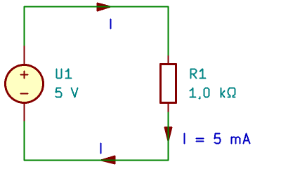{#fig-grunder-stromriktning width=8cm fig-align="left"}

I en metall är de rörliga laddningsbärarna elektroner. Eftersom elektroner är negativt laddade rör de sig i motsatt riktning mot den definierade strömriktningen. Vid kretsanalys använder vi den definierade strömriktningen. Vi behöver normalt inte bry oss om och följa elektronernas rörelse.

::: {.callout-important title="Ström förbrukas inte"}

När ström passerar en resistor omvandlas elektrisk energi till värme. Strömmen förbrukas däremot inte. I ett stationärt tillstånd går lika stor ström in i resistorns ena anslutning som ut ur den andra.

:::

## Elektrisk potential och spänning {#sec-grunder-elektrisk-potential-och-spanning}

Potential och spänning har samma enhet, volt, men beskriver olika saker.

**Potential** anges för en punkt i förhållande till en vald referens.

**Spänning** är **potentialskillnaden** mellan två punkter.

::: {.callout-tip title="Potential och spänning – jämför med höjd"}

Elektrisk potential kan jämföras med **höjd över havet**. Havsnivån är då vår valda referens, på samma sätt som jordpunkten tilldelas potentialen $0\,\mathrm{V}$ i en krets.

Spänning kan jämföras med **höjdskillnaden mellan två platser**.

Om plats A ligger 100 m över havet och plats B ligger 40 m över havet är höjdskillnaden 60 m. På motsvarande sätt ger potentialerna $V_A = 100\,\mathrm{V}$ och $V_B = 40\,\mathrm{V}$ spänningen

$$
U_{AB} = V_A - V_B = 60\,\mathrm{V}.
$$

Om vi väljer en annan referensnivå ändras platsernas angivna höjder, men höjdskillnaden är densamma. På samma sätt ändrar ett byte av elektrisk referenspunkt potentialernas värden, men inte spänningen mellan punkterna.

:::

### Elektrisk potential {#sec-grunder-elektrisk-potential}

Elektrisk potential beskriver elektrisk potentiell energi per laddningsenhet.

Vi väljer en **referenspunkt** och tilldelar den potentialen $0\,\mathrm{V}$. Därefter kan vi ange andra punkters potential i förhållande till denna referens.

Om punkten A har potentialen

$$
V_A = 5\,\mathrm{V}
$$

betyder det att dess potential ligger $5\,\mathrm{V}$ över den valda referensens.

Potentialen kan också vara negativ. Om

$$
V_B = -2\,\mathrm{V}
$$

ligger punkten B:s potential $2\,\mathrm{V}$ under referensens.

### Elektrisk spänning {#sec-grunder-elektrisk-spanning}

Spänningen från punkten A till punkten B definieras i denna bok som

$$
\boxed{U_{AB} = V_A - V_B}.
$$

Indexordningen är viktig. Om vi byter ordning får vi

$$
U_{BA} = V_B - V_A = -U_{AB}.
$$

Spänningen $U_{AB}$ kan också markeras med plus vid A och minus vid B. Markeringen anger hur spänningen är definierad.

Spänningens enhet är volt:

$$
[\mathrm{V}] = [\mathrm{J/C}].
$$

En potentialskillnad på $1\,\mathrm{V}$ motsvarar alltså en skillnad i elektrisk potentiell energi på $1\,\mathrm{J}$ per coulomb laddning.

::: {.callout-note title="Exempel: spänning mellan två punkter" icon=false}

Två punkter har potentialerna

$$
V_A = 5{,}0\,\mathrm{V},
\qquad
V_B = -2{,}0\,\mathrm{V}.
$$

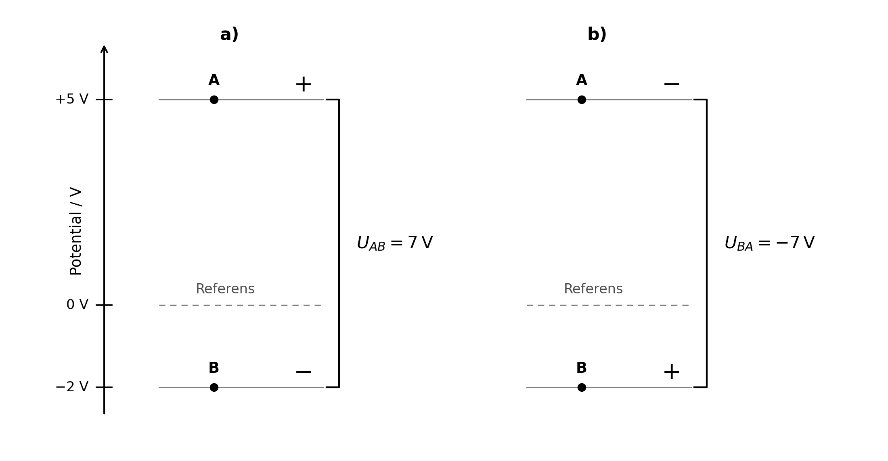{#fig-grunder-potential-spanning width=14cm}

**Lösning**

Spänningen från A till B blir

$$
U_{AB}
= V_A - V_B
= \bigl(5{,}0 - (-2{,}0)\bigr)\,\mathrm{V}
= 7{,}0\,\mathrm{V}.
$$

I motsatt riktning får vi

$$
U_{BA} = -7{,}0\,\mathrm{V}.
$$

**Svar:** $U_{AB} = 7{,}0\,\mathrm{V}$ och $U_{BA} = -7{,}0\,\mathrm{V}$.

Det är samma potentialskillnad, men med två olika val av **polaritet**.

:::

## Referenspunkt och jord {#sec-grunder-referenspunkt-och-jord}

Referenspunkten i en krets kallas ofta **jord** och markeras med en jordsymbol. Dess potential sätts till $0\,\mathrm{V}$.

Valet av referens bestämmer vilka talvärden vi anger för kretsens potentialer. Det förändrar däremot inte spänningarna mellan punkterna eller strömmarna i kretsen.

::: {.callout-note title="Exempel: byte av referens" icon=false}

Anta att vi först har följande potentialer (vänster kretsschema i @fig-grunder-byte-av-referens):

| Punkt | Potential |
|---|---|
| A | $12\,\mathrm{V}$ |
| B | $5\,\mathrm{V}$ |
| C | $0\,\mathrm{V}$ |

: Potentialer med C som referens. {#tbl-potentialer-c}

Vi väljer nu B som ny referenspunkt  (höger kretsschema i @fig-grunder-byte-av-referens). Vi måste då subtrahera $5\,\mathrm{V}$ från samtliga potentialer:

| Punkt | Potential med B som referens |
|---|---|
| A | $7\,\mathrm{V}$ |
| B | $0\,\mathrm{V}$ |
| C | $-5\,\mathrm{V}$ |

: Potentialer med B som referens. {#tbl-potentialer-b}

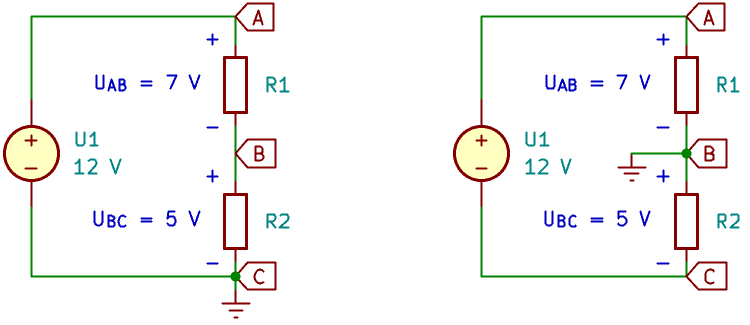{#fig-grunder-byte-av-referens width=15cm fig-align="left"}

Spänningen mellan A och C är fortfarande

$$
U_{AC} = V_A - V_C = \bigl(7 - (-5)\bigr)\,\mathrm{V} = 12\,\mathrm{V}.
$$

Vi har ändrat beskrivningen av kretsen och var referensen är placerad, men inte själva kretsen.

:::

::: {.callout-important title="Jord är en referens – ingen plats där ström försvinner"}

En referenspunkt i ett kretsschema behöver inte vara ansluten till marken eller till elnätets skyddsjord.

Signaljord, kretsens referens och skyddsjord kan ha olika funktioner.

En jordsymbol innebär inte att ström försvinner ur kretsen. Det är en vanlig missuppfattning att all ström går till jord när en punkt markeras med en jordsymbol.

I de stationära likströmskretsar vi behandlar här måste strömmen ha en sluten väg tillbaka till källan. Ström kan flyta genom jordledningar, men jordsymbolen i sig skapar ingen returväg.

:::

**Att välja en annan referens i en beräkning ska skiljas från att fysiskt ansluta en jordad instrumentledning till kretsen.** En sådan anslutning kan förändra kopplingen.

## Riktningar, polariteter och negativa svar {#sec-grunder-riktningar-polariteter-och-negativa-svar}

Innan vi beräknar en ström behöver vi bestämma vilken riktning som ska räknas som positiv. Den valda riktningen kallas **referensriktning**. På motsvarande sätt behöver en spänning ha en definierad polaritet.

Vi kan välja riktning även om vi ännu inte vet åt vilket håll strömmen faktiskt flyter.

Om beräkningen ger

$$
I = -2{,}0\,\mathrm{mA}
$$

betyder det att strömmen är $3\,\mathrm{mA}$ i motsatt riktning mot den valda referensriktningen, se @fig-grunder-negativ-strom.

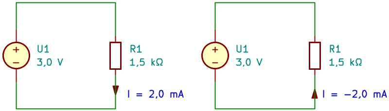{#fig-grunder-negativ-strom width=16cm fig-align="left"}

Ett negativt svar är alltså inte automatiskt ett fel.

::: {.callout-note title="Exempel: negativ spänning" icon=false}

Vi definierar spänningen som

$$
U_{AB} = V_A - V_B.
$$

Om $V_A = 2\,\mathrm{V}$ och $V_B = 5\,\mathrm{V}$ blir

$$
U_{AB} = V_A - V_B
= (2 - 5)\,\mathrm{V}
= -3\,\mathrm{V}.
$$

Svaret betyder att B har högre potential än A.

:::

## Resistans och Ohms lag {#sec-ohms-lag}

En **resistor** är en komponent som begränsar strömmen i en krets. **Resistans**, $R$, är den elektriska storhet som beskriver komponentens motstånd mot ström.

För en ideal linjär resistor gäller **Ohms lag**:

$$
\boxed{U = RI}.
$$

Här definieras strömmen som positiv in i resistorns anslutning märkt med plus för spänningen $U$.

Sambandet kan också skrivas

$$
\boxed{I = \frac{U}{R}}
$$

eller

$$
\boxed{R = \frac{U}{I}}.
$$

Resistansens enhet är ohm:

$$
[\Omega] = [\mathrm{V/A}].
$$

För en given spänning ger en större resistans en mindre ström.

### Linjär resistor {#sec-grunder-linjar-resistor}

Att resistorn är **linjär** innebär att strömmen är proportionell mot spänningen. Om spänningen fördubblas fördubblas strömmen.

I ett diagram (@fig-grunder-ohms-lag) med spänning på den horisontella axeln och ström på den vertikala blir sambandet en rät linje genom origo. Linjens lutning är $1/R$.

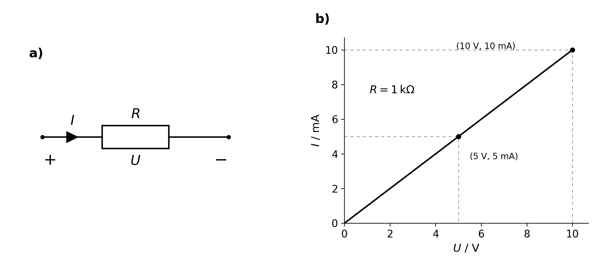{#fig-grunder-ohms-lag width=14cm fig-align="left"}

::: {.callout-important title="Ohms lag är en idealiserad modell"}

Sambandet $U = RI$ med konstant resistans beskriver en ideal linjär resistor. Vi använder det som en **modell** för en verklig resistor, som följer modellen ungefärligt inom ett begränsat arbetsområde.

Resistansen påverkas bland annat av temperaturen. När strömmen värmer upp resistorn kan resistansen förändras, vilket gör att strömmen inte längre är exakt proportionell mot spänningen.

Modellen med konstant resistans är ändå ofta tillräckligt noggrann för våra beräkningar. Vi behöver bedöma om den är rimlig för komponentens arbetsförhållanden och den noggrannhet vi behöver.

:::

::: {.callout-note title="Exempel: ström genom en resistor" icon=false}

En resistor med resistansen $2{,}2\,\mathrm{k}\Omega$ ansluts till spänningen $5{,}0\,\mathrm{V}$.

Strömmen blir

$$
I = \frac{U}{R}
= \frac{5{,}0}{2200}\,\mathrm{A}
\approx 2{,}3\,\mathrm{mA}.
$$

**Rimlighetskontroll:** Vid $2{,}2\,\mathrm{V}$ skulle strömmen vara $1\,\mathrm{mA}$. Vid $5{,}0\,\mathrm{V}$ bör den därför vara lite mer än dubbelt så stor.

:::

::: {.callout-note title="Exempel: bestäm resistansen" icon=false}

Spänningen över en resistor mäts till $3{,}6\,\mathrm{V}$ och strömmen genom den till $12\,\mathrm{mA}$.

Resistansen blir

$$
R = \frac{U}{I}
= \frac{3{,}6}{0{,}012}\,\Omega
= 300\,\Omega.
$$

:::

## Konduktans {#sec-grunder-konduktans}

**Konduktans** beskriver hur lätt en komponent leder ström. Konduktansen betecknas $G$ och definieras som resistansens invers:

$$
\boxed{G = \frac{1}{R}}.
$$

Enheten är siemens:

$$
[\mathrm{S}] = [\Omega^{-1}].
$$

Ohms lag kan därför även skrivas

$$
\boxed{I = GU}.
$$

Hög resistans innebär låg konduktans. Låg resistans innebär hög konduktans.

::: {.callout-note title="Exempel: från resistans till konduktans" icon=false}

En resistor har resistansen $R = 2{,}0\,\mathrm{k}\Omega = 2000\,\Omega$.

Dess konduktans är

$$
G = \frac{1}{R}
= \frac{1}{2000}\,\mathrm{S}
= 0{,}00050\,\mathrm{S}
= 0{,}50\,\mathrm{mS}.
$$

Konduktans blir särskilt användbar när vi senare arbetar med parallellkopplingar.

:::

## Resistans i en ledare {#sec-grunder-resistans-i-en-ledare}

Även ledningar har resistans. **Resistivitet** är en materialegenskap som beskriver hur starkt materialet motverkar elektrisk ström. Ledarens resistans beror dessutom på dess längd och **tvärsnittsarea**. För en homogen ledare med konstant tvärsnittsarea (se exempelt med ledare med cirkulärt tvärsnitt i @fig-grunder-ledarens-resistans) gäller

$$
\boxed{R = \rho\frac{l}{A}},
$$

där

- $\rho$ är materialets resistivitet,

- $l$ är ledarens längd,

- $A$ är ledarens tvärsnittsarea.

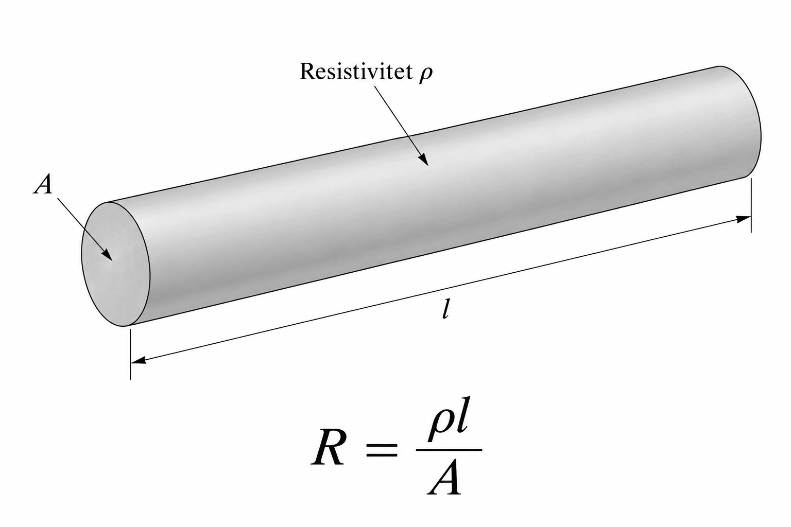{#fig-grunder-ledarens-resistans width=8cm fig-align="left"}

Om $\rho$ anges i $\Omega\,\mathrm{m}$ ska längden anges i meter och arean i kvadratmeter.

Sambandet visar att:

- en längre ledare har högre resistans,

- en grövre ledare har lägre resistans,

- material med högre resistivitet ger högre resistans.

Resistiviteten beror bland annat på material och temperatur.

::: {.callout-note title="Exempel: resistans i en kopparledning" icon=false}

Använd det avrundade värdet

$$
\rho = 0{,}0175\,\Omega\,\mathrm{mm^2/m}
$$

för koppar vid ungefär rumstemperatur.

En ledare är $2{,}0\,\mathrm{m}$ lång och har arean $0{,}50\,\mathrm{mm^2}$. Dess resistans blir

$$
R = \rho\frac{l}{A}
= \left(0{,}0175 \cdot \frac{2{,}0}{0{,}50}\right)\,\Omega
= 0{,}070\,\Omega.
$$

Vid strömmen $1{,}0\,\mathrm{A}$ blir **spänningsfallet**

$$
U = RI
= (0{,}070 \cdot 1{,}0)\,\mathrm{V}
= 0{,}070\,\mathrm{V}.
$$

Om strömmen går till en last genom en ledare och tillbaka genom en lika lång ledare blir den sammanlagda ledningsresistansen dubbelt så stor.

:::

## Ideala källor {#sec-grunder-ideala-kallor}

### Ideal spänningskälla {#sec-grunder-ideal-spanningskalla}

En **ideal spänningskälla** håller en bestämd spänning mellan sina anslutningar, oberoende av vilken ström som tas ut.

Strömmen bestäms av den anslutna kretsen, som vi kallar **lasten**.

Om lasten är en resistor gäller

$$
I = \frac{U}{R}.
$$

En mindre lastresistans ger alltså större ström, medan källans spänning är oförändrad.

Vid **tomgång**, när ingen last är ansluten, är strömmen noll.

Spänningen mellan källans anslutningar finns ändå kvar.

::: {.callout-note title="Exempel: ideal spänningskälla" icon=false}

En ideal spänningskälla håller spänningen $U_1 = 10\,\mathrm{V}$ (@fig-grunder-ideal-spanningskalla).

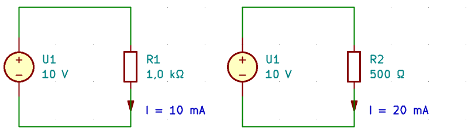{#fig-grunder-ideal-spanningskalla width=16cm fig-align="left"}

Med lastresistansen $R_1 = 1000\,\Omega$ blir strömmen

$$
I = \frac{U_1}{R_1}
= \frac{10}{1000}\,\mathrm{A}
= 10\,\mathrm{mA}.
$$

Om resistansen minskas till $500\,\Omega$ blir strömmen

$$
I = \frac{U_1}{R_2}
= \frac{10}{500}\,\mathrm{A}
= 20\,\mathrm{mA}.
$$

Strömmen fördubblas, men spänningen är fortfarande $10\,\mathrm{V}$.

:::

### Ideal strömkälla {#sec-grunder-ideal-stromkalla}

En **ideal strömkälla** håller en bestämd ström genom den anslutna kretsen, oberoende av vilken spänning som behövs.

Spänningen bestäms av lasten. Om lasten är en resistor gäller

$$
U = RI.
$$

En större lastresistans kräver alltså högre spänning, medan strömmen är oförändrad.

Vid **kortslutning** är spänningen över den ideala förbindelsen noll.

Strömkällan ger fortfarande sin bestämda ström.

::: {.callout-note title="Exempel: ideal strömkälla" icon=false}

En ideal strömkälla håller strömmen $I_1 = 10\,\mathrm{mA}$ (@fig-grunder-ideal-stromkalla).

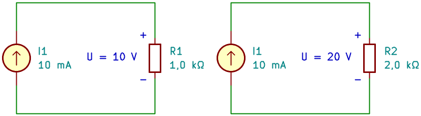{#fig-grunder-ideal-stromkalla width=16cm fig-align="left"}

$$
U = R_{1}I_{1}
= (1000 \cdot 0{,}010)\,\mathrm{V}
= 10\,\mathrm{V}.
$$

Om resistansen ökas till $2000\,\Omega$ blir spänningen

$$
U = R_{2}I_{1}
= (2000 \cdot 0{,}010)\,\mathrm{V}
= 20\,\mathrm{V}.
$$

Spänningen fördubblas, men strömmen är fortfarande $10\,\mathrm{mA}$.

:::

::: {.callout-important title="Ideala källor är modeller"}

En ideal spänningskälla kan enligt modellen ge hur stor ström som helst. En ideal strömkälla kan enligt modellen ge hur hög spänning som helst. Verkliga källor har däremot begränsningar i ström, spänning och effekt.

Modellerna har också gränsfall där de inte ger något ändligt resultat: en ideal spänningskälla med spänning skild från noll kan inte kortslutas, och en ideal strömkälla med ström skild från noll kan inte lämnas med öppen krets.

Vi använder idealmodellerna när verkliga källors begränsningar inte påverkar kretsens funktion.

:::

## Kirchhoffs strömlag {#sec-grunder-kirchhoffs-stromlag}

En **nod** är en elektriskt sammanhängande del av kretsen. Alla punkter som är förbundna med ideala ledningar utan någon komponent mellan sig tillhör samma nod och har samma potential.

**Kirchhoffs strömlag** beskriver hur strömmarna förhåller sig vid en nod:

> Summan av strömmarna in i en nod är lika med summan av strömmarna ut ur noden.

Vi kan också uttrycka lagen med en teckenkonvention. Om strömmar in i noden räknas som positiva och strömmar ut som negativa gäller

$$
\boxed{\sum_k I_k = 0}.
$$

Lagen bygger på att laddning bevaras. I den idealiserade noden ansamlas ingen laddning.

::: {.callout-note title="Exempel: ström i en förgrening" icon=false}

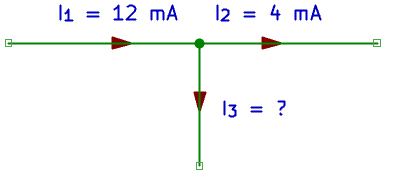{#fig-grunder-stromforgrening width=8cm fig-align="left"}

Se urklippet i kretsschemat i @fig-grunder-stromforgrening. Strömmen $I_1 = 12\,\mathrm{mA}$ går in i en nod. Två strömmar, $I_2$ och $I_3$, går ut.

Om $I_2 = 4\,\mathrm{mA}$ ger strömlagen

$$
I_1 - I_2 - I_3 = 0.
$$

Vi löser ut $I_3$:

$$
I_3 = I_1 - I_2
= (12 - 4)\,\mathrm{mA}
= 8\,\mathrm{mA}.
$$

**Kontroll:** Totalt går $12\,\mathrm{mA}$ in och $(4+8)\,\mathrm{mA}=12\,\mathrm{mA}$ ut.

:::

::: {.callout-note title="Exempel: en antagen riktning visar sig vara fel" icon=false}

Anta i stället att $I_1 = 5\,\mathrm{mA}$ och $I_2 = 8\,\mathrm{mA}$, med samma definierade riktningar (@fig-grunder-stromforgrening-negativ).

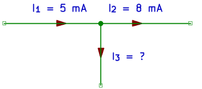{#fig-grunder-stromforgrening-negativ width=8cm fig-align="left"}

Då blir

$$
I_3 = I_1 - I_2 = (5 - 8)\,\mathrm{mA} = -3\,\mathrm{mA}.
$$

Strömmen $I_3$ går alltså i verkligheten in i noden. Då går totalt $(5+3)\,\mathrm{mA}=8\,\mathrm{mA}$ in och $8\,\mathrm{mA}$ ut.

:::

## Kirchhoffs spänningslag {#sec-grunder-kirchhoffs-spanningslag}

**Kirchhoffs spänningslag** beskriver spänningarna längs en sluten väg i en krets:

> Den algebraiska summan av spänningsändringarna längs en sluten väg är noll.

Vi skriver detta som

$$
\boxed{\sum_k \Delta V_k = 0}.
$$

Välj först en riktning att följa runt kretsen. När du passerar en komponent gäller:

- från minus till plus: en positiv potentialändring,

- från plus till minus: en negativ potentialändring.

När du återkommer till startpunkten måste potentialen vara densamma som när du började.

::: {.callout-note title="Exempel: källa och två resistorer" icon=false}

En sluten krets består av en ideal spänningskälla på $12\,\mathrm{V}$ och två resistorer som är kopplade efter varandra (@fig-grunder-spanningslagen).

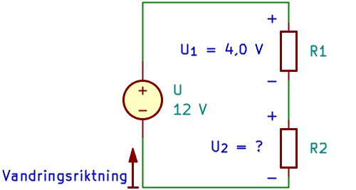{#fig-grunder-spanningslagen width=10cm fig-align="left"}

Vi följer kretsen från källans minuspol genom källan till dess pluspol och därefter genom de två resistorerna tillbaka till startpunkten.

Om källspänningen betecknas $U$ och spänningsfallen över resistorerna är $U_1$ och $U_2$ får vi

$$
U - U_1 - U_2 = 0.
$$

Om $U_1 = 4{,}0\,\mathrm{V}$ blir

$$
U_2 = U - U_1 = (12 - 4{,}0)\,\mathrm{V} = 8{,}0\,\mathrm{V}.
$$

Spänningsfallen över resistorerna summeras alltså till källans spänning.

:::

::: {.callout-important title="Lagarna används i en kretsmodell"}

Kirchhoffs lagar används genom hela boken. Här arbetar vi med kretsar där ledningarnas egenskaper kan försummas och komponenterna kan beskrivas var för sig.

Om ett tidsvarierande magnetiskt flöde genom kretsen ger en inducerad spänning måste även denna tas med i modellen.

:::

::: {.callout-note title="Exempel: en enkel, sammanhängande kretsberäkning" icon=false}

En ideal spänningskälla på $9{,}0\,\mathrm{V}$ är ansluten till en resistor med resistansen $1{,}5\,\mathrm{k}\Omega$. Resistorns andra anslutning är kopplad tillbaka till källans minuspol (@fig-grunder-kretsberakning  ).

Vi kallar källans pluspol A och minuspol B.

**Välj referens och riktningar**

Vi väljer B som referens (jord):

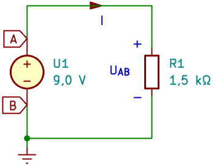{#fig-grunder-kretsberakning width=7cm fig-align="left"}

$$
V_B = 0\,\mathrm{V}.
$$

Källan bestämmer då potentialen i A:

$$
V_A = 9{,}0\,\mathrm{V}.
$$

Strömmen $I$ definieras från A genom resistorn till B.

**Bestäm spänningen över resistorn**

Spänningen definieras med plus vid A och minus vid B:

$$
U_{AB}
= V_A - V_B
= (9{,}0 - 0)\,\mathrm{V}
= 9{,}0\,\mathrm{V}.
$$

**Beräkna strömmen**

Ohms lag ger

$$
I
= \frac{U_{AB}}{R}
= \frac{9{,}0}{1500}\,\mathrm{A}
= 6{,}0\,\mathrm{mA}.
$$

Det positiva svaret betyder att strömmen går i den valda riktningen.

**Kontrollera resultatet**

Kirchhoffs spänningslag ger

$$
U_{AB} - RI
= (9{,}0 - 1500 \cdot 0{,}0060)\,\mathrm{V}
= 0\,\mathrm{V}.
$$

Strömmen är också lika stor överallt i kretsens enda strömväg.

Om vi väljer A som referens i stället får vi

$$
V_A = 0\,\mathrm{V},
\qquad
V_B = -9{,}0\,\mathrm{V}.
$$

Spänningen över resistorn är fortfarande $9{,}0\,\mathrm{V}$ och strömmen fortfarande $6{,}0\,\mathrm{mA}$.

:::

## En arbetsgång för kretsberäkningar {#sec-grunder-en-arbetsgang-for-kretsberakningar}

En tydlig arbetsgång minskar risken för fel och gör lösningen lättare att följa.

1. **Identifiera vad som söks.** Är det en ström, en spänning, en potential eller en resistans?

2. **Markera givna värden.** Skriv in värden och enheter i schemat.

3. **Välj referens och riktningar.** Markera jordpunkt, strömpilar och spänningspolariteter.

4. **Skriv sambanden med symboler.** Använd exempelvis Ohms lag och Kirchhoffs lagar.

5. **Lös ut den sökta storheten.**

6. **Sätt in talvärden och ange enheten efter det numeriska uttrycket.** Kontrollera att valda enheter och prefix ger rätt resultatenhet.

7. **Kontrollera och tolka resultatet.**

Behåll gärna fler siffror under beräkningen och avrunda först i slutsvaret.

### Kontrollera enheten {#sec-grunder-kontrollera-enheten}

Om vi beräknar ström som spänning dividerad med resistans ska enheten bli ampere:

$$
\frac{[\mathrm{V}]}{[\Omega]} = [\mathrm{A}].
$$

Med lämpliga prefix kan vi också direkt använda

$$
\frac{[\mathrm{V}]}{[\mathrm{k}\Omega]} = [\mathrm{mA}].
$$

### Kontrollera storleksordningen {#sec-grunder-kontrollera-storleksordningen}

En spänning på några volt över en resistans på några kiloohm ger normalt en ström på några milliampere.

Om kalkylatorn visar flera ampere bör du kontrollera prefix och inmatning.

### Tolka tecknet {#sec-grunder-tolka-tecknet}

Ett negativt svar ska tolkas utifrån de riktningar och polariteter som valts. Byt inte bort minustecknet utan att samtidigt förklara hur riktningen ändras.

## Sammanfattning {#sec-grunder-sammanfattning}

- En **modell** är en förenklad beskrivning av verkligheten. Dess antaganden måste vara rimliga för den krets och de arbetsförhållanden som undersöks.
- **Elektrisk ström** beskriver hur mycket laddning som passerar ett tvärsnitt per tidsenhet.
- Den definierade **strömriktningen** är positiva laddningars rörelseriktning. I metaller rör sig elektronerna åt motsatt håll.
- **Potential** anges relativt en vald referens. **Spänning** är potentialskillnaden mellan två punkter.
- Ett byte av **referenspunkt** ändrar potentialernas talvärden men inte kretsens spänningar och strömmar.
- En **resistor** är en komponent. **Resistans** är en storhet som beskriver dess motstånd mot ström.
- **Ohms lag**, $U = RI$, beskriver en ideal linjär resistor med konstant resistans.
- **Konduktans** är resistansens invers: $G = 1/R$.
- En ledares resistans beror på materialets **resistivitet**, ledarens längd och dess tvärsnittsarea.
- En **ideal spänningskälla** håller sin bestämda spänning. Strömmen bestäms av den anslutna kretsen.
- En **ideal strömkälla** håller sin bestämda ström. Spänningen bestäms av den anslutna kretsen.
- **Kirchhoffs strömlag** innebär att summan av strömmarna in i en nod är lika med summan av strömmarna ut.
- **Kirchhoffs spänningslag** innebär att summan av potentialändringarna längs en sluten väg är noll.
- Negativa resultat ska tolkas utifrån valda **referensriktningar och polariteter**.

| Samband | Uttryck |
|---|---|
| Konstant ström | $I = \Delta Q/\Delta t$ |
| Spänning mellan två punkter | $U_{AB} = V_A - V_B$ |
| Ohms lag | $U = RI$ |
| Konduktans | $G = 1/R$ |
| Ohms lag med konduktans | $I = GU$ |
| Resistans i homogen ledare | $R = \rho l/A$ |
| Kirchhoffs strömlag | $\sum_k I_k = 0$, med konsekventa tecken |
| Kirchhoffs spänningslag | $\sum_k \Delta V_k = 0$ |

: Grundläggande samband för kretsanalys. {#tbl-grundlaggande-samband}

## Övningar {#sec-grunder-ovningar}

### Begrepp och förståelse {#sec-grunder-begrepp-och-forstaelse}

1. Vad är skillnaden mellan elektrisk laddning och elektrisk ström?

2. Elektroner rör sig åt vänster i en metallledning. Åt vilket håll går den definierade strömmen?

3. Förklara skillnaden mellan potential och spänning.

4. Kan en punkt i en krets ha negativ potential? Förklara vad det innebär.

5. En krets får en ny referenspunkt i en beräkning. Vad händer med potentialerna, spänningarna och strömmarna?

6. En ström har beräknats till $-8\,\mathrm{mA}$. Vad behöver du veta för att kunna förklara svaret?

7. Varför går det inte att använda $U = RI$ med ett konstant resistansvärde för alla komponenter?

### Enheter och grundläggande beräkningar {#sec-grunder-enheter-och-grundlaggande-berakningar}

8. Skriv följande värden utan prefix:

   a. $4{,}7\,\mathrm{k}\Omega$ b. $250\,\mathrm{mA}$ c. $680\,\mathrm{\mu A}$ d. $2{,}2\,\mathrm{M}\Omega$

9. Skriv med lämpligt SI-prefix:

   a. $0{,}0033\,\mathrm{A}$ b. $47000\,\Omega$ c. $0{,}0000022\,\mathrm{A}$

10. Strömmen i en ledning är konstant $40\,\mathrm{mA}$. Hur stor laddning passerar under $15\,\mathrm{s}$?

11. En laddning på $0{,}60\,\mathrm{C}$ passerar ett tvärsnitt under $3{,}0\,\mathrm{s}$. Beräkna medelströmmen.

12. En resistor på $3{,}3\,\mathrm{k}\Omega$ har spänningen $12\,\mathrm{V}$ över sig. Beräkna strömmen.

13. Strömmen genom en resistor på $470\,\Omega$ är $15\,\mathrm{mA}$. Beräkna spänningen.

14. Spänningen över en resistor är $8{,}0\,\mathrm{V}$ och strömmen är $2{,}0\,\mathrm{mA}$. Beräkna resistansen och konduktansen.

### Potentialer och Kirchhoffs lagar {#sec-grunder-potentialer-och-kirchhoffs-lagar}

15. Punkterna A, B och C har potentialerna

    $$
    V_A = 12\,\mathrm{V},
    \qquad
    V_B = 3\,\mathrm{V},
    \qquad
    V_C = -2\,\mathrm{V}.
    $$

    Beräkna $U_{AB}$, $U_{BC}$ och $U_{CA}$.

16. Välj C som ny referens i uppgift 15. Ange de nya potentialerna och kontrollera att $U_{AB}$ är oförändrad.

17. Strömmarna $18\,\mathrm{mA}$ och $7\,\mathrm{mA}$ går in i en nod. En ström på $10\,\mathrm{mA}$ går ut. Hur stor ytterligare ström måste gå ut ur noden?

18. Strömmen $I_1 = 6\,\mathrm{mA}$ går in i en nod. Strömmarna $I_2$ och $I_3$ definieras ut ur noden. Om $I_2 = 9\,\mathrm{mA}$, hur stor blir $I_3$? Tolka tecknet.

19. En spänningskälla på $15\,\mathrm{V}$ är ansluten till två resistorer efter varandra i en sluten krets. Spänningsfallet över den första är $6{,}0\,\mathrm{V}$. Beräkna spänningsfallet över den andra.

### Tillämpning och problemlösning {#sec-grunder-tillampning-och-problemlosning}

20. Två punkter har potentialerna $V_A = 2{,}0\,\mathrm{V}$ och $V_B = 8{,}0\,\mathrm{V}$. Mellan dem är en resistor på $2{,}0\,\mathrm{k}\Omega$ ansluten.

    a. Definiera strömmen $I$ från A till B och beräkna den.

    b. Ange strömmens verkliga riktning.

    c. Beräkna strömmen om referensriktningen i stället väljs från B till A.

21. En last ansluts till en spänningskälla med två kopparledare. Varje ledare är $5{,}0\,\mathrm{m}$ lång och har tvärsnittsarean $0{,}50\,\mathrm{mm^2}$.

    Använd $\rho = 0{,}0175\,\Omega\,\mathrm{mm^2/m}$.

    a. Beräkna ledarnas sammanlagda resistans.

    b. Beräkna det sammanlagda spänningsfallet i ledarna vid strömmen $2{,}0\,\mathrm{A}$.

    c. Källans spänning är $12{,}0\,\mathrm{V}$. Hur stor spänning får lasten?

22. En studerande beräknar strömmen genom en resistor på $4{,}7\,\mathrm{k}\Omega$ ansluten till $5{,}0\,\mathrm{V}$ och får svaret $1{,}06\,\mathrm{A}$.

    a. Förklara hur du kan se att svaret är orimligt.

    b. Beräkna rätt ström.

    c. Vilket inmatnings- eller enhetsfel kan ha orsakat resultatet?

23. Jämför en ideal spänningskälla och en ideal strömkälla.

    a. Vilken storhet håller respektive källa konstant?

    b. Hur förändras strömmen genom en resistiv last om lastresistansen fördubblas vid anslutning till en ideal spänningskälla?

    c. Hur förändras spänningen över en resistiv last om lastresistansen fördubblas vid anslutning till en ideal strömkälla?

24. En ideal strömkälla ger strömmen $I = 5{,}0\,\mathrm{mA}$ till en resistor med resistansen $R = 2{,}2\,\mathrm{k}\Omega$.

    a. Beräkna spänningen över resistorn.

    b. Resistorn ersätts med en resistor på $4{,}7\,\mathrm{k}\Omega$. Beräkna den nya spänningen.

    c. En verklig strömkälla kan som mest ge $15\,\mathrm{V}$ över lasten. Kan den upprätthålla strömmen $5{,}0\,\mathrm{mA}$ i båda fallen? Motivera med dina beräkningar.
