# Resistorkopplingar, spänningsdelning och strömdelning {#sec-resistorkopplingar}

Med Ohms lag och Kirchhoffs lagar kan vi ställa upp samband för strömmar och spänningar i en krets. För vissa vanliga kopplingar kan dessa samband sammanfattas i uttryck som gör beräkningen enklare.

I detta kapitel behandlas seriekopplade och parallellkopplade resistorer samt kombinationer av dessa. Vi härleder uttryck för ersättningsresistans, spänningsdelning och strömdelning. Vi undersöker också hur en last påverkar en spänningsdelare.

Vi arbetar med stationära likströmskretsar. Om inget annat anges är resistorerna ideala med positiva, ändliga resistansvärden, ledningarnas resistans försumbar och källorna ideala. Spänningar och strömmar i delningsformlerna avser de gemensamt valda riktningar och polariteter som beskrivs i texten.

## Mål {.unnumbered #sec-resistorkopplingar-mal}

Efter kapitlet ska du kunna:

- identifiera serie- och parallellkopplingar genom att följa kretsens noder,
- förklara vad en ersättningsresistans beskriver och vad som bevaras vid en ersättning,
- härleda och använda uttrycken för serie- och parallellkopplade resistorer,
- använda spänningsdelning och strömdelning,
- beräkna strömmar, spänningar och effekter i blandade kopplingar,
- välja resistorförhållande för en önskad obelastad utspänning,
- beräkna hur en resistiv last påverkar en spänningsdelare,
- översiktligt beskriva hur voltmetrar och amperemetrar påverkar en krets,
- känna igen Δ- och Y-kopplingar och beskriva varför de kan behöva behandlas med andra metoder,
- kontrollera beräkningar med rimlighetsbedömningar, Kirchhoffs lagar och effektbalans.

## Noder och kopplingar {#sec-resistorkopplingar-noder}

En **nod** omfattar alla punkter som är sammankopplade med ideala ledningar utan någon komponent mellan sig. Alla punkter i samma nod har samma potential.

För att avgöra hur resistorer är kopplade behöver vi därför följa deras anslutningar, se @fig-resistorkopplingar-noder. Komponenternas placering och ledningarnas form på papperet avgör inte kopplingstypen.

- **Seriekoppling:** resistorerna följer efter varandra i en strömväg. Den gemensamma noden mellan två resistorer saknar andra anslutna grenar som kan föra ström vidare.
- **Parallellkoppling:** resistorerna är anslutna mellan samma två noder.

I en seriekoppling går samma ström genom resistorerna. I en parallellkoppling har resistorerna samma spänning över sig, med samma val av polaritet mellan de gemensamma noderna.

{#fig-resistorkopplingar-noder width=15cm fig-align="left"}

::: {.callout-tip title="Märk noderna innan du börjar"}
Ge elektriskt skilda noder olika beteckningar. Följ sedan varje resistors båda anslutningar.

Två resistorer är parallellkopplade först när **båda** deras anslutningsnoder är gemensamma. Att de delar en enda nod räcker inte.
:::

::: {.callout-important title="Samma ström eller spänning bevisar inte kopplingstypen"}
Seriekopplade komponenter har samma ström, men två komponenter kan av andra skäl råka ha lika stor ström utan att vara seriekopplade.

På samma sätt kan två komponenter ha lika stor spänning utan att vara parallellkopplade. Kopplingstypen bestäms av anslutningarna.
:::

## Ersättningsresistans {#sec-resistorkopplingar-ersattningsresistans}

En grupp resistorer kan ibland ersättas med en enda ideal resistor, sett från två bestämda anslutningar. Denna resistors resistans kallas **ersättningsresistans**, $R_\mathrm{ers}$.

Ersättningen ska ge samma samband mellan spänningen över anslutningarna och strömmen in i kopplingen:

$$
U=R_\mathrm{ers}I.
$$

Vid samma anslutna spänning tar ersättningsresistorn alltså samma ström som den ursprungliga kopplingen, se @fig-resistorkopplingar-ersattningsresistans. Den tar också emot samma sammanlagda effekt.

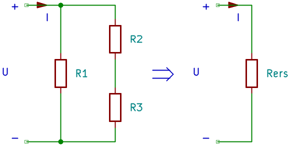{#fig-resistorkopplingar-ersattningsresistans width=12cm fig-align="left"}

Ersättningen bevarar däremot inte de interna strömmarna, spänningarna eller effektfördelningen mellan de ursprungliga resistorerna. För att bestämma dem behöver vi återvända till originalkretsen.

::: {.callout-important title="Ange mellan vilka anslutningar ersättningen gäller"}
Ersättningsresistansen hör till ett bestämt par av anslutningar. Om kopplingen har fler anslutningar till resten av kretsen får dessa inte tas bort utan vidare.

Förenkla endast delkopplingar där anslutningarna till den övriga kretsen bevaras korrekt.
:::

## Seriekopplade resistorer {#sec-resistorkopplingar-serie}

Anta att $R_1$ och $R_2$ är kopplade efter varandra utan förgrening vid den gemensamma noden. Kirchhoffs strömlag ger

$$
I_1=I_2=I.
$$

Vi väljer spänningsfall i strömmens riktning genom båda resistorerna. Kirchhoffs spänningslag ger då

$$
U=U_1+U_2.
$$

Ohms lag ger $U_1=R_1I$ och $U_2=R_2I$. Därmed blir

$$
U=R_1I+R_2I=(R_1+R_2)I.
$$

Jämförelse med $U=R_\mathrm{ers}I$ ger (se @fig-resistorkopplingar-serie):

$$
\boxed{R_\mathrm{ers}=R_1+R_2}.
$$

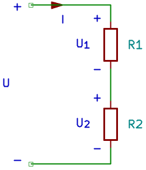{#fig-resistorkopplingar-serie width=5cm fig-align="left"}

För $n$ seriekopplade resistorer gäller

$$
\boxed{R_\mathrm{ers}=R_1+R_2+\cdots+R_n}.
$$

För minst två positiva resistansvärden är ersättningsresistansen större än varje enskild resistans. Om alla $n$ resistorer har samma resistans $R$ blir

$$
R_\mathrm{ers}=nR.
$$

::: {.callout-note title="Exempel: två resistorer i serie" icon=false}
En källa på $U=12\,\mathrm{V}$ driver $R_1=1{,}0\,\mathrm{k}\Omega$ och $R_2=2{,}0\,\mathrm{k}\Omega$ i serie.

Ersättningsresistansen blir

$$
R_\mathrm{ers}=(1000+2000)\,\Omega=3000\,\Omega=3{,}0\,\mathrm{k}\Omega.
$$

Strömmen blir

$$
I=\frac{U}{R_\mathrm{ers}}=\frac{12}{3000}\,\mathrm{A}=4{,}0\,\mathrm{mA}.
$$

Spänningsfallen blir

$$
U_1=R_1I=(1000\cdot0{,}0040)\,\mathrm{V}=4{,}0\,\mathrm{V},
$$

$$
U_2=R_2I=(2000\cdot0{,}0040)\,\mathrm{V}=8{,}0\,\mathrm{V}.
$$

**Kontroll:** $U_1+U_2=(4{,}0+8{,}0)\,\mathrm{V}=12\,\mathrm{V}$. Samma ström går genom båda resistorerna. Resistorn med dubbelt så stor resistans får dubbelt så stort spänningsfall.
:::

## Spänningsdelning {#sec-resistorkopplingar-spanningsdelning}

Eftersom samma ström går genom seriekopplade resistorer fördelas spänningen i proportion till resistansvärdena:

$$
\frac{U_1}{U_2}=\frac{R_1}{R_2}.
$$

För två resistorer (se @fig-resistorkopplingar-spanningsdelning) är strömmen $I=U/(R_1+R_2)$. Insättning i $U_2=R_2I$ ger

$$
U_2=R_2\frac{U}{R_1+R_2},
$$

alltså

$$
\boxed{U_2=U\frac{R_2}{R_1+R_2}}.
$$

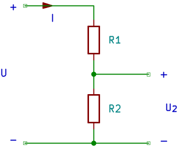{#fig-resistorkopplingar-spanningsdelning width=7cm fig-align="left"}

På motsvarande sätt gäller

$$
U_1=U\frac{R_1}{R_1+R_2}.
$$

För en kedja av flera seriekopplade resistorer gäller

$$
U_k=U\frac{R_k}{R_1+R_2+\cdots+R_n}.
$$

### Spänningsdelarens utgång {#sec-resistorkopplingar-spanningsdelare-utgang}

En vanlig **spänningsdelare** har $R_1$ från källans plusnod till utgången och $R_2$ från utgången till referensen. Källans minuspol är ansluten till samma referens. Utspänningen är utgångens potential relativt referensen, alltså spänningen över $R_2$:

$$
\boxed{U_\mathrm{ut}=U\frac{R_2}{R_1+R_2}}.
$$

Utgången är **obelastad** när ingen ytterligare ström tas ut där. Då är $R_1$ och $R_2$ seriekopplade. För positiva resistansvärden och positiv inspänning ligger utspänningen mellan noll och inspänningen.

::: {.callout-important title="Vilken resistor ligger utgången över?"}
Resistansen i täljaren ska vara resistansen som den sökta spänningen ligger över.

Formeln ovan avser utspänningen över $R_2$. Tas utspänningen i stället över $R_1$ används $R_1$ i täljaren. När en last kopplas in behöver delningsförhållandet beräknas för den nya kopplingen, se @sec-resistorkopplingar-belastad.
:::

### Välj resistansförhållande {#sec-resistorkopplingar-valj-forhallande}

Om $U$ och önskad obelastad $U_\mathrm{ut}$ är kända kan spänningsdelningsuttrycket omformas:

$$
U_\mathrm{ut}(R_1+R_2)=UR_2,
$$

vilket ger

$$
\boxed{R_1=R_2\left(\frac{U}{U_\mathrm{ut}}-1\right)}.
$$

Förhållandet mellan resistorerna bestämmer delningen, men inte deras absoluta värden. Flera resistorpar kan därför ge samma obelastade utspänning.

::: {.callout-note title="Exempel: från 12 V till 3 V" icon=false}
En obelastad spänningsdelare ska ge $U_\mathrm{ut}=3{,}0\,\mathrm{V}$ från $U=12\,\mathrm{V}$. Välj $R_2=1{,}0\,\mathrm{k}\Omega$.

Den övre resistansen blir

$$
R_1=R_2\left(\frac{U}{U_\mathrm{ut}}-1\right)
=1000\left(\frac{12}{3{,}0}-1\right)\,\Omega
=3000\,\Omega=3{,}0\,\mathrm{k}\Omega.
$$

Strömmen genom delaren blir

$$
I=\frac{12}{3000+1000}\,\mathrm{A}=3{,}0\,\mathrm{mA}.
$$

**Svar:** $R_1=3{,}0\,\mathrm{k}\Omega$ och $R_2=1{,}0\,\mathrm{k}\Omega$ ger $3{,}0\,\mathrm{V}$ utan last. Även $30\,\mathrm{k}\Omega$ och $10\,\mathrm{k}\Omega$ ger samma obelastade utspänning, men strömmen blir då $0{,}30\,\mathrm{mA}$.
:::

::: {.callout-tip title="Samma delning kan ge olika ström och förluster"}
Om båda resistansvärdena multipliceras med samma faktor är den obelastade utspänningen oförändrad. Vid samma inspänning minskar däremot strömmen och den sammanlagda effekten när resistansvärdena ökar.

Stora resistansvärden gör samtidigt delaren känsligare för en given ansluten last. Valet behöver därför ta hänsyn till både strömförbrukning och belastning.
:::

### Potentiometer som spänningsdelare {#sec-resistorkopplingar-potentiometer}

En **potentiometer** har en resistiv bana och en rörlig kontakt, ofta kallad löpare. Om banans ändar ansluts till en källa kan löparen användas som en justerbar utgång (@fig-resistorkopplingar-potentiometer).

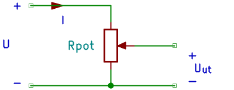{#fig-resistorkopplingar-potentiometer width=8cm fig-align="left"}

Löparen delar banan i två resistansdelar som tillsammans motsvarar $R_1$ och $R_2$. Utan belastning bestäms utspänningen av deras förhållande. För en ideal potentiometer med linjär resistansfördelning ändras utspänningen proportionellt mot löparens läge.

Används endast löparen och en av banans ändar fungerar komponenten i stället som en variabel resistor. En potentiometer som används som spänningsdelare påverkas också av belastning på löparen.

## Parallellkopplade resistorer {#sec-resistorkopplingar-parallell}

Resistorer som är anslutna mellan samma två noder enligt @fig-resistorkopplingar-parallell har samma spänning över sig. Med gemensam polaritet gäller

$$
U_1=U_2=U.
$$

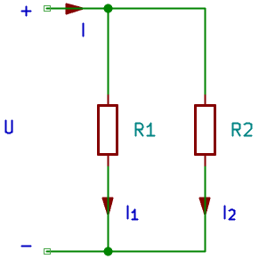{#fig-resistorkopplingar-parallell width=6cm fig-align="left"}

Vi väljer grenströmmarna från noden med högre potential till noden med lägre potential. Ohms lag ger

$$
I_1=\frac{U}{R_1},\qquad I_2=\frac{U}{R_2}.
$$

Kirchhoffs strömlag ger totalströmmen:

$$
I=I_1+I_2
=U\left(\frac{1}{R_1}+\frac{1}{R_2}\right).
$$

Jämförelse med $I=U/R_\mathrm{ers}$ ger

$$
\boxed{\frac{1}{R_\mathrm{ers}}=\frac{1}{R_1}+\frac{1}{R_2}}.
$$

För flera parallellkopplade resistorer gäller

$$
\boxed{\frac{1}{R_\mathrm{ers}}=\frac{1}{R_1}+\frac{1}{R_2}+\cdots+\frac{1}{R_n}}.
$$

Summan i högerledet är den sammanlagda **konduktansen**, inte resistansen. Ta därför inversen för att få $R_\mathrm{ers}$.

### Två parallella resistorer {#sec-resistorkopplingar-parallell-tva}

För just två resistorer kan sambandet omformas:

$$
\frac{1}{R_\mathrm{ers}}=\frac{R_1+R_2}{R_1R_2},
$$

vilket ger

$$
\boxed{R_\mathrm{ers}=\frac{R_1R_2}{R_1+R_2}}.
$$

Ersättningsresistansen är mindre än den minsta enskilda resistansen. En extra parallell gren ger strömmen ytterligare en väg. Vid samma spänning blir totalströmmen därför större.

Uttrycket har rätt enhet:

$$
\frac{[\Omega]\cdot[\Omega]}{[\Omega]}=[\Omega].
$$

### Konduktanser och lika resistorer {#sec-resistorkopplingar-konduktanser}

Eftersom $G=1/R$ kan parallellkopplingen skrivas

$$
\boxed{G_\mathrm{ers}=G_1+G_2+\cdots+G_n}.
$$

För $n$ lika stora parallellkopplade resistorer med resistansen $R$ blir

$$
R_\mathrm{ers}=\frac{R}{n}.
$$

::: {.callout-note title="Exempel: två resistorer parallellt" icon=false}
Resistorerna $R_1=1{,}0\,\mathrm{k}\Omega$ och $R_2=2{,}0\,\mathrm{k}\Omega$ ansluts parallellt till $U=12\,\mathrm{V}$.

Grenströmmarna blir

$$
I_1=\frac{U}{R_1}=\frac{12}{1000}\,\mathrm{A}=12\,\mathrm{mA},
$$

$$
I_2=\frac{U}{R_2}=\frac{12}{2000}\,\mathrm{A}=6{,}0\,\mathrm{mA}.
$$

Totalströmmen blir

$$
I=I_1+I_2=(12+6{,}0)\,\mathrm{mA}=18\,\mathrm{mA}.
$$

Ersättningsresistansen är

$$
R_\mathrm{ers}=\frac{R_1R_2}{R_1+R_2}
=\frac{1000\cdot2000}{1000+2000}\,\Omega
\approx667\,\Omega.
$$

**Kontroll:** Ersättningsresistansen är mindre än $1000\,\Omega$. Dessutom ger $U/I=12/0{,}018\,\Omega\approx667\,\Omega$ samma resultat.
:::

::: {.callout-important title="Samma enhet i hela beräkningen"}
Vid addition och insättning av resistansvärden behöver du använda en gemensam enhet. Om ett värde anges i ohm och ett annat i kiloohm måste de först omvandlas.

Vid summering av inversa resistanser kan du exempelvis använda ohm genomgående. Då får summan enheten siemens och dess invers enheten ohm.
:::

### Notation för parallellkoppling {#sec-resistorkopplingar-parallellnotation}

För att skriva beräkningar mer kompakt använder vi symbolen
$\parallel$ mellan resistanser som är parallellkopplade.
Uttrycket $R_1\parallel R_2$ betecknar deras
**ersättningsresistans**:

$$
\boxed{R_1\parallel R_2=\frac{R_1R_2}{R_1+R_2}}.
$$

Symbolen beskriver alltså en parallellkoppling och dess
resulterande resistans. Den betyder inte multiplikation.

För flera parallellkopplade resistorer skriver vi

$$
R_1\parallel R_2\parallel R_3
=
\left(
\frac{1}{R_1}+\frac{1}{R_2}+\frac{1}{R_3}
\right)^{-1}.
$$

::: {.callout-note title="Exempel: kompakt notation för en blandad koppling" icon=false}
Resistorn $R_1=100\,\Omega$ ligger i serie med
parallellkopplingen av $R_2=300\,\Omega$ och
$R_3=600\,\Omega$.

Ersättningsresistansen kan skrivas

$$
R_\mathrm{ers}=R_1+(R_2\parallel R_3).
$$

Insättning ger

$$
R_\mathrm{ers}
=
\left(
100+\frac{300\cdot600}{300+600}
\right)\,\Omega
=300\,\Omega.
$$

Parentesen visar vilken delkoppling som förenklas först.
:::

::: {.callout-tip title="Använd parenteser i blandade uttryck"}
Skriv tydligt vilka resistanser som ingår i varje delkoppling.

- $R_1+(R_2\parallel R_3)$ betyder att $R_1$ ligger i serie
  med parallellkopplingen av $R_2$ och $R_3$.
- $(R_1+R_2)\parallel R_3$ betyder att seriekopplingen av
  $R_1$ och $R_2$ ligger parallellt med $R_3$.

Uttrycken beskriver olika kopplingar och ger i allmänhet
olika ersättningsresistanser.
:::

## Strömdelning {#sec-resistorkopplingar-stromdelning}

I en parallellkoppling fördelas totalströmmen mellan grenarna. Eftersom spänningen är gemensam får grenen med lägst resistans störst ström.

För två resistorer gäller $U=IR_\mathrm{ers}$ och $I_1=U/R_1$. Insättning ger

$$
I_1=I\frac{R_\mathrm{ers}}{R_1}
=I\frac{R_1R_2}{R_1(R_1+R_2)},
$$

alltså

$$
\boxed{I_1=I\frac{R_2}{R_1+R_2}},\qquad
\boxed{I_2=I\frac{R_1}{R_1+R_2}}.
$$

Totalströmmen $I$ avser här strömmen in i just dessa två parallella grenar.

::: {.callout-tip title="Den andra resistansen står i täljaren"}
När strömmen genom $R_1$ beräknas med tvågrensformeln står $R_2$ i täljaren. Detta ger rätt fördelning: grenen med hög resistans får liten ström.

Kontrollera också att grenströmmarna tillsammans blir totalströmmen.
:::

::: {.callout-note title="Exempel: dela en känd ström" icon=false}
Strömmen $I=9{,}0\,\mathrm{mA}$ delas mellan $R_1=1{,}0\,\mathrm{k}\Omega$ och $R_2=2{,}0\,\mathrm{k}\Omega$.

$$
I_1=I\frac{R_2}{R_1+R_2}
=9{,}0\frac{2000}{1000+2000}\,\mathrm{mA}=6{,}0\,\mathrm{mA},
$$

$$
I_2=I\frac{R_1}{R_1+R_2}
=9{,}0\frac{1000}{1000+2000}\,\mathrm{mA}=3{,}0\,\mathrm{mA}.
$$

**Kontroll:** Grenströmmarna summeras till $9{,}0\,\mathrm{mA}$. Båda grenarna får spänningen $6{,}0\,\mathrm{V}$ enligt Ohms lag.
:::

### Flera parallella grenar {#sec-resistorkopplingar-stromdelning-flera}

För flera grenar är det ofta tydligast att använda konduktanser. Eftersom $I_k=UG_k$ och $I=UG_\mathrm{ers}$ gäller

$$
\boxed{I_k=I\frac{G_k}{G_1+G_2+\cdots+G_n}}.
$$

Samma uttryck kan skrivas med resistanser:

$$
I_k=I\frac{1/R_k}{1/R_1+1/R_2+\cdots+1/R_n}.
$$

Grenen får alltså samma andel av strömmen som dess konduktans utgör av den sammanlagda konduktansen.

## Blandade kopplingar {#sec-resistorkopplingar-blandade}

I en **blandad koppling** förekommer både serie- och parallellkoppling. Ett enkelt exampel finns i @fig-resistorkopplingar-blandad. För många sådana kretsar kan ersättningsresistansen bestämmas genom stegvisa förenklingar.

### Arbetsgång {#sec-resistorkopplingar-arbetsgang}

1. Märk noderna och identifiera en del som säkert är serie- eller parallellkopplad.
2. Beräkna delens ersättningsresistans.
3. Rita om kretsen med ersättningen och behåll anslutningarna till resten av kretsen.
4. Upprepa tills kretsen är tillräckligt enkel för att bestämma källans ström eller spänning.
5. Arbeta tillbaka genom de tidigare stegen och bestäm interna spänningar och strömmar.
6. Kontrollera med Kirchhoffs lagar och vid behov effektbalans.

Skriv gärna $R_{23}$ för ersättningen av $R_2$ och $R_3$. Då syns vilka komponenter som ingår i varje steg.

::: {.callout-note title="Exempel: en resistor i serie med två parallella grenar" icon=false}
En källa på $U=12\,\mathrm{V}$ driver $R_1=100\,\Omega$ i serie med en parallellkoppling av $R_2=300\,\Omega$ och $R_3=600\,\Omega$ (@fig-resistorkopplingar-blandad).

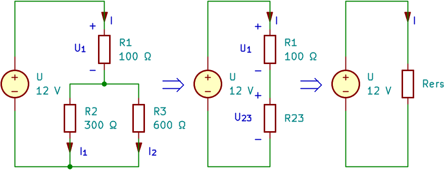{#fig-resistorkopplingar-blandad width=16cm fig-align="left"}

**Förenkla parallellkopplingen:**

$$
R_{23}=\frac{R_2R_3}{R_2+R_3}
=\frac{300\cdot600}{300+600}\,\Omega=200\,\Omega.
$$

**Bestäm totalströmmen:**

$$
R_\mathrm{ers}=R_1+R_{23}=(100+200)\,\Omega=300\,\Omega,
$$

$$
I=\frac{U}{R_\mathrm{ers}}=\frac{12}{300}\,\mathrm{A}=40\,\mathrm{mA}.
$$

**Återvänd till originalkretsen:** Hela totalströmmen går genom $R_1$. Därmed blir

$$
U_1=R_1I=(100\cdot0{,}040)\,\mathrm{V}=4{,}0\,\mathrm{V},
$$

$$
U_{23}=U-U_1=(12-4{,}0)\,\mathrm{V}=8{,}0\,\mathrm{V}.
$$

Båda parallella resistorerna har denna spänning:

$$
I_2=\frac{U_{23}}{R_2}=\frac{8{,}0}{300}\,\mathrm{A}\approx26{,}7\,\mathrm{mA},
$$

$$
I_3=\frac{U_{23}}{R_3}=\frac{8{,}0}{600}\,\mathrm{A}\approx13{,}3\,\mathrm{mA}.
$$

**Kontroll:** $(26{,}7+13{,}3)\,\mathrm{mA}=40{,}0\,\mathrm{mA}$ och $(4{,}0+8{,}0)\,\mathrm{V}=12\,\mathrm{V}$, inom avrundningen.
:::

::: {.callout-important title="Totalspänningen ligger inte över varje resistor"}
I exemplet ovan ligger $12\,\mathrm{V}$ över hela kopplingen, men endast $8{,}0\,\mathrm{V}$ över $R_2$ och $R_3$. Uttrycket $I_2=U/R_2$ skulle därför ge fel om $U$ används för källans spänning.

Bestäm alltid vilken spänning som ligger över just den komponent som undersöks.
:::

### Effekt som kontroll {#sec-resistorkopplingar-effektkontroll}

Effektbalans kan kontrollera både förenklingen och återgången till originalkretsen. Källans avgivna effekt ska vara lika med resistorernas sammanlagda mottagna effekt.

För exemplet ovan blir

$$
P_\mathrm{källa}=UI=(12\cdot0{,}040)\,\mathrm{W}=0{,}48\,\mathrm{W}.
$$

Resistoreffekterna är

$$
P_1=R_1I^2=(100\cdot0{,}040^2)\,\mathrm{W}=0{,}16\,\mathrm{W},
$$

$$
P_2=\frac{U_{23}^2}{R_2}=\frac{8{,}0^2}{300}\,\mathrm{W}\approx0{,}213\,\mathrm{W},
$$

$$
P_3=\frac{U_{23}^2}{R_3}=\frac{8{,}0^2}{600}\,\mathrm{W}\approx0{,}107\,\mathrm{W}.
$$

Kontrollen ger

$$
P_1+P_2+P_3\approx(0{,}16+0{,}213+0{,}107)\,\mathrm{W}=0{,}48\,\mathrm{W}.
$$

Effekterna behöver också jämföras med komponenternas tillåtna belastning under aktuella förhållanden. En korrekt kretsberäkning innebär inte automatiskt ett lämpligt komponentval.

## Belastad spänningsdelare {#sec-resistorkopplingar-belastad}

Anta att $R_1$ går från källans plusnod till utgången och $R_2$ från utgången till referensen (motsvarande spänningsdelaren i @fig-resistorkopplingar-spanningsdelning). En **lastresistor**, $R_L$, ansluts mellan utgången och referensen, alltså parallellt med $R_2$. Se kretsschema för den lastade spänningsdelaren i @fig-resistorkopplingar-belastad.

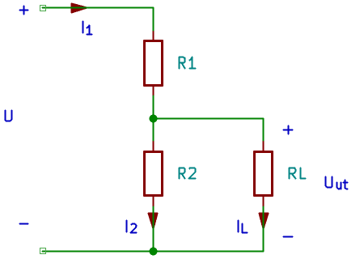{#fig-resistorkopplingar-belastad width=9cm fig-align="left"}

Vid utgångsnoden förgrenas nu strömmen. $R_1$ och $R_2$ är därför inte längre seriekopplade som enskilda resistorer. Däremot ligger $R_1$ i serie med ersättningen av $R_2$ och $R_L$.

Beteckna denna ersättningsresistans $R_\mathrm{ned}$:

$$
R_\mathrm{ned}=\frac{R_2R_L}{R_2+R_L}.
$$

Den belastade utspänningen blir

$$
\boxed{U_\mathrm{ut}=U\frac{R_\mathrm{ned}}{R_1+R_\mathrm{ned}}}.
$$

Eftersom $R_\mathrm{ned}<R_2$ blir utspänningen lägre än utan last. Strömmarna kan därefter beräknas som

$$
I_1=\frac{U-U_\mathrm{ut}}{R_1},\qquad
I_2=\frac{U_\mathrm{ut}}{R_2},\qquad
I_L=\frac{U_\mathrm{ut}}{R_L}.
$$

Kirchhoffs strömlag vid utgången ger $I_1=I_2+I_L$.

Om lastströmmen $I_L$ är känd kan utspänningen beräknas direkt utan att först bestämma $R_\mathrm{ned}$:

$$
\boxed{
U_\mathrm{ut}
= U\frac{R_2}{R_1+R_2}
- I_L\frac{R_1R_2}{R_1+R_2}
}.
$$

::: {.callout-note title="Exempel: en last sänker utspänningen" icon=false}
Spänningsdelaren från det tidigare exemplet har $U=12\,\mathrm{V}$, $R_1=3{,}0\,\mathrm{k}\Omega$ och $R_2=1{,}0\,\mathrm{k}\Omega$. Utan last är utspänningen $3{,}0\,\mathrm{V}$.

Anslut $R_L=1{,}0\,\mathrm{k}\Omega$ över utgången. Den nedre ersättningsresistansen blir

$$
R_\mathrm{ned}=\frac{1000\cdot1000}{1000+1000}\,\Omega=500\,\Omega.
$$

Utspänningen blir

$$
U_\mathrm{ut}=12\frac{500}{3000+500}\,\mathrm{V}\approx1{,}71\,\mathrm{V}.
$$

Strömmen genom den övre resistorn är

$$
I_1=\frac{12}{3000+500}\,\mathrm{A}\approx3{,}43\,\mathrm{mA}.
$$

De två lika stora nedre resistanserna delar strömmen lika:

$$
I_2=I_L\approx1{,}71\,\mathrm{mA}.
$$

**Svar:** Lasten sänker utspänningen från $3{,}0\,\mathrm{V}$ till cirka $1{,}71\,\mathrm{V}$. Strömmen genom $R_1$ har samtidigt ökat.
:::

### Hur stor får belastningen vara? {#sec-resistorkopplingar-belastning-storlek}

En last med stor resistans tar liten ström och påverkar spänningsdelaren mindre än en last med liten resistans. Om $R_L$ är mycket större än $R_2$ ligger $R_\mathrm{ned}$ nära $R_2$ och utspänningen ligger nära det obelastade värdet.

Vad som räknas som liten påverkan beror på tillåten avvikelse. En allmän tumregel räcker därför inte vid noggrann dimensionering: beräkna den belastade utspänningen och jämför med kravet.

::: {.callout-important title="En spänningsdelare är inte en spänningsregulator"}
Utspänningen ändras när inspänningen, resistansvärdena eller lasten ändras. En enkel resistiv spänningsdelare är därför normalt olämplig som matning till en apparat med varierande strömförbrukning.

Den kan däremot användas för att skala ned en mätspänning eller skapa en referensnivå när belastningen är tillräckligt liten och övriga krav är uppfyllda.
:::

## Mätinstrumentens påverkan – översikt {#sec-resistorkopplingar-matinstrument}

Ett mätinstrument blir en del av kretsen när det ansluts. Här använder vi främst idealmodeller och nöjer oss med att känna till följande skillnader.

| Instrument | Anslutning | Idealmodell | Verklig påverkan |
|---|---|---|---|
| Voltmeter | Parallellt mellan de punkter vars spänning mäts | Oändlig ingångsresistans; tar ingen ström | Tar en liten ström och belastar den uppmätta kretsen |
| Amperemeter | I serie med den gren vars ström mäts | Noll resistans; inget spänningsfall | Ger ett spänningsfall som kan ändra kretsens ström |

: Idealiserade och verkliga mätinstrument. {#tbl-resistorkopplingar-matinstrument}

En verklig voltmeter över spänningsdelarens utgång fungerar i en enkel likströmsmodell som en lastresistans parallellt med $R_2$. Påverkan behandlas då med samma princip som i @sec-resistorkopplingar-belastad. Instrumentens noggrannhet och mer detaljerade egenskaper behandlas i en separat kurs.

::: {.callout-important title="Anslut instrumentet för rätt mätning"}
En amperemeter ska inte anslutas direkt över en spänningskälla. Dess låga resistans kan ge mycket stor ström.

Resistansmätning görs på en spänningslös krets. Övriga anslutna komponenter kan påverka vilken resistans instrumentet mäter.
:::

## Δ- och Y-kopplingar – orientering {#sec-resistorkopplingar-delta-y}

Alla resistornät kan inte förenklas genom att enbart använda
serie- och parallellkoppling. Två vanliga strukturer är
**deltakoppling**, Δ, och **stjärnkoppling**, Y.

En Δ-koppling kan omvandlas till en motsvarande Y-koppling,
och tvärtom. Omvandlingen bevarar kopplingens elektriska
beteende vid de tre yttre anslutningarna A, B och C.
Det kan göra det möjligt att fortsätta förenklingen med
serie- och parallellkoppling.

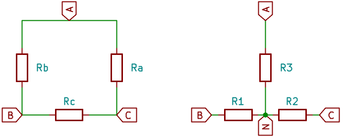{#fig-resistorkopplingar-delta-y width=14cm fig-align="left"}

### Deltakoppling {#sec-resistorkopplingar-delta}

I Δ-kopplingen i @fig-resistorkopplingar-delta-y är:

- $R_a$ ansluten mellan A och C,
- $R_b$ ansluten mellan A och B,
- $R_c$ ansluten mellan B och C.

Resistorerna bildar en sluten triangel elektriskt, oavsett
hur schemat ritas.

När samtliga tre noder är anslutna till resten av kretsen
kan två av resistorerna inte utan vidare betraktas som
seriekopplade. Deras gemensamma nod har då en ytterligare
anslutning där ström kan förgrenas.

### Stjärnkoppling {#sec-resistorkopplingar-stjarna}

I Y-kopplingen går en resistor från varje yttre anslutning
till en gemensam inre nod. Med beteckningarna i bilden är:

- $R_1$ ansluten mellan B och den inre noden,
- $R_2$ ansluten mellan C och den inre noden,
- $R_3$ ansluten mellan A och den inre noden.

Den inre noden är inte automatiskt jord.

::: {.callout-important title="Bevara de yttre anslutningarna"}
Vid omvandlingen ska A, B och C vara anslutna till samma
delar av den övriga kretsen som tidigare.

Y-kopplingens inre nod får inte ha någon ytterligare
anslutning till den övriga kretsen om omvandlingsformlerna
nedan ska användas.
:::

### Omvandling från Δ till Y {#sec-resistorkopplingar-delta-till-y}

Varje resistans i Y-kopplingen beräknas som produkten av
de två Δ-resistanser som möts vid samma yttre anslutning,
dividerad med summan av alla tre Δ-resistanser.

Med beteckningarna i @fig-resistorkopplingar-delta-y gäller

$$
\boxed{R_1=\frac{R_bR_c}{R_a+R_b+R_c}},
$$

$$
\boxed{R_2=\frac{R_aR_c}{R_a+R_b+R_c}},
$$

$$
\boxed{R_3=\frac{R_aR_b}{R_a+R_b+R_c}}.
$$

Exempelvis går $R_1$ till anslutning B. I Δ-kopplingen
möts $R_b$ och $R_c$ vid B, vilket förklarar produkten
$R_bR_c$ i täljaren.

### Omvandling från Y till Δ {#sec-resistorkopplingar-y-till-delta}

Bilda först summan av Y-resistansernas parvisa produkter:

$$
S=R_1R_2+R_2R_3+R_3R_1.
$$

Varje Δ-resistans fås genom att dividera denna summa med
den Y-resistans som går till den motsatta yttre anslutningen:

$$
\boxed{R_a=\frac{R_1R_2+R_2R_3+R_3R_1}{R_1}},
$$

$$
\boxed{R_b=\frac{R_1R_2+R_2R_3+R_3R_1}{R_2}},
$$

$$
\boxed{R_c=\frac{R_1R_2+R_2R_3+R_3R_1}{R_3}}.
$$

Exempelvis ligger $R_a$ mellan A och C. Den motsatta
anslutningen är B, dit Y-resistorn $R_1$ går.
Därför står $R_1$ i nämnaren.

::: {.callout-tip title="Följ anslutningarna, inte bara indexen"}
Beteckningarna varierar mellan olika böcker och scheman.
Identifiera därför alltid vilken resistor som ligger mellan
vilka anslutningar innan du använder en omvandlingsformel.

Formlerna här följer beteckningarna i
@fig-resistorkopplingar-delta-y.
:::

### Specialfall: lika stora resistorer {#sec-resistorkopplingar-delta-y-lika}

Om alla tre Δ-resistorer har samma resistans $R_\Delta$
får varje resistor i den motsvarande Y-kopplingen resistansen

$$
\boxed{R_Y=\frac{R_\Delta}{3}}.
$$

Omvänt gäller för en Y-koppling med tre lika resistanser:

$$
\boxed{R_\Delta=3R_Y}.
$$

::: {.callout-note title="Exempel: symmetrisk Δ-koppling" icon=false}
En Δ-koppling har tre resistorer på vardera
$300\,\Omega$. Varje resistor i den motsvarande
Y-kopplingen blir

$$
R_Y=\frac{R_\Delta}{3}
=\frac{300}{3}\,\Omega
=100\,\Omega.
$$

Vi kontrollerar resistansen mellan A och B när den yttre
anslutningen C lämnas öppen.

I Δ-kopplingen ligger en resistor på $300\,\Omega$
parallellt med två serieresistorer på sammanlagt
$600\,\Omega$:

$$
R_{AB,\Delta}
=\frac{300\cdot600}{300+600}\,\Omega
=200\,\Omega.
$$

I Y-kopplingen går ingen ström genom grenen till den
öppna anslutningen C. Mellan A och B återstår två
resistorer i serie:

$$
R_{AB,Y}=(100+100)\,\Omega=200\,\Omega.
$$

**Kontroll:** Båda kopplingarna ger samma resistans mellan
A och B. Eftersom kopplingarna är symmetriska gäller
motsvarande resultat även mellan övriga nodpar.
:::

Omvandlingsformlerna ges här som orientering och härleds
inte. Kirchhoffs lagar kan också användas direkt för att
analysera kretsar som innehåller Δ- eller Y-kopplingar.

## Sammanfattning {#sec-resistorkopplingar-sammanfattning}

- Seriekopplade resistorer har samma ström. Ersättningsresistansen är summan av resistanserna.
- Parallellkopplade resistorer ligger mellan samma två noder och har samma spänning. Deras konduktanser adderas.
- Spänningsdelning fördelar spänningen i proportion till resistanserna i en seriekoppling.
- Strömdelning fördelar strömmen i proportion till konduktanserna i en parallellkoppling.
- Vid förenkling bevaras beteendet vid delkopplingens anslutningar. Interna strömmar och spänningar bestäms genom att arbeta tillbaka i originalkretsen.
- En last över spänningsdelarens utgång ligger parallellt med den nedre resistorn och sänker utspänningen.
- Verkliga mätinstrument påverkar kretsen de ansluts till.
- Δ- och Y-kopplingar är treanslutningsnät som kan behöva andra metoder än direkt serie- och parallellförenkling.

| Egenskap | Seriekoppling | Parallellkoppling |
|---|---|---|
| Gemensam storhet | Ström | Spänning |
| Fördelning | Spänningen fördelas | Strömmen fördelas |
| Ersättningsresistans, minst två positiva resistanser | Större än största delresistansen | Mindre än minsta delresistansen |
| $n$ lika resistorer med resistansen $R$ | $nR$ | $R/n$ |

: Jämförelse mellan serie- och parallellkoppling. {#tbl-resistorkopplingar-jamforelse}

| Samband | Uttryck och förutsättningar |
|---|---|
| Seriekoppling | $R_\mathrm{ers}=R_1+R_2+\cdots+R_n$ |
| Parallellkoppling | $1/R_\mathrm{ers}=1/R_1+1/R_2+\cdots+1/R_n$ |
| Två parallella resistorer | $R_\mathrm{ers}=R_1R_2/(R_1+R_2)$ |
| Spänningsdelning över $R_2$ | $U_2=UR_2/(R_1+R_2)$, samma ström genom båda |
| Strömdelning genom $R_1$ | $I_1=IR_2/(R_1+R_2)$, två parallella grenar |
| Flera parallella grenar | $I_k=IG_k/(G_1+\cdots+G_n)$ |
| Belastad spänningsdelare | $U_\mathrm{ut}=UR_\mathrm{ned}/(R_1+R_\mathrm{ned})$, där $R_\mathrm{ned}=R_2R_L/(R_2+R_L)$ |

: Centrala samband för resistorkopplingar. {#tbl-resistorkopplingar-samband}

## Övningar {#sec-resistorkopplingar-ovningar}

Använd idealmodeller om inget annat anges. Rita kretsschema där kopplingen beskrivs i text. Markera strömriktningar och spänningspolariteter. Redovisa samband före insättning av talvärden och kontrollera resultaten med lämplig kretslag eller rimlighetsbedömning.

### Begrepp och förståelse {#sec-resistorkopplingar-ovningar-begrepp}

1. Två olika resistorer är seriekopplade. Vilken har störst ström genom sig och vilken har störst spänningsfall? Motivera.

2. Två olika resistorer är parallellkopplade. Vilken har störst spänning över sig och vilken har störst ström genom sig? Motivera.

3. Två resistorer delar en nod. Räcker detta för att avgöra om de är serie- eller parallellkopplade? Förklara vilken ytterligare information som behövs.

4. Vad bevaras när en resistorgrupp ersätts med sin ersättningsresistans mellan två anslutningar? Kan strömmen genom varje ursprunglig resistor avläsas direkt ur ersättningskretsen?

5. En extra resistor ansluts parallellt med en befintlig resistor över en ideal spänningskälla. Hur förändras ersättningsresistansen, strömmen i den ursprungliga resistorn och källströmmen?

6. Två resistorer har lika stor ström genom sig. Måste de vara seriekopplade? Ge ett motexempel.

### Serie- och parallellkoppling {#sec-resistorkopplingar-ovningar-grundberakningar}

7. Resistorerna $220\,\Omega$ och $330\,\Omega$ seriekopplas till $11\,\mathrm{V}$. Beräkna ersättningsresistansen, strömmen och spänningen över varje resistor.

8. Samma resistorer parallellkopplas till $6{,}6\,\mathrm{V}$. Beräkna ersättningsresistansen, grenströmmarna och källströmmen.

9. Fyra resistorer på vardera $1{,}0\,\mathrm{k}\Omega$ kopplas först i serie och sedan parallellt. Beräkna ersättningsresistansen i båda fallen. Bestäm även totalströmmen vid $10\,\mathrm{V}$ för respektive koppling.

10. En resistor på $1{,}0\,\mathrm{k}\Omega$ ska parallellkopplas med en okänd resistor så att ersättningsresistansen blir $600\,\Omega$. Bestäm den okända resistansen och kontrollera att svaret är rimligt.

### Spänningsdelning och strömdelning {#sec-resistorkopplingar-ovningar-delning}

11. En obelastad spänningsdelare ska ge $3{,}0\,\mathrm{V}$ från $12\,\mathrm{V}$. Den nedre resistorn $R_2$ är $1{,}0\,\mathrm{k}\Omega$. Bestäm $R_1$, strömmen genom delaren och effekten i båda resistorerna.

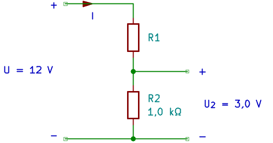{width=11cm fig-align="center"}

12. En obelastad spänningsdelare har $R_1=18\,\mathrm{k}\Omega$ och $R_2=2{,}0\,\mathrm{k}\Omega$. Inspänningen är $30\,\mathrm{V}$.

    a. Bestäm utspänningen över $R_2$.

    b. Båda resistansvärdena multipliceras med tio. Bestäm ny utspänning, ström och sammanlagd effekt. Jämför med ursprungskopplingen.

13. En ström på $15\,\mathrm{mA}$ delas mellan två parallellkopplade resistorer på $2{,}0\,\mathrm{k}\Omega$ och $3{,}0\,\mathrm{k}\Omega$. Använd strömdelning för att bestämma grenströmmarna. Kontrollera att båda resistorerna får samma spänning.

14. En strömkälla matar $12\,\mathrm{mA}$ till tre parallella grenar med resistanserna $2{,}0\,\mathrm{k}\Omega$, $3{,}0\,\mathrm{k}\Omega$ och $6{,}0\,\mathrm{k}\Omega$. Bestäm grenströmmarna med konduktanser och beräkna spänningen över kopplingen.

15. En ideal linjär potentiometer på $10\,\mathrm{k}\Omega$ är ansluten mellan $5{,}0\,\mathrm{V}$ och referensen. Ingen last är ansluten till löparen. Resistansen mellan löparen och referensanslutningen är $2{,}0\,\mathrm{k}\Omega$. Bestäm utspänningen och strömmen genom banan.

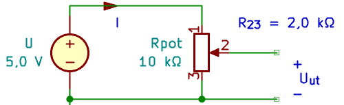{width=10cm fig-align="center"}

### Blandade kopplingar och belastning {#sec-resistorkopplingar-ovningar-blandade}

16. En källa på $18\,\mathrm{V}$ driver $R_1=1{,}0\,\mathrm{k}\Omega$ i serie med en parallellkoppling av $R_2=3{,}0\,\mathrm{k}\Omega$ och $R_3=6{,}0\,\mathrm{k}\Omega$.

    a. Bestäm ersättningsresistansen och källströmmen.

    b. Bestäm spänningen och strömmen för varje resistor.

    c. Beräkna resistoreffekterna och kontrollera effektbalansen.

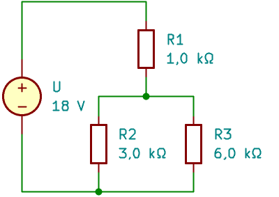{width=8cm fig-align="center"}

17. Två grenar ansluts parallellt till en källa på $12\,\mathrm{V}$. Den första grenen innehåller $R_1=1{,}0\,\mathrm{k}\Omega$ och $R_2=2{,}0\,\mathrm{k}\Omega$ i serie. Den andra innehåller en enda resistor $R_3=6{,}0\,\mathrm{k}\Omega$. Beräkna ersättningsresistansen, källströmmen och spänningen över varje resistor.

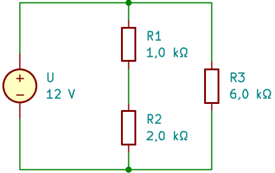{width=9cm fig-align="center"}

18. Anslut $R_L=1{,}0\,\mathrm{k}\Omega$ över utgången på spänningsdelaren i uppgift 11. Bestäm utspänningen och strömmarna genom $R_1$, $R_2$ och $R_L$. Kontrollera strömlagen vid utgången.

19. Byt lasten i uppgift 18 till $R_L=100\,\mathrm{k}\Omega$.

    a. Bestäm utspänningen.

    b. Beräkna hur många procent lägre utspänningen är än det obelastade värdet. Använd $(U_\mathrm{obelastad}-U_\mathrm{belastad})/U_\mathrm{obelastad}$.

    c. Uppfyller delaren kravet att sänkningen ska vara mindre än $1{,}0\,\%$?

20. En mätspänning på högst $50\,\mathrm{V}$ ska delas ned till högst $5{,}0\,\mathrm{V}$ med en resistiv spänningsdelare. Den anslutna ingången antas ta försumbar ström. Välj $R_2=10\,\mathrm{k}\Omega$.

    a. Beräkna vilket nominellt värde $R_1$ ska ha för exakt delning 10:1.

    b. Beräkna strömmen och effekten i respektive resistor vid $50\,\mathrm{V}$.

    c. Räcker den nominella beräkningen för att garantera att utspänningen aldrig överstiger $5{,}0\,\mathrm{V}$? Ange vilka variationer som behöver undersökas.

### Tillämpning och problemlösning {#sec-resistorkopplingar-tillampning-och-problemlosning}

21. Bestäm ersättningsresistansen mellan punkterna:

    a. A och B.

    b. A och C.

    c. B och C.

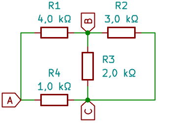{width=7cm fig-align="center"}

22.  Beräkna strömmen $I$.

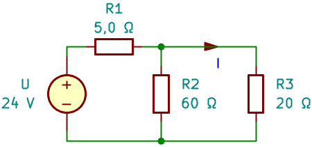{width=9cm fig-align="center"} 

23. Beräkna spänningen $U_2$.

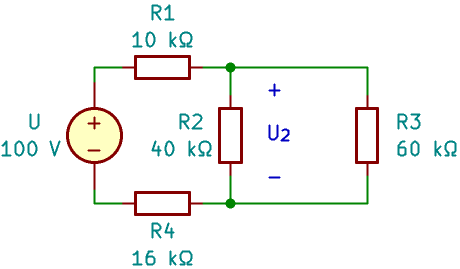{width=9.2cm fig-align="center"}

```{=latex}
\needspace{6cm}
```

24. Beräkna resistansen mellan punkterna A och B. Samtliga resistanser har resistansen $R=3{,}0\,\mathrm{k}\Omega$.

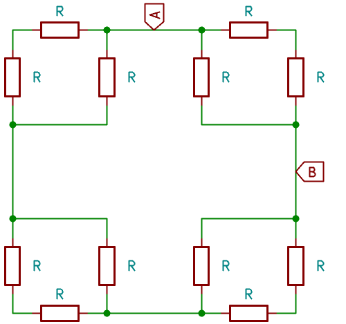{width=10cm fig-align="center"}

25. Beräkna resistansen mellan punkterna A och B om $R=60\,\Omega$.

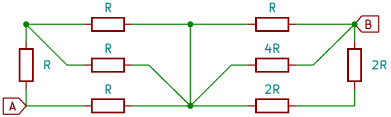{width=13cm fig-align="center"}

```{=latex}
\needspace{6cm}
```

26. Beräkna resistansen i kretsen nedan mellan punkterna: 

    a. A och B.

    b. A och C.

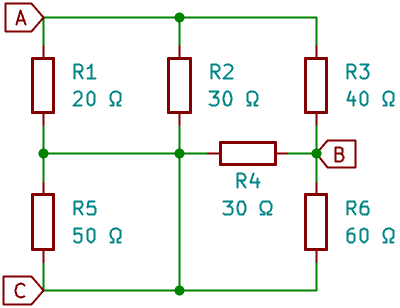{width=8cm fig-align="center"}

### Felsökning och orientering {#sec-resistorkopplingar-ovningar-orientering}

27. En studerande beräknar ersättningsresistansen för två parallella resistorer på $100\,\Omega$ och $200\,\Omega$ till $300\,\Omega$.

    a. Hur kan felet upptäckas utan en fullständig beräkning?

    b. Beräkna rätt värde.

28. Spänningsdelaren i uppgift 11 har utgången mellan $R_1$ och $R_2$ och referensen vid källans minuspol. Ingen last är ansluten. Bestäm utspänningen vid vart och ett av följande enskilda fel:

    a. Avbrott i $R_1$.

    b. Avbrott i $R_2$.

    c. Kortslutning av $R_2$.

    d. Kortslutning av $R_1$.

29. Beskriv hur en ideal voltmeter respektive amperemeter ansluts. Förklara översiktligt hur verkliga instrument kan påverka kretsen. Någon instrumentberäkning krävs inte.

30. Rita en Δ-koppling och en Y-koppling med samma yttre noder A, B och C. Markera den inre noden N i Y-kopplingen. Förklara varför N inte automatiskt är jord.

31. En symmetrisk Δ-koppling har tre resistorer på vardera $900\,\Omega$.

    a. Vilka resistansvärden får den motsvarande symmetriska Y-kopplingen?

    b. Beräkna resistansen mellan A och B för båda kopplingarna när den yttre anslutningen C är öppen.

32. En resistor är ansluten mellan A och B, en mellan B och C och en mellan C och A. Alla tre noder är anslutna till andra delar av kretsen. En studerande vill ersätta resistorerna mellan A–B och B–C med deras summa. Förklara varför detta inte är en giltig serieförenkling av den beskrivna kretsen.

## Facit – Resistorkopplingar {#sec-facit-resistorkopplingar}

Facit följer numreringen i uppgiftslistan med 32 uppgifter och de bifogade kretsschemana. Om inget annat anges är den tredje yttre anslutningen öppen när resistansen mellan två punkter beräknas. Inga externa komponenter ansluts då till denna tredje punkt.

I lösningarna används $R_a\parallel R_b$ som kort notation för parallellkopplingens ersättningsresistans:

$$
R_a\parallel R_b=\frac{R_aR_b}{R_a+R_b}.
$$

### Begrepp och förståelse {#sec-facit-resistorkopplingar-begrepp}

1. **Samma ström** går genom båda resistorerna, eftersom det inte finns någon förgrening mellan dem. Resistorn med **störst resistans** får störst spänningsfall enligt $U_k=R_kI$, förutsatt att strömmen inte är noll.

2. **Samma spänning** ligger över båda resistorerna, eftersom de är anslutna mellan samma två noder. Resistorn med **lägst resistans** har störst ström enligt $I_k=U/R_k$, förutsatt att spänningen inte är noll.

3. Nej. För seriekoppling behöver den gemensamma noden sakna andra strömförande förgreningar. För parallellkoppling ska resistorernas båda anslutningar vara kopplade till samma två noder. Om de endast delar en nod och denna har ytterligare en gren är de varken serie- eller parallellkopplade.

4. Sambandet mellan anslutningsspänningen och strömmen in i resistorgruppen bevaras: $U=R_\mathrm{ers}I$. Vid samma spänning blir därför totalströmmen och den sammanlagda mottagna effekten lika stora. Strömmen genom varje ursprunglig resistor kan inte avläsas direkt ur ersättningskretsen; återvänd till originalkretsen och beräkna fördelningen.

5. Ersättningsresistansen **minskar**. Strömmen genom den ursprungliga resistorn är **oförändrad**, eftersom spänningen över den är oförändrad. Källströmmen **ökar** med strömmen genom den nya grenen.

6. Nej. Två lika stora resistorer parallellt över samma källa har lika stora strömmar genom sig, men är inte seriekopplade. Kopplingstypen bestäms av anslutningarna, inte enbart av strömmarnas värden.

### Serie- och parallellkoppling {#sec-facit-resistorkopplingar-grundberakningar}

7. Ersättningsresistansen är

    $$
    R_\mathrm{ers}=R_1+R_2=(220+330)\,\Omega=550\,\Omega.
    $$

    Strömmen blir

    $$
    I=\frac{U}{R_\mathrm{ers}}=\frac{11}{550}\,\mathrm{A}=20\,\mathrm{mA}.
    $$

    Spänningarna över $220\,\Omega$ respektive $330\,\Omega$ är

    $$
    U_1=R_1I=(220\cdot0{,}020)\,\mathrm{V}=4{,}4\,\mathrm{V},
    $$

    $$
    U_2=R_2I=(330\cdot0{,}020)\,\mathrm{V}=6{,}6\,\mathrm{V}.
    $$

    **Kontroll:** $(4{,}4+6{,}6)\,\mathrm{V}=11\,\mathrm{V}$.

8. Ersättningsresistansen är

    $$
    R_\mathrm{ers}=\frac{R_1R_2}{R_1+R_2}
    =\frac{220\cdot330}{220+330}\,\Omega=132\,\Omega.
    $$

    Grenströmmarna blir

    $$
    I_1=\frac{U}{R_1}=\frac{6{,}6}{220}\,\mathrm{A}=30\,\mathrm{mA},
    $$

    $$
    I_2=\frac{U}{R_2}=\frac{6{,}6}{330}\,\mathrm{A}=20\,\mathrm{mA}.
    $$

    Källströmmen är $I=I_1+I_2=50\,\mathrm{mA}$.

    **Kontroll:** $U/I=(6{,}6/0{,}050)\,\Omega=132\,\Omega$, vilket är mindre än båda delresistanserna.

9. Fyra lika resistorer:

    | Koppling | Ersättningsresistans | Totalström vid $10\,\mathrm{V}$ |
    |---|---|---|
    | Serie | $R_\mathrm{ers}=4R=4{,}0\,\mathrm{k}\Omega$ | $I=U/(4R)=2{,}5\,\mathrm{mA}$ |
    | Parallell | $R_\mathrm{ers}=R/4=250\,\Omega$ | $I=U/(R/4)=40\,\mathrm{mA}$ |

10. Använd parallellsambandet och lös ut den okända resistansen $R_x$:

    $$
    \frac{1}{R_\mathrm{ers}}=\frac{1}{R_1}+\frac{1}{R_x}
    \quad\Rightarrow\quad
    R_x=\frac{R_\mathrm{ers}R_1}{R_1-R_\mathrm{ers}}.
    $$

    $$
    R_x=\frac{600\cdot1000}{1000-600}\,\Omega
    =1500\,\Omega=1{,}5\,\mathrm{k}\Omega.
    $$

    **Kontroll:** $1000\parallel1500=600\,\Omega$. Ersättningsresistansen är mindre än den minsta delresistansen.

### Spänningsdelning och strömdelning {#sec-facit-resistorkopplingar-delning}

11. Från $U_2=UR_2/(R_1+R_2)$ fås

    $$
    R_1=R_2\left(\frac{U}{U_2}-1\right)
    =1000\left(\frac{12}{3{,}0}-1\right)\,\Omega
    =3{,}0\,\mathrm{k}\Omega.
    $$

    $$
    I=\frac{U}{R_1+R_2}=\frac{12}{3000+1000}\,\mathrm{A}=3{,}0\,\mathrm{mA}.
    $$

    Effekterna blir

    $$
    P_1=R_1I^2=(3000\cdot0{,}0030^2)\,\mathrm{W}=27\,\mathrm{mW},
    $$

    $$
    P_2=R_2I^2=(1000\cdot0{,}0030^2)\,\mathrm{W}=9{,}0\,\mathrm{mW}.
    $$

    **Kontroll:** Källan avger $UI=36\,\mathrm{mW}$, lika med $P_1+P_2$.

12. Spänningsdelaren:

    a. Utspänningen är

       $$
       U_\mathrm{ut}=U\frac{R_2}{R_1+R_2}
       =30\frac{2000}{18000+2000}\,\mathrm{V}=3{,}0\,\mathrm{V}.
       $$

    b. När båda resistansvärdena multipliceras med tio är förhållandet oförändrat. Därför är utspänningen fortfarande $3{,}0\,\mathrm{V}$.

       | Storhet | Ursprunglig koppling | Tio gånger större resistanser |
       |---|---|---|
       | Total resistans | $20\,\mathrm{k}\Omega$ | $200\,\mathrm{k}\Omega$ |
       | Ström, $I=U/R_\mathrm{ers}$ | $1{,}5\,\mathrm{mA}$ | $0{,}15\,\mathrm{mA}$ |
       | Sammanlagd effekt, $P=UI$ | $45\,\mathrm{mW}$ | $4{,}5\,\mathrm{mW}$ |
       | Utspänning | $3{,}0\,\mathrm{V}$ | $3{,}0\,\mathrm{V}$ |

       Strömmen och den sammanlagda effekten minskar till en tiondel.

13. Låt $I_1$ avse strömmen genom $2{,}0\,\mathrm{k}\Omega$ och $I_2$ strömmen genom $3{,}0\,\mathrm{k}\Omega$:

    $$
    I_1=I\frac{R_2}{R_1+R_2}
    =15\frac{3000}{2000+3000}\,\mathrm{mA}=9{,}0\,\mathrm{mA},
    $$

    $$
    I_2=I\frac{R_1}{R_1+R_2}
    =15\frac{2000}{2000+3000}\,\mathrm{mA}=6{,}0\,\mathrm{mA}.
    $$

    **Kontroll:** $R_1I_1=18\,\mathrm{V}$ och $R_2I_2=18\,\mathrm{V}$. Dessutom är $I_1+I_2=15\,\mathrm{mA}$.

14. Konduktanserna är

    $$
    G_1=0{,}50\,\mathrm{mS},\qquad
    G_2=\frac{1}{3}\,\mathrm{mS},\qquad
    G_3=\frac{1}{6}\,\mathrm{mS}.
    $$

    Summan är $G_\mathrm{ers}=1{,}0\,\mathrm{mS}$. Strömdelning ger

    $$
    I_k=I\frac{G_k}{G_\mathrm{ers}},
    $$

    alltså $I_1=6{,}0\,\mathrm{mA}$, $I_2=4{,}0\,\mathrm{mA}$ och $I_3=2{,}0\,\mathrm{mA}$.

    Spänningen blir

    $$
    U=\frac{I}{G_\mathrm{ers}}=\frac{0{,}012}{0{,}0010}\,\mathrm{V}=12\,\mathrm{V}.
    $$

    **Kontroll:** Grenströmmarna summeras till $12\,\mathrm{mA}$ och ger alla samma spänning enligt Ohms lag.

15. Resistansen från löparen till referensen är $R_{23}=2{,}0\,\mathrm{k}\Omega$ och hela banan har resistansen $R_\mathrm{pot}=10\,\mathrm{k}\Omega$:

    $$
    U_\mathrm{ut}=U\frac{R_{23}}{R_\mathrm{pot}}
    =5{,}0\frac{2000}{10000}\,\mathrm{V}=1{,}0\,\mathrm{V}.
    $$

    $$
    I=\frac{U}{R_\mathrm{pot}}=\frac{5{,}0}{10000}\,\mathrm{A}=0{,}50\,\mathrm{mA}.
    $$

    Ingen ström tas ut genom löparen. Strömmen genom båda delarna av banan är därför lika stor.

### Blandade kopplingar och belastning {#sec-facit-resistorkopplingar-blandade}

16. Förenkla först parallellkopplingen:

    a.

       $$
       R_{23}=\frac{R_2R_3}{R_2+R_3}
       =\frac{3000\cdot6000}{3000+6000}\,\Omega=2{,}0\,\mathrm{k}\Omega.
       $$

       $$
       R_\mathrm{ers}=R_1+R_{23}=3{,}0\,\mathrm{k}\Omega,
       \qquad
       I=\frac{U}{R_\mathrm{ers}}=\frac{18}{3000}\,\mathrm{A}=6{,}0\,\mathrm{mA}.
       $$

    b. Hela källströmmen går genom $R_1$. $U_1=R_1I=6{,}0\,\mathrm{V}$ och $U_{23}=U-U_1=12\,\mathrm{V}$.

       | Resistor | Spänning | Ström |
       |---|---|---|
       | $R_1$ | $6{,}0\,\mathrm{V}$ | $6{,}0\,\mathrm{mA}$ |
       | $R_2$ | $12\,\mathrm{V}$ | $I_2=U_{23}/R_2=4{,}0\,\mathrm{mA}$ |
       | $R_3$ | $12\,\mathrm{V}$ | $I_3=U_{23}/R_3=2{,}0\,\mathrm{mA}$ |

       **Kontroll:** $I_2+I_3=6{,}0\,\mathrm{mA}$ och $U_1+U_{23}=18\,\mathrm{V}$.

    c. $P_1=36\,\mathrm{mW}$, $P_2=48\,\mathrm{mW}$ och $P_3=24\,\mathrm{mW}$, beräknade med respektive komponents spänning och ström.

       Källan avger $P_\mathrm{källa}=UI=108\,\mathrm{mW}$. Effektbalansen är

       $$
       108\,\mathrm{mW}=(36+48+24)\,\mathrm{mW}.
       $$

17. Den första grenen har resistansen $R_{12}=R_1+R_2=3{,}0\,\mathrm{k}\Omega$. Grenarna ligger parallellt:

    $$
    R_\mathrm{ers}=\frac{R_{12}R_3}{R_{12}+R_3}
    =\frac{3000\cdot6000}{3000+6000}\,\Omega=2{,}0\,\mathrm{k}\Omega.
    $$

    $$
    I=\frac{U}{R_\mathrm{ers}}=\frac{12}{2000}\,\mathrm{A}=6{,}0\,\mathrm{mA}.
    $$

    Första grenens ström är $I_{12}=U/R_{12}=4{,}0\,\mathrm{mA}$ och andra grenens är $I_3=U/R_3=2{,}0\,\mathrm{mA}$. Spänningarna blir

    $$
    U_1=R_1I_{12}=4{,}0\,\mathrm{V},\qquad
    U_2=R_2I_{12}=8{,}0\,\mathrm{V},\qquad U_3=12\,\mathrm{V}.
    $$

    **Kontroll:** $U_1+U_2=U_3=12\,\mathrm{V}$ och $I_{12}+I_3=6{,}0\,\mathrm{mA}$.

18. Använd $R_1=3{,}0\,\mathrm{k}\Omega$ och $R_2=1{,}0\,\mathrm{k}\Omega$ från uppgift 11. Den belastade nedre resistansen är

    $$
    R_\mathrm{ned}=\frac{R_2R_L}{R_2+R_L}
    =\frac{1000\cdot1000}{1000+1000}\,\Omega=500\,\Omega.
    $$

    $$
    U_\mathrm{ut}=U\frac{R_\mathrm{ned}}{R_1+R_\mathrm{ned}}
    =12\frac{500}{3000+500}\,\mathrm{V}
    =\frac{12}{7}\,\mathrm{V}\approx1{,}714\,\mathrm{V}.
    $$

    Strömmarna är

    $$
    I_1=\frac{U}{R_1+R_\mathrm{ned}}=\frac{12}{3500}\,\mathrm{A}\approx3{,}429\,\mathrm{mA},
    $$

    $$
    I_2=\frac{U_\mathrm{ut}}{R_2}\approx1{,}714\,\mathrm{mA},\qquad
    I_L=\frac{U_\mathrm{ut}}{R_L}\approx1{,}714\,\mathrm{mA}.
    $$

    **Kontroll:** $I_1=I_2+I_L$. En liten skillnad med de avrundade talen beror på avrundning.

19. Med $R_L=100\,\mathrm{k}\Omega$:

    a.

       $$
       R_\mathrm{ned}=\frac{1000\cdot100000}{1000+100000}\,\Omega\approx990{,}099\,\Omega.
       $$

       $$
       U_\mathrm{ut}=U\frac{R_\mathrm{ned}}{R_1+R_\mathrm{ned}}
       =\frac{1200}{403}\,\mathrm{V}\approx2{,}97767\,\mathrm{V}.
       $$

    b. Sänkningen relativt obelastade $3{,}0\,\mathrm{V}$ blir

       $$
       \frac{U_\mathrm{obelastad}-U_\mathrm{belastad}}{U_\mathrm{obelastad}}
       =\frac{3{,}0-1200/403}{3{,}0}
       \approx0{,}007444=0{,}7444\,\%.
       $$

    c. **Ja**, sänkningen är mindre än $1{,}0\,\%$ med uppgiftens idealmodeller.

20. Delning 10:1:

    a.

       $$
       R_1=R_2\left(\frac{U}{U_\mathrm{ut}}-1\right)
       =10000\left(\frac{50}{5{,}0}-1\right)\,\Omega
       =90\,\mathrm{k}\Omega.
       $$

    b.

       $$
       I=\frac{U}{R_1+R_2}=\frac{50}{90000+10000}\,\mathrm{A}=0{,}50\,\mathrm{mA}.
       $$

       $$
       P_1=R_1I^2=(90000\cdot0{,}00050^2)\,\mathrm{W}=22{,}5\,\mathrm{mW},
       $$

       $$
       P_2=R_2I^2=(10000\cdot0{,}00050^2)\,\mathrm{W}=2{,}5\,\mathrm{mW}.
       $$

       **Kontroll:** Källan avger $UI=25\,\mathrm{mW}=P_1+P_2$.

    c. **Nej.** Undersök resistorernas toleranser och temperaturberoende samt eventuell variation eller överskridning av den angivna maximala inspänningen. Utspänningen blir störst vid högsta inspänning, lägsta $R_1$ och högsta $R_2$. Vid praktisk användning behöver även verklig ingångsbelastning och eventuella transienter beaktas. En nominell utspänning exakt vid gränsen ger ingen marginal.

### Tillämpning och problemlösning {#sec-facit-resistorkopplingar-tillampning}

21. I schemat ligger $R_2$ och $R_3$ mellan samma noder B och C. De är parallellkopplade:

    $$
    R_{23}=\frac{R_2R_3}{R_2+R_3}
    =\frac{3000\cdot2000}{3000+2000}\,\Omega=1200\,\Omega.
    $$

    Efter denna förenkling återstår en triangel: $R_1$ mellan A och B, $R_4$ mellan A och C och $R_{23}$ mellan B och C. Den tredje anslutningen lämnas öppen vid varje delberäkning.

    a. Mellan A och B ligger $R_1$ parallellt med strömvägen genom $R_4$ och $R_{23}$:

       $$
       R_{AB}=\frac{R_1(R_4+R_{23})}{R_1+R_4+R_{23}}
       =\frac{4000(1000+1200)}{4000+1000+1200}\,\Omega
       \approx1419{,}35\,\Omega\approx1{,}4\,\mathrm{k}\Omega.
       $$

    b. Mellan A och C:

       $$
       R_{AC}=\frac{R_4(R_1+R_{23})}{R_4+R_1+R_{23}}
       =\frac{1000(4000+1200)}{1000+4000+1200}\,\Omega
       \approx840\,\Omega.
       $$

    c. Mellan B och C:

       $$
       R_{BC}=\frac{R_{23}(R_1+R_4)}{R_{23}+R_1+R_4}
       =\frac{1200(4000+1000)}{1200+4000+1000}\,\Omega
       \approx970\,\Omega.
       $$

    **Kontroll:** Varje resultat är mindre än den direkta resistansen mellan respektive nodpar, eftersom det även finns en parallell strömväg.

22. **Pilen $I$ ligger i grenen till $R_3$ och visar inte källans totalström.**

    Parallellkopplingen ger

    $$
    R_{23}=\frac{R_2R_3}{R_2+R_3}
    =\frac{60\cdot20}{60+20}\,\Omega=15\,\Omega.
    $$

    Ersättningsresistansen är $R_\mathrm{ers}=R_1+R_{23}=20\,\Omega$. Källströmmen blir

    $$
    I_\mathrm{tot}=\frac{U}{R_\mathrm{ers}}=\frac{24}{20}\,\mathrm{A}=1{,}2\,\mathrm{A}.
    $$

    Strömdelning ger den sökta strömmen:

    $$
    I=I_\mathrm{tot}\frac{R_2}{R_2+R_3}
    =1{,}2\frac{60}{60+20}\,\mathrm{A}
    =0{,}90\,\mathrm{A}.
    $$

    **Kontroll:** Parallellgrenarna har spänningen $I_\mathrm{tot}R_{23}=18\,\mathrm{V}$. Strömmen genom $R_2$ är $0{,}30\,\mathrm{A}$ och genom $R_3$ $0{,}90\,\mathrm{A}$. Summan är $1{,}2\,\mathrm{A}$.

23. $R_2$ och $R_3$ är parallellkopplade. Denna parallellkoppling ligger i serie med både $R_1$ och $R_4$:

    $$
    R_{23}=\frac{R_2R_3}{R_2+R_3}
    =\frac{40000\cdot60000}{40000+60000}\,\Omega
    =24\,\mathrm{k}\Omega.
    $$

    $$
    R_\mathrm{ers}=R_1+R_{23}+R_4=(10+24+16)\,\mathrm{k}\Omega
    =50\,\mathrm{k}\Omega.
    $$

    Spänningsdelning ger

    $$
    U_2=U\frac{R_{23}}{R_1+R_{23}+R_4}
    =100\frac{24000}{10000+24000+16000}\,\mathrm{V}=48\,\mathrm{V}.
    $$

    Polariteten stämmer med schemat: plus upptill och minus nedtill.

    **Kontroll:** Totalströmmen är $2{,}0\,\mathrm{mA}$. Spänningsfallen över $R_1$ och $R_4$ är $20\,\mathrm{V}$ respektive $32\,\mathrm{V}$, så $(20+48+32)\,\mathrm{V}=100\,\mathrm{V}$.

24. Vänster och höger sidonod är **inte direkt sammanbundna**. Kalla vänster sidonod L och den nedre gemensamma noden D. Höger sidonod är B och den övre noden är A.

    Varje hörndel består av en direkt resistor $R$ parallellt med två seriekopplade resistorer, sammanlagt $2R$. Varje hörndel får därför ersättningsresistansen

    $$
    r=R\parallel2R=\frac{R\cdot2R}{R+2R}=\frac{2R}{3}.
    $$

    Efter förenklingen återstår en ring med fyra lika resistanser $r$ mellan A–L, L–D, D–B och B–A.

    Mellan A och B finns två parallella vägar: den direkta övre högra delen med resistansen $r$ och vägen A–L–D–B med tre seriekopplade delar, sammanlagt $3r$.

    $$
    R_{AB}=r\parallel3r=\frac{r\cdot3r}{r+3r}
    =\frac{3r}{4}=\frac{3}{4}\frac{2R}{3}=\frac{R}{2}.
    $$

    Med $R=3{,}0\,\mathrm{k}\Omega$ fås **$R_{AB}=1{,}5\,\mathrm{k}\Omega$**.

    **Kontroll:** Varje hörndel ger $2{,}0\,\mathrm{k}\Omega$. Mellan A och B blir det därför $2{,}0\,\mathrm{k}\Omega$ parallellt med $6{,}0\,\mathrm{k}\Omega$, vilket ger $1{,}5\,\mathrm{k}\Omega$.

25. Kalla den övre vänstra noden L och den gemensamma mittnoden X. Den vänstra lodräta resistorn ligger mellan A och L och är **inte kortsluten**. Den lodräta ledningen i mitten gör däremot den övre och den nedre mittpunkten till samma nod X.

    Mellan L och X ligger den övre och den sneda vänstra resistorn parallellt:

    $$
    R_{LX}=R\parallel R=\frac{R}{2}.
    $$

    Vägen från A via L till X har därför resistansen

    $$
    R+R_{LX}=\frac{3R}{2}.
    $$

    Denna väg ligger parallellt med den nedre vänstra resistorn, som går direkt mellan A och X:

    $$
    R_{AX}=R\parallel\frac{3R}{2}
    =\frac{R(3R/2)}{R+3R/2}=\frac{3R}{5}.
    $$

    Mellan X och B finns tre parallella vägar: den övre resistorn $R$, den sneda resistorn $4R$ och två seriekopplade resistorer med summan $2R+2R=4R$.

    $$
    \frac{1}{R_{XB}}=\frac{1}{R}+\frac{1}{4R}+\frac{1}{4R}
    =\frac{3}{2R}
    \quad\Rightarrow\quad R_{XB}=\frac{2R}{3}.
    $$

    Delkopplingarna mellan A–X och X–B ligger i serie:

    $$
    R_{AB}=R_{AX}+R_{XB}=\frac{3R}{5}+\frac{2R}{3}
    =\frac{19R}{15}.
    $$

    Med $R=60\,\Omega$ blir

    $$
    R_{AB}=\frac{19\cdot60}{15}\,\Omega=76\,\Omega.
    $$

    **Kontroll:** Vänstra delkopplingen ger $36\,\Omega$ och den högra $40\,\Omega$, sammanlagt $76\,\Omega$.

26. Den lodräta mittledningen förbinder noden vid $R_1$ och $R_2$:s nedre anslutningar med C. $R_5$ har därför båda anslutningarna i samma nod och är **kortsluten**.

    Mellan A och C ligger $R_1$ och $R_2$ parallellt:

    $$
    R_{12}=\frac{20\cdot30}{20+30}\,\Omega=12\,\Omega.
    $$

    Mellan C och B ligger $R_4$ och $R_6$ parallellt:

    $$
    R_{46}=\frac{30\cdot60}{30+60}\,\Omega=20\,\Omega.
    $$

    Kvar finns en triangel med $12\,\Omega$ mellan A och C, $20\,\Omega$ mellan C och B och $R_3=40\,\Omega$ mellan A och B.

    a. Mellan A och B är den direkta resistorn på $40\,\Omega$ parallell med strömvägen via C:

       $$
       R_{AB}=\frac{R_3(R_{12}+R_{46})}{R_3+R_{12}+R_{46}}
       =\frac{40(12+20)}{40+12+20}\,\Omega
       =\frac{160}{9}\,\Omega\approx18\,\Omega.
       $$

    b. Mellan A och C ligger $R_{12}$ parallellt med vägen via B:

       $$
       R_{AC}=\frac{R_{12}(R_3+R_{46})}{R_{12}+R_3+R_{46}}
       =\frac{12(40+20)}{12+40+20}\,\Omega=10\,\Omega.
       $$

    **Kontroll:** $R_{AB}<32\,\Omega$ och $R_{AC}<12\,\Omega$, som förväntat för dessa parallellkopplingar.

### Felsökning och orientering {#sec-facit-resistorkopplingar-orientering}

27. Felaktig parallellberäkning:

    a. Ersättningsresistansen för två positiva, ändliga parallella resistanser måste vara **mindre än den minsta delresistansen**, här $100\,\Omega$. Svaret $300\,\Omega$ är därför orimligt; det motsvarar i stället summan vid seriekoppling.

    b.

       $$
       R_\mathrm{ers}=\frac{R_1R_2}{R_1+R_2}
       =\frac{100\cdot200}{100+200}\,\Omega\approx66{,}7\,\Omega.
       $$

28. Ingen last är ansluten. Varje fel behandlas separat; övriga komponenter är felfria:

    | Fel | Utspänning | Förklaring |
    |---|---|---|
    | a. Avbrott i $R_1$ | $0\,\mathrm{V}$ | Utgången är förbunden med referensen genom $R_2$. Ingen ström går och inget spänningsfall uppstår över $R_2$. |
    | b. Avbrott i $R_2$ | $12\,\mathrm{V}$ | Utgången är förbunden med källans plus genom $R_1$. Ingen ström går, så spänningsfallet över $R_1$ är noll. |
    | c. Kortslutning av $R_2$ | $0\,\mathrm{V}$ | Utgången är direkt förbunden med referensen. |
    | d. Kortslutning av $R_1$ | $12\,\mathrm{V}$ | Utgången är direkt förbunden med källans pluspol. |

29. En ideal **voltmeter** ansluts parallellt mellan de punkter vars spänning mäts. Dess ingångsresistans är oändlig, så den tar ingen ström. En verklig voltmeter tar en liten ström och kan därmed förändra den uppmätta spänningen.

    En ideal **amperemeter** ansluts i serie med den gren vars ström mäts. Dess resistans är noll och den ger inget spänningsfall. En verklig amperemeter ger ett spänningsfall som kan förändra kretsens ström. Den ska inte anslutas direkt över en spänningskälla.

30. Ett korrekt schema har följande anslutningar:

    | Koppling | Resistorernas anslutningar |
    |---|---|
    | Δ | En resistor mellan A–B, en mellan B–C och en mellan C–A |
    | Y | En resistor mellan A–N, en mellan B–N och en mellan C–N |

    N är en inre kopplingsnod. Den är inte automatiskt jord eller ansluten till någon annan nod. Potentialen noll kan tilldelas N om den väljs som referens, men ett sådant val innebär inte att en ny fysisk ledning kopplas in.

31. Symmetrisk omvandling:

    a. Varje resistor i den motsvarande Y-kopplingen blir

       $$
       R_Y=\frac{R_\Delta}{3}=\frac{900}{3}\,\Omega=300\,\Omega.
       $$

    b. Med den yttre anslutningen C öppen får Δ-kopplingen en direkt väg A–B och en väg via C:

       $$
       R_{AB,\Delta}=\frac{R_\Delta\cdot2R_\Delta}{R_\Delta+2R_\Delta}
       =\frac{900\cdot1800}{900+1800}\,\Omega=600\,\Omega.
       $$

       I Y-kopplingen går ingen ström genom resistorn till den öppna anslutningen C. De två andra resistorerna ligger i serie:

       $$
       R_{AB,Y}=2R_Y=(2\cdot300)\,\Omega=600\,\Omega.
       $$

       **Kontroll:** Båda kopplingarna ger samma resistans mellan A och B.

32. Vid B finns en anslutning till den övriga kretsen där ström kan tillföras eller lämna noden. Samma ström behöver därför inte gå genom resistorerna A–B och B–C. De kan inte ersättas med en serieresistans utan att beteendet vid den yttre anslutningen B förändras. En eventuell förenkling måste bevara alla tre yttre anslutningarna A, B och C.
