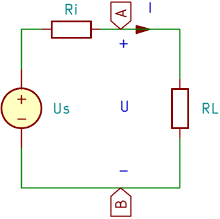
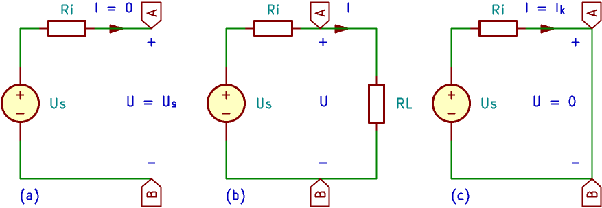
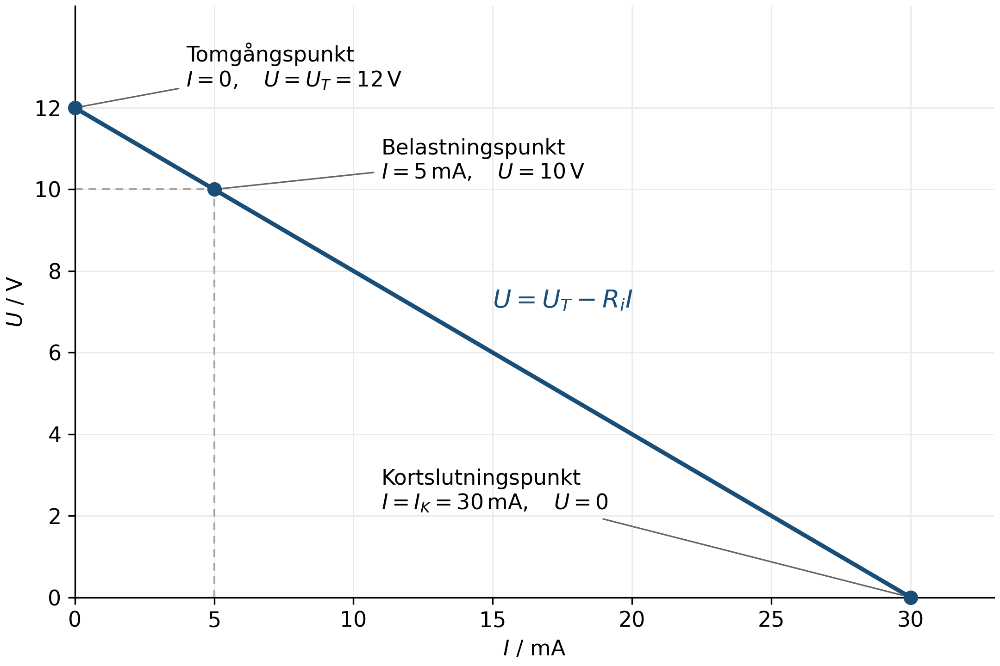
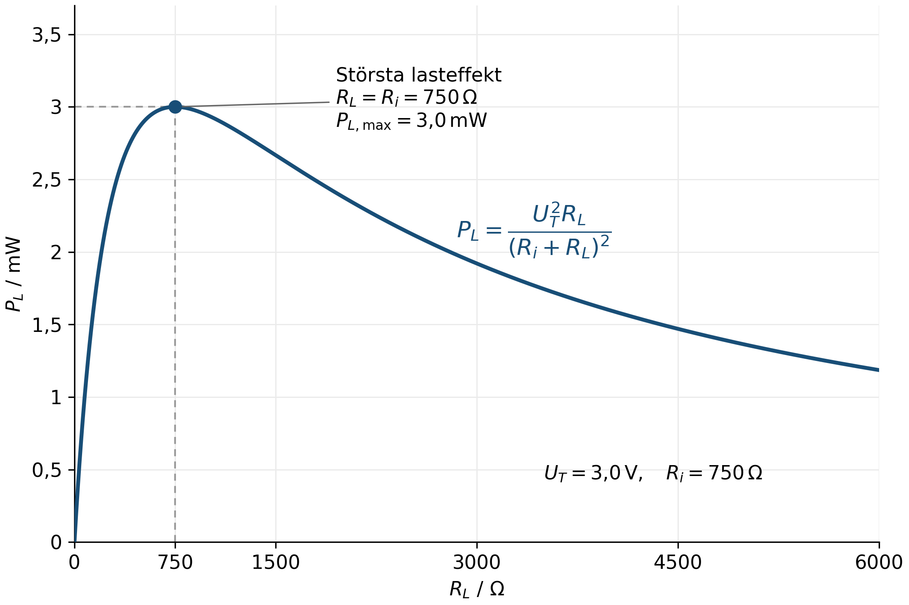
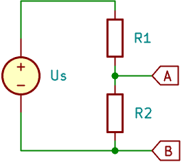
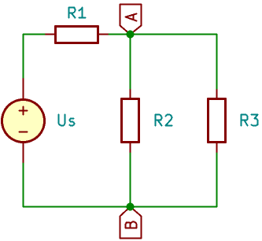
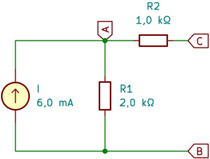
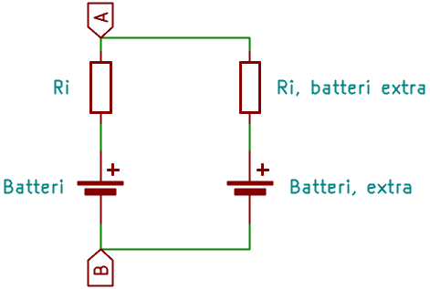
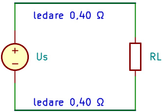
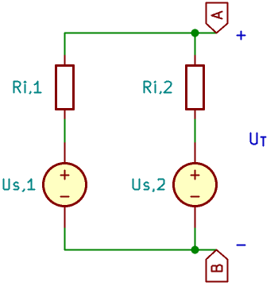

# Tvåpoler och ekvivalenta källor {#sec-tvapoler}

En krets kan innehålla många komponenter men ändå vara ansluten till sin last med bara två ledningar. För lasten är sambandet mellan spänningen och strömmen vid dessa anslutningar avgörande. Den inre uppbyggnaden behöver inte alltid vara känd.

I detta kapitel beskriver vi sådana kretsar som **tvåpoler**. Vi undersöker hur en verklig källa påverkas av belastning och hur ett linjärt resistivt nät kan ersättas med en enkel modell. Modellen gör det möjligt att beräkna lastspänning, lastström och lasteffekt utan att lösa hela originalkretsen på nytt för varje last.

Vi arbetar med stationära likströmskretsar, ideala ledningar och linjära resistorer. Om inget annat anges är resistansvärdena positiva och ändliga. De nät som ersätts innehåller endast resistorer och oberoende ideala källor. Beroende källor och tidsberoende förlopp behandlas inte här.

## Mål {.unnumbered #sec-tvapoler-mal}

Efter kapitlet ska du kunna:

- förklara vad en tvåpol är och ange mellan vilka anslutningar en modell gäller,

- skilja mellan ideal källspänning, tomgångsspänning och polspänning under belastning,

- använda en modell med spänningskälla och inre resistans,

- bestämma tomgångsspänning, kortslutningsström och ekvivalent resistans,

- bestämma en Théveninmodell för enklare resistiva nät,

- känna igen en Nortonmodell och omvandla mellan modellerna,

- beräkna hur en last påverkar spänning, ström och effekt,

- förklara skillnaden mellan största lasteffekt och hög verkningsgrad,

- kontrollera modellens resultat mot originalkretsen och känna till vad modellen inte beskriver.

## Beteckningar i kapitlet {.unnumbered #sec-tvapoler-beteckningar}

Vi använder $R_i$ för **inre resistans**, $U_T$ för **tomgångsspänning** och $I_K$ för **kortslutningsström**. En ideal spänningskällas källspänning betecknas $U_s$ och en ideal strömkällas källström betecknas $I_s$.

Beteckningarna skiljer mellan en källas föreskrivna värde och tvåpolens beteende vid anslutningarna. I Théveninmodellen (@sec-tvapoler-thevenin) väljs $U_s=U_T$. I Nortonmodellen (@sec-tvapoler-norton) väljs $I_s=I_K$. En spänningskälla i originalkretsen kan däremot ha en annan källspänning än tvåpolens tomgångsspänning, exempelvis när originalkretsen är en spänningsdelare.

Polspänningen för en tvåpol betecknas $U$ och den utgående lastströmmen $I$ eller $I_L$. I exemplet med en spänningsdelare betecknas originalkretsens matningsström $I_\mathrm{mat}$, så att den inte förväxlas med Nortonmodellens källström $I_s$ (s för engelskans *source*).

## Vad är en tvåpol? {#sec-tvapoler-begrepp}

En **tvåpol** är en komponent eller ett nät som betraktas från två anslutningar, även kallade **poler**. Exempel är en resistor, ett batteri eller en spänningsdelare betraktad från utgången och referensanslutningen. Se exemplet i @fig-tvapoler-beskrivning som visar just en spänningsdelare som är lastad med en lastresistans.

{#fig-tvapoler-beskrivning width=10cm fig-align="left"}

Vi betecknar anslutningarna A och B och definierar polspänningen som

$$
U=V_A-V_B.
$$

Spänningen har alltså plusmarkering vid A och minusmarkering vid B. När tvåpolen används som källa väljer vi strömmen $I$ som positiv **ut från A**, genom lasten och tillbaka till B. För positiv polspänning och positiv ström avger tvåpolen effekt till lasten.

Detta val behålls genom kapitlet. Om en beräkning ger negativ ström går den verkliga strömmen åt motsatt håll mot den valda riktningen.

En tvåpol behöver inte vara en källa. En resistor är också en tvåpol, men behöver anslutas till en yttre källa för att föra ström i stationärt tillstånd. I fortsättningen ligger tyngdpunkten på tvåpoler som kan försörja en last.

### Vad innebär en ekvivalent tvåpol? {#sec-tvapoler-ekvivalens}

Två tvåpoler är **ekvivalenta vid anslutningarna** om de ger samma samband mellan polspänning och ström inom modellens giltighetsområde. En ansluten last får då samma spänning och ström oavsett vilken av tvåpolerna som används.

Ekvivalens innebär däremot inte att tvåpolerna har samma inre strömmar, effektförluster eller komponenter. Vi återkommer till den skillnaden i @sec-tvapoler-modellbegransningar.

::: {.callout-important title="Bestäm modellens anslutningar"}

Ange alltid mellan vilka två anslutningar ersättningen gäller. Bestäm också vad som tillhör källnätet och vad som är den yttre lasten.

En resistor som ingår i källnätet ska vara kvar när modellen bestäms. Den yttre last som modellen ska försörja kopplas däremot bort vid bestämning av tomgångsspänningen.

:::

## Ideal och verklig spänningskälla {#sec-tvapoler-spanningskalla}

En ideal spänningskälla håller sin spänning oberoende av strömmen. En verklig källa har begränsningar. Spänningen kan exempelvis sjunka när strömmen ökar.

En enkel modell består av en ideal spänningskälla med källspänningen $U_s$ i serie med en **inre resistans** $R_i$. I denna modell är $U_s=U_T$, där $U_T$ är tomgångsspänningen då ingen last är ansluten (se @sec-tvapoler-tomgang). En last $R_L$ ansluts mellan modellens yttre poler. Strömmen går från den ideala källans pluspol genom $R_i$ och lasten. Ett kretsschema för denna modell finns i @fig-tvapoler-inre-resistans. 

{#fig-tvapoler-inre-resistans width=6cm fig-align="left"}

Kirchhoffs spänningslag ger

$$
U_T=R_iI+U.
$$

Polspänningen blir därför

$$
\boxed{U=U_T-R_iI}.
$$

För positiv ström minskar alltså polspänningen med spänningsfallet över den inre resistansen. I denna modell är den ideala källspänningen $U_s$ lika med tomgångsspänningen $U_T$. Dessa ska inte förväxlas med polspänningen $U$ under belastning.

Med en resistiv last gäller även $U=R_LI$. Därmed får vi

$$
\boxed{I=\frac{U_T}{R_i+R_L}}
$$

och

$$
\boxed{U=U_T\frac{R_L}{R_i+R_L}}.
$$

Uttrycket för polspänningen är samma spänningsdelning som i föregående kapitel. Här är den ena resistansen källans inre resistans och den andra den anslutna lasten.

::: {.callout-note title="Exempel: spänningsfall i en källa" icon=false}

En källa modelleras med $U_T=12\,\mathrm{V}$ och $R_i=0{,}50\,\Omega$. Lasten är $R_L=5{,}5\,\Omega$.

Strömmen blir

$$
I=\frac{U_T}{R_i+R_L}=\frac{12}{0{,}50+5{,}5}\,\mathrm{A}=2{,}0\,\mathrm{A}.
$$

Polspänningen blir

$$
U=U_T-R_iI=(12-0{,}50\cdot2{,}0)\,\mathrm{V}=11\,\mathrm{V}.
$$

**Kontroll:** Spänningsfallet över den inre resistansen är $1{,}0\,\mathrm{V}$. Summan av detta och lastspänningen är $12\,\mathrm{V}$. Lasten tar emot effekten

$$
P_L=UI=(11\cdot2{,}0)\,\mathrm{W}=22\,\mathrm{W}.
$$

:::

::: {.callout-important title="En verklig källa har ett begränsat arbetsområde"}

Modellen med konstant $U_T$ och $R_i$ är en förenkling. Ett batteris egenskaper kan ändras med bland annat laddningstillstånd och temperatur. Ett nätaggregat kan ha spänningsreglering och strömbegränsning.

Använd därför modellen inom det arbetsområde där den beskriver källan tillräckligt väl. Den inre resistansen behöver inte motsvara en separat fysisk resistor.

:::

## Tomgång och kortslutning {#sec-tvapoler-tomgang-kortslutning}

### Tomgångsspänning {#sec-tvapoler-tomgang}

**Tomgång** innebär att ingen yttre lastström tas ut ur tvåpolen (se @fig-tvapoler-belastningsfall). Då gäller:

$$
I=0.
$$

I seriemodellen blir spänningsfallet över $R_i$ då noll. Polspänningen är därför

$$
U=U_T.
$$

$U_T$ är modellens **tomgångsspänning**. Den kan vara skild från noll trots att ingen ström går genom den yttre anslutningen.

Tomgång betyder inte att alla strömmar inne i originalkretsen är noll. En obelastad spänningsdelare har exempelvis fortfarande ström genom sina båda resistorer.

### Kortslutningsström {#sec-tvapoler-kortslutning}

Vid ideal kortslutning (se @fig-tvapoler-belastningsfall) förbinds A och B med en ideal ledning. Då gäller

$$
U=0.
$$

För modellen med $R_i>0$ blir **kortslutningsströmmen**

$$
\boxed{I_K=\frac{U_T}{R_i}}.
$$

Detta är en beräkning av vad modellen förutsäger. En ideal spänningskälla med noll inre resistans och en påtvingad kortslutning har ingen ändlig, väldefinierad ström i idealmodellen.

::: {.callout-important title="Kortslutningsström behöver inte mätas genom kortslutning"}

Kortslut inte ett batteri eller ett nätaggregat för att bestämma kortslutningsströmmen. Strömmen kan bli stor, och en verklig källa kan gå in i strömbegränsning eller skadas.

Bestäm i stället modellens parametrar genom beräkning eller genom lämpliga belastningsmätningar inom källans tillåtna arbetsområde.

:::

{#fig-tvapoler-belastningsfall width=17cm fig-align="left"}

### Tvåpolens spännings–strömsamband {#sec-tvapoler-karakteristik}

Sambandet $U=U_T-R_iI$ är en rät linje om $U$ ritas på lodrät axel och $I$ på vågrät axel. Linjen går genom tomgångspunkten $(0,U_T)$ och kortslutningspunkten $(I_K,0)$. Se diagrammet i @fig-tvapoler-karakteristik.

{#fig-tvapoler-karakteristik width=15cm fig-align="left"}

Lutningen i @fig-tvapoler-karakteristik är

$$
\frac{\Delta U}{\Delta I}=-R_i.
$$

En större inre resistans ger alltså en större spänningssänkning vid samma strömökning.

## Thévenins ekvivalenta tvåpol {#sec-tvapoler-thevenin}

**Thévenins sats** innebär att ett linjärt resistivt nät med oberoende källor kan ersättas, sett från två bestämda anslutningar, med en ideal spänningskälla i serie med en resistans. Vi förutsätter att nätet har en väldefinierad sådan modell.

Modellen kallas **Théveninmodell** eller **spänningsekvivalent**. Den har samma form som modellen för en verklig spänningskälla:

- $U_T$ är originalnätets tomgångsspänning mellan de valda anslutningarna. Den ideala spänningskällan i Théveninmodellen får källspänningen $U_s=U_T$.

- $R_i$ är nätets ekvivalenta resistans sedd från dessa anslutningar när de oberoende källorna har **nollställts** (@sec-tvapoler-nollstallning).

I annan litteratur används ofta beteckningarna $U_\mathrm{Th}$ och $R_\mathrm{Th}$. Här använder vi genomgående $U_T$ och $R_i$.

Det spelar ingen roll om originalnätet är ett batteri med resistans eller en krets med flera källor och resistorer. Det är sambandet vid de valda anslutningarna som modellen beskriver.

### En spänningsdelare som tvåpol {#sec-tvapoler-thevenin-spanningsdelare}

Betrakta en spänningsdelare (@fig-tvapoler-spanningsdelare-thevenin) med källspänningen $U_s$. Resistorn $R_1$ är ansluten från källans plusnod till utgången A. Resistorn $R_2$ är ansluten från A till referensen B. Källans minuspol är ansluten till B.

{#fig-tvapoler-spanningsdelare-thevenin width=17cm fig-align="left"}

När den yttre lasten är bortkopplad ger spänningsdelning

$$
\boxed{U_T=U_s\frac{R_2}{R_1+R_2}}.
$$

När den ideala spänningskällan nollställs ersätts den med en kortslutning. Då ansluts både $R_1$ och $R_2$ mellan A och B. De är alltså parallellkopplade sett från utgången:

$$
\boxed{R_i=R_1\parallel R_2=\frac{R_1R_2}{R_1+R_2}}.
$$

Symbolen $\parallel$ betyder här att resistanserna kombineras enligt parallellformeln. Den betyder inte att deras värden multipliceras.

::: {.callout-note title="Exempel: Théveninmodell för en spänningsdelare" icon=false}

En spänningsdelare har $U_s=12\,\mathrm{V}$, $R_1=3{,}0\,\mathrm{k}\Omega$ och $R_2=1{,}0\,\mathrm{k}\Omega$. Utgången ligger över $R_2$.

Tomgångsspänningen blir

$$
U_T=U_s\frac{R_2}{R_1+R_2}=12\cdot\frac{1000}{3000+1000}\,\mathrm{V}=3{,}0\,\mathrm{V}.
$$

Den ekvivalenta resistansen blir

$$
R_i=\frac{R_1R_2}{R_1+R_2}=\frac{3000\cdot1000}{3000+1000}\,\Omega=750\,\Omega.
$$

Sett från utgången kan hela spänningsdelaren därför ersättas med en ideal källa på $3{,}0\,\mathrm{V}$ i serie med $750\,\Omega$.

Observera att modellens källspänning är $3{,}0\,\mathrm{V}$, trots att originalkretsens matningsspänning är $12\,\mathrm{V}$.

:::

## Bestämning av tvåpolens parametrar {#sec-tvapoler-parametrar}

### Arbetsgång vid beräkning {#sec-tvapoler-arbetsgang}

För ett nät med resistorer och oberoende ideala källor kan följande arbetsgång användas:

1. Markera anslutningarna A och B. Definiera polspänningen och strömmen ut mot lasten.

2. Koppla bort den yttre lasten. Beräkna spänningen mellan A och B. Detta är $U_T$.

3. Nollställ de oberoende källorna i källnätet.

4. Beräkna resistansen sedd in mellan A och B. Detta är $R_i$.

5. Rita modellen med $U_T$ i serie med $R_i$. Anslut lasten till modellen och beräkna önskade storheter.

6. Kontrollera resultatet, exempelvis mot originalkretsen för en vald last.

### Att nollställa en ideal källa {#sec-tvapoler-nollstallning}

Att **nollställa** en källa betyder att sätta dess föreskrivna storhet till noll. Det är en matematisk operation som används när den ekvivalenta resistansen beräknas.

| Ideal källa | Nollställt värde | Ersättning vid beräkning av $R_i$ |
|:--|:--|:--|
| Spänningskälla | $U_s=0$ | Kortslutning |
| Strömkälla | $I_s=0$ | Avbrott |

: Nollställning av oberoende ideala källor. {#tbl-tvapoler-nollstallning}

En nollställd ideal spänningskälla har noll spänning mellan sina anslutningar, precis som en ideal ledning. En nollställd ideal strömkälla tillåter ingen ström genom sin gren, precis som ett avbrott.

Alla resistorer som ingår i källnätet är kvar. Det gäller även en resistans som modellerar en verklig källas inre resistans.

::: {.callout-important title="Nollställ inte källorna när tomgångsspänningen beräknas"}

Vid beräkning av $U_T$ ska originalnätets källor vara aktiva. Det är endast den yttre lasten som kopplas bort.

Nollställningen används i ett annat steg: när $R_i$ bestäms. Reglerna ovan avser oberoende ideala källor.

:::

### Sambandet mellan tomgång och kortslutning {#sec-tvapoler-parametrar-kortslutning}

Om både $U_T$ och $I_K$ är kända och $I_K\ne0$ kan den inre resistansen bestämmas som

$$
\boxed{R_i=\frac{U_T}{I_K}}.
$$

Polariteter och strömriktningar ska vara valda enligt samma modell. För den vanliga avgivande tvåpolen med $U_T>0$ och $R_i>0$ är $I_K$ positiv ut från A.

Kvoten kan inte användas om både tomgångsspänningen och kortslutningsströmmen är noll. Ett rent resistornät utan källa är ett sådant exempel. Där bestäms resistansen direkt från nätet eller med en yttre provkälla.

### Bestämning genom belastningsmätning {#sec-tvapoler-belastningsmatning}

Om tomgångsspänningen är känd kan en belastningspunkt användas för att uppskatta $R_i$:

$$
U=U_T-R_iI
\quad\Rightarrow\quad
\boxed{R_i=\frac{U_T-U}{I}},\qquad I\ne0.
$$

Alternativt kan två olika belastningspunkter användas. Om strömmen ökar från $I_1$ till $I_2$ och spänningen sjunker från $U_1$ till $U_2$ blir

$$
R_i=\frac{U_1-U_2}{I_2-I_1}.
$$

Därefter beräknas $U_T=U_1+R_iI_1$. Punkterna behöver ligga inom ett område där den linjära modellen är rimlig. Mätinstrumentens påverkan försummas här.

::: {.callout-note title="Exempel: bestämning från tomgång och belastning" icon=false}

En tvåpol har tomgångsspänningen $12\,\mathrm{V}$. Vid strömmen $5{,}0\,\mathrm{mA}$ är polspänningen $10\,\mathrm{V}$.

Den inre resistansen uppskattas till

$$
R_i=\frac{U_T-U}{I}=\frac{12-10}{0{,}0050}\,\Omega=400\,\Omega.
$$

Modellen blir alltså $12\,\mathrm{V}$ i serie med $400\,\Omega$. Den förutsäger kortslutningsströmmen

$$
I_K=\frac{U_T}{R_i}=\frac{12}{400}\,\mathrm{A}=30\,\mathrm{mA}.
$$

Det sista värdet är en extrapolering av modellen. Mätningen visar inte i sig att den verkliga tvåpolen följer modellen ända till kortslutning.

:::

## Nortons ekvivalenta tvåpol {#sec-tvapoler-norton}

Samma linjära tvåpol kan, när $0<R_i<\infty$, också beskrivas med en ideal strömkälla parallellt med en resistans. Detta kallas **Nortonmodell** eller **strömekvivalent**.

Vi betecknar den ideala strömkällans källström $I_s$. Denna källström ska skiljas från den utgående lastströmmen $I$. Strömkällans pil riktas internt från B mot A, så att den matar ström till utgångsnoden A. Den yttre lastströmmen $I$ är fortfarande positiv ut från A. Parallellresistansen har värdet $R_i$.

Kirchhoffs strömlag vid A ger

$$
I_s=I+\frac{U}{R_i}.
$$

Därmed blir

$$
U=R_iI_s-R_iI.
$$

Jämförelse med Théveninmodellens $U=U_T-R_iI$ ger (@fig-tvapoler-thevenin-norton)

$$
\boxed{I_s=\frac{U_T}{R_i}},
\qquad
\boxed{U_T=I_sR_i}.
$$

Nortonströmmen är alltså lika med kortslutningsströmmen: $I_s=I_K$. Modellernas ekvivalenta resistans har samma värde, men den är seriekopplad i Théveninmodellen och parallellkopplad i Nortonmodellen.

{#fig-tvapoler-thevenin-norton width=12cm fig-align="left"}

Vid kortslutning är $U=0$, så ingen ström går genom parallellresistansen. Hela $I_s$ går ut genom kortslutningen. Vid tomgång är lastströmmen noll och hela $I_s$ går genom parallellresistansen, vilket ger $U_T=I_sR_i$.

::: {.callout-note title="Exempel: omvandling till Nortonmodell" icon=false}

Spänningsdelaren i det tidigare exemplet har $U_T=3{,}0\,\mathrm{V}$ och $R_i=750\,\Omega$.

Nortonströmmen blir

$$
I_s=\frac{U_T}{R_i}=\frac{3{,}0}{750}\,\mathrm{A}=4{,}0\,\mathrm{mA}.
$$

Nortonmodellen består alltså av en strömkälla på $4{,}0\,\mathrm{mA}$ parallellt med $750\,\Omega$.

**Kontroll:** Tomgångsspänningen blir

$$
U_T=I_sR_i=(0{,}0040\cdot750)\,\mathrm{V}=3{,}0\,\mathrm{V}.
$$

:::

::: {.callout-tip title="Välj den modell som förenklar beräkningen"}

Théveninmodellen passar ofta när lastspänningen söks: modellen blir en enkel spänningsdelare.

Nortonmodellen kan vara praktisk när strömmen ska fördelas mellan parallella grenar. Båda modellerna ger samma spänning och ström för samma last.

:::

En ensam ideal spänningskälla utan serieresistans kan inte omvandlas till en Nortonmodell med ändlig källström. På motsvarande sätt har en ensam ideal strömkälla utan parallellresistans ingen ändlig tomgångsspänning. Omvandlingsformlerna ska därför användas inom de angivna förutsättningarna.

## Belastning av en tvåpol {#sec-tvapoler-belastning}

När en last $R_L$ ansluts till Théveninmodellen gäller

$$
I=\frac{U_T}{R_i+R_L},
\qquad
U=U_T\frac{R_L}{R_i+R_L}.
$$

Om $R_L$ minskar ökar lastströmmen. Då ökar spänningsfallet över $R_i$ och polspänningen sjunker. Om $R_L$ är mycket större än $R_i$ blir spänningssänkningen liten och $U\approx U_T$.

### Åter till den belastade spänningsdelaren {#sec-tvapoler-belastad-delare}

För en spänningsdelare med en last parallellt med $R_2$ kan vi antingen räkna med originalkretsens $R_2\parallel R_L$ eller först bestämma tvåpolsmodellen. Metoderna ger samma resultat.

Med modellens $U_T$ och $R_i$ blir sambandet mellan lastström och utspänning

$$
U_\mathrm{ut}=U_T-R_iI_L.
$$

Insättning av spänningsdelarens parametrar ger

$$
\boxed{U_\mathrm{ut}=U_s\frac{R_2}{R_1+R_2}-I_L\frac{R_1R_2}{R_1+R_2}}.
$$

Det första ledet är den obelastade utspänningen. Det andra beskriver spänningssänkningen när en positiv lastström tas ut. För en resistiv last gäller dessutom $I_L=U_\mathrm{ut}/R_L$.

::: {.callout-note title="Exempel: samma last i originalkrets och tvåpolsmodell" icon=false}

Spänningsdelaren med $U_s=12\,\mathrm{V}$, $R_1=3{,}0\,\mathrm{k}\Omega$ och $R_2=1{,}0\,\mathrm{k}\Omega$ belastas med $R_L=1{,}0\,\mathrm{k}\Omega$.

**Med Théveninmodellen:** $U_T=3{,}0\,\mathrm{V}$ och $R_i=750\,\Omega$ ger

$$
I_L=\frac{U_T}{R_i+R_L}=\frac{3{,}0}{750+1000}\,\mathrm{A}\approx1{,}71\,\mathrm{mA},
$$

$$
U_\mathrm{ut}=U_T\frac{R_L}{R_i+R_L}=3{,}0\cdot\frac{1000}{750+1000}\,\mathrm{V}\approx1{,}71\,\mathrm{V}.
$$

**Med originalkretsen:**

$$
R_2\parallel R_L=\frac{1000\cdot1000}{1000+1000}\,\Omega=500\,\Omega,
$$

$$
U_\mathrm{ut}=12\cdot\frac{500}{3000+500}\,\mathrm{V}\approx1{,}71\,\mathrm{V}.
$$

Metoderna ger samma lastspänning. Den har sjunkit från $3{,}0\,\mathrm{V}$ till ungefär $1{,}71\,\mathrm{V}$.

Originalkretsens matningsström är däremot

$$
I_\mathrm{mat}=\frac{U_s}{R_1+(R_2\parallel R_L)}=\frac{12}{3000+500}\,\mathrm{A}\approx3{,}43\,\mathrm{mA}.
$$

Den ska inte förväxlas med modellens lastström $I_L$. I originalkretsen delar sig $I_\mathrm{mat}$ mellan $R_2$ och lasten.

:::

### Ett krav på liten spänningssänkning {#sec-tvapoler-spanningskrav}

För $U_T>0$ blir den relativa spänningssänkningen

$$
\frac{U_T-U}{U_T}=\frac{R_i}{R_i+R_L}.
$$

Om sänkningen får vara högst andelen $\varepsilon$, där $0<\varepsilon<1$, krävs

$$
\boxed{R_L\ge\frac{1-\varepsilon}{\varepsilon}R_i}.
$$

För högst $1{,}0\,\%$ sänkning används $\varepsilon=0{,}010$, vilket ger $R_L\ge99R_i$. Tumregeln $R_L\ge100R_i$ ger alltså strax under en procents sänkning. Här bortser vi från komponenttoleranser.

### Vad modellen inte bevarar {#sec-tvapoler-modellbegransningar}

En ekvivalent tvåpol ger rätt lastspänning, lastström och lasteffekt. Den ger däremot inte automatiskt rätt ström genom originalkretsens enskilda komponenter eller rätt sammanlagd intern effektförlust.

I den obelastade spänningsdelaren går ström genom $R_1$ och $R_2$, trots att lastströmmen är noll. I dess obelastade Théveninmodell går ingen ström genom serieresistansen. Modellerna är ändå ekvivalenta vid anslutningarna.

::: {.callout-important title="Beräkna originalkretsens interna effekter i originalkretsen"}

Effekten i Théveninmodellens $R_i$ är inte generellt lika med originalnätets sammanlagda förlusteffekt. Modellens ideala källa behöver inte heller avge samma effekt som originalnätets källor tillsammans.

När modellen uttryckligen beskriver en fysisk källa med en faktisk serieresistans kan resistorns effekt däremot användas som förlusteffekt för just den modellen.

:::

## Effektanpassning {#sec-tvapoler-effektanpassning}

En stor lastresistans ger liten ström och liten lasteffekt. En mycket liten lastresistans ger stor ström men liten lastspänning. Vid ideal kortslutning är lastspänningen noll och därmed även effekten i den ideala kortslutningen.

Det finns därför en lastresistans mellan dessa ytterligheter som ger störst lasteffekt. För en tvåpol med fast $U_T\ne0$ och fast $R_i>0$ blir

$$
P_L=I^2R_L=\frac{U_T^2R_L}{(R_i+R_L)^2}.
$$

Eftersom

$$
(R_i+R_L)^2-4R_iR_L=(R_i-R_L)^2\ge0
$$

följer att

$$
P_L\le\frac{U_T^2}{4R_i}.
$$

Likhet gäller när $R_L=R_i$. Vi får alltså

$$
\boxed{R_L=R_i\quad\text{vid största lasteffekt}}
$$

och

$$
\boxed{P_{L,\mathrm{max}}=\frac{U_T^2}{4R_i}}.
$$

Detta kallas **effektanpassning**. Vid denna last är

$$
U=\frac{U_T}{2},
\qquad
I=\frac{U_T}{2R_i}.
$$

::: {.callout-note title="Exempel: största lasteffekt" icon=false}

En tvåpol har $U_T=3{,}0\,\mathrm{V}$ och $R_i=750\,\Omega$.

{#fig-tvapoler-effektanpassning width=15cm fig-align="left"}

Störst lasteffekt fås med $R_L=750\,\Omega$. Effekten blir (se @fig-tvapoler-effektanpassning)

$$
P_{L,\mathrm{max}}=\frac{U_T^2}{4R_i}=\frac{3{,}0^2}{4\cdot750}\,\mathrm{W}=3{,}0\,\mathrm{mW}.
$$

Lastspänningen är då $1{,}5\,\mathrm{V}$ och lastströmmen $2{,}0\,\mathrm{mA}$.

**Kontroll:** $P_L=UI=(1{,}5\cdot0{,}0020)\,\mathrm{W}=3{,}0\,\mathrm{mW}$.

:::

### Största effekt är inte högsta verkningsgrad {#sec-tvapoler-verkningsgrad}

Betrakta nu en källa där serieresistansen $R_i$ beskriver källans förlust och lasten $R_L$ tar emot den nyttiga effekten. Den ideala källan avger

$$
P_\mathrm{källa}=U_TI=I^2(R_i+R_L).
$$

Verkningsgraden för denna modell blir

$$
\eta=\frac{P_L}{P_\mathrm{källa}}=\frac{R_L}{R_i+R_L}.
$$

Vid effektanpassning är $R_L=R_i$ och därmed $\eta=0{,}50=50\,\%$. Lika stor effekt utvecklas i den inre resistansen som i lasten.

Vid strömförsörjning vill vi vanligtvis ha liten spänningssänkning och små förluster. Då eftersträvas $R_i\ll R_L$, inte likhet mellan resistanserna. Effektanpassning är alltså inte ett allmänt dimensioneringsmål för en spänningsmatning.

Om Théveninmodellen har ersatt ett större nät, exempelvis en spänningsdelare, måste **hela originalkretsens verkningsgrad** beräknas från originalkretsens källor och förluster. Att den ekvivalenta modellen har lika stor effekt i $R_i$ och $R_L$ innebär inte att originalkretsens verkningsgrad är $50\,\%$.

## Sammanfattning {#sec-tvapoler-sammanfattning}

En tvåpol betraktas från två bestämda anslutningar. För linjära resistiva källnät kan sambandet vid anslutningarna ofta beskrivas med en Théveninmodell: tomgångsspänningen $U_T$ i serie med den ekvivalenta resistansen $R_i$.

Med strömmen positiv ut mot lasten gäller $U=U_T-R_iI$. Samma tvåpol kan för $0<R_i<\infty$ beskrivas med en Nortonmodell, där $I_s=U_T/R_i$ och samma $R_i$ ligger parallellt med strömkällan.

| Storhet | Beteckning | Enhet | Betydelse |
|:--|:--:|:--:|:--|
| Källspänning | $U_s$ | V | En ideal spänningskällas spänning; i Théveninmodellen gäller $U_s=U_T$ |
| Tomgångsspänning | $U_T$ | V | Polspänning när lastströmmen är noll |
| Polspänning | $U$ | V | Spänning mellan de valda anslutningarna |
| Inre resistans | $R_i$ | $\Omega$ | Serieresistans i Théveninmodellen, parallellresistans i Nortonmodellen |
| Lastresistans | $R_L$ | $\Omega$ | Den yttre resistiva lasten |
| Lastström | $I$ eller $I_L$ | A | Ström ut från tvåpolen genom lasten |
| Kortslutningsström | $I_K$ | A | Modellens utgående ström vid noll polspänning |
| Källström | $I_s$ | A | En ideal strömkällas ström; i Nortonmodellen gäller $I_s=I_K$ |
| Lasteffekt | $P_L$ | W | Effekt som lasten tar emot |

: Storheter och beteckningar för tvåpoler. {#tbl-tvapoler-storheter}

| Samband | Förutsättning eller användning |
|:--|:--|
| $U=U_T-R_iI$ | Théveninmodell med ström positiv ut mot lasten |
| $I=U_T/(R_i+R_L)$ | Resistiv last |
| $U=U_TR_L/(R_i+R_L)$ | Resistiv last |
| $I_K=U_T/R_i$ | $R_i>0$ |
| $R_i=U_T/I_K$ | $I_K\ne0$, med konsekventa riktningar |
| $I_s=U_T/R_i$, $U_T=I_sR_i$ | Omvandling mellan Thévenin och Norton, $0<R_i<\infty$ |
| $P_L=U_T^2R_L/(R_i+R_L)^2$ | Resistiv last |
| $R_L=R_i$, $P_{L,\mathrm{max}}=U_T^2/(4R_i)$ | Effektanpassning, fast $U_T\ne0$ och $R_i>0$ |

: Centrala samband för linjära resistiva tvåpoler. {#tbl-tvapoler-samband}

::: {.callout-tip title="Kontrollera modellen"}

Kontrollera först tomgången: ger modellen rätt $U_T$? Kontrollera sedan gärna en belastningspunkt i originalkretsen.

För $U_T>0$, $R_i>0$ och en positiv ändlig resistiv last ska $0<U<U_T$ och $0<I<I_K$. En mindre lastresistans ger större ström men lägre polspänning.

:::

## Övningar {#sec-tvapoler-ovningar}

Använd idealmodeller om inget annat anges. Rita kretsschema där kopplingen beskrivs i text. Markera polspänningens polaritet och välj lastströmmen positiv ut från tvåpolens positiva anslutning. Redovisa samband före insättning av talvärden. Återanvänd gärna spänningsdelarens schema från föregående kapitel.

### Begrepp och förståelse {#sec-tvapoler-ovningar-begrepp}

1. Vad menas med en tvåpol? Ge ett exempel som är en källa och ett som enbart innehåller resistorer.

2. Två kretsar har olika inre uppbyggnad men är ekvivalenta vid anslutningarna A och B. Vad innebär det för en last som ansluts där?

3. Förklara skillnaden mellan tomgångsspänning och polspänning under belastning.

4. Varför kan ström gå inne i en tvåpol trots att dess yttre anslutningar är obelastade? Använd en spänningsdelare som exempel.

5. Hur nollställs en oberoende ideal spänningskälla respektive strömkälla vid beräkning av $R_i$? Förklara utifrån vad som sätts till noll.

6. En studerande tar bort både lasten och samtliga resistorer när tomgångsspänningen ska beräknas. Förklara vad som är fel.

### Spänningskälla med inre resistans {#sec-tvapoler-ovningar-kallmodell}

7. En källa har $U_T=12\,\mathrm{V}$ och $R_i=2{,}0\,\Omega$. Lasten är $R_L=10\,\Omega$. Bestäm lastström, polspänning, lasteffekt och effekt i den inre resistansen. Kontrollera effektbalansen för modellen.

8. En tvåpol har $U_T=9{,}0\,\mathrm{V}$ och $R_i=300\,\Omega$. Bestäm polspänningen vid lastströmmarna $0$, $5{,}0\,\mathrm{mA}$, $10\,\mathrm{mA}$ och $20\,\mathrm{mA}$. Rita sambandet mellan $U$ och $I$ och ange modellens kortslutningsström.

9. En källa har tomgångsspänningen $6{,}0\,\mathrm{V}$. Vid strömmen $0{,}20\,\mathrm{A}$ är polspänningen $5{,}6\,\mathrm{V}$. Bestäm $R_i$ och beräkna den lastresistans som ger denna belastningspunkt.

10. En tvåpol ger $10\,\mathrm{V}$ vid $2{,}0\,\mathrm{mA}$ och $8{,}0\,\mathrm{V}$ vid $6{,}0\,\mathrm{mA}$. Bestäm $R_i$ och $U_T$. Beräkna därefter polspänningen när $R_L=1{,}5\,\mathrm{k}\Omega$.

11. Två källor har samma tomgångsspänning $5{,}0\,\mathrm{V}$ men inre resistanserna $10\,\Omega$ respektive $100\,\Omega$. Beräkna polspänningen för vardera källan med lasten $R_L=1{,}0\,\mathrm{k}\Omega$. Vilken modell beskriver den styvare spänningskällan, det vill säga den som ändrar spänningen minst vid belastning?

12. En källa har $U_T=24\,\mathrm{V}$ och $R_i=4{,}0\,\Omega$. Bestäm minsta tillåtna lastresistans om polspänningen ska vara minst $22\,\mathrm{V}$. Beräkna strömmen vid gränsfallet.

### Théveninmodell och belastning {#sec-tvapoler-ovningar-thevenin}

13. En spänningsdelare har $U_s=15\,\mathrm{V}$, $R_1=2{,}0\,\mathrm{k}\Omega$ och $R_2=3{,}0\,\mathrm{k}\Omega$. Utgången ligger över $R_2$. Bestäm $U_T$ och $R_i$ och rita Théveninmodellen.

    {width=7cm fig-align="center"}

14. Anslut $R_L=1{,}8\,\mathrm{k}\Omega$ till utgången i uppgift 13. Bestäm lastspänning och lastström med Théveninmodellen. Kontrollera lastspänningen genom att räkna med $R_2\parallel R_L$ i originalkretsen.

15. Byt lasten i uppgift 14 till $18\,\mathrm{k}\Omega$. Beräkna lastspänningen och den procentuella sänkningen från tomgångsspänningen.

16. En spänningsdelare har $U_s=10\,\mathrm{V}$, $R_1=1{,}0\,\mathrm{k}\Omega$ och $R_2=1{,}0\,\mathrm{k}\Omega$. En resistor $R_3=500\,\Omega$ ansluts mellan delarnoden och utgång A. Referensen är B.

    {width=7cm fig-align="center"}

    a. Bestäm tomgångsspänningen mellan A och B.

    b. Bestäm den ekvivalenta resistansen mellan A och B.

    c. Anslut $R_L=1{,}0\,\mathrm{k}\Omega$ mellan A och B och bestäm lastström och lastspänning.

17. En ideal strömkälla på $6{,}0\,\mathrm{mA}$ är parallellkopplad med $R_1=2{,}0\,\mathrm{k}\Omega$ mellan A och B. Källans pil pekar från B mot A. Ytterligare en resistor $R_2=1{,}0\,\mathrm{k}\Omega$ ligger mellan A och utgång C. Bestäm Théveninmodellen sedd från C och B. Var noga med hur strömkällan nollställs.

    {width=7cm fig-align="center"}

18. En tvåpol har $U_T=8{,}0\,\mathrm{V}$ och beräknad kortslutningsström $I_K=20\,\mathrm{mA}$. Bestäm $R_i$. Vilken lastresistans ger polspänningen $6{,}0\,\mathrm{V}$?

19. En tvåpol har $R_i=200\,\Omega$. Hur stor måste lastresistansen minst vara om spänningssänkningen från tomgång får vara högst $2{,}0\,\%$?

20. Två spänningsdelare matas med $12\,\mathrm{V}$. Den första har $R_1=3{,}0\,\mathrm{k}\Omega$ och $R_2=1{,}0\,\mathrm{k}\Omega$. Den andra har $R_1=30\,\mathrm{k}\Omega$ och $R_2=10\,\mathrm{k}\Omega$.

    a. Bestäm båda delarnas tomgångsspänning och ekvivalenta resistans.

    b. Är de ekvivalenta tvåpoler? Motivera.

    c. Anslut $R_L=10\,\mathrm{k}\Omega$ till vardera delaren och beräkna utspänningarna.

### Nortonmodell och omvandling {#sec-tvapoler-ovningar-norton}

21. En Théveninmodell har $U_T=18\,\mathrm{V}$ och $R_i=1{,}5\,\mathrm{k}\Omega$. Bestäm motsvarande Nortonmodell. Rita båda modellerna och markera polariteter och källpil.

22. En Nortonmodell har $I_s=5{,}0\,\mathrm{mA}$ och $R_i=4{,}0\,\mathrm{k}\Omega$. Bestäm motsvarande Théveninmodell och beräkna lastspänningen när $R_L=6{,}0\,\mathrm{k}\Omega$.

23. En Nortonmodell med $I_s=12\,\mathrm{mA}$ och $R_i=3{,}0\,\mathrm{k}\Omega$ belastas med $R_L=6{,}0\,\mathrm{k}\Omega$. Bestäm lastströmmen med strömdelning. Bestäm också strömmen genom modellens parallellresistans och kontrollera Kirchhoffs strömlag.

24. En studerande omvandlar $10\,\mathrm{V}$ i serie med $500\,\Omega$ till $20\,\mathrm{mA}$ i serie med $500\,\Omega$. Vilken del av omvandlingen är fel? Rita rätt modell och kontrollera tomgångsspänningen.

### Effekt och modellens begränsningar {#sec-tvapoler-ovningar-effekt}

25. En tvåpol har $U_T=12\,\mathrm{V}$ och $R_i=600\,\Omega$.

    a. Vilken lastresistans ger störst lasteffekt?

    b. Bestäm lastspänningen, lastströmmen och den största lasteffekten.

    c. Bestäm effekten i modellens inre resistans vid denna last.

26. En fysisk källa modelleras med $U_T=12\,\mathrm{V}$ och en förlustresistans $R_i=2{,}0\,\Omega$. Jämför lasterna $R_L=2{,}0\,\Omega$ och $R_L=18\,\Omega$. Bestäm lastspänning, lasteffekt, intern förlusteffekt och modellens verkningsgrad i båda fallen. Vilken last ger störst effekt och vilken ger högst verkningsgrad av dessa två?

27. Spänningsdelaren med $U_s=12\,\mathrm{V}$, $R_1=3{,}0\,\mathrm{k}\Omega$ och $R_2=1{,}0\,\mathrm{k}\Omega$ är obelastad (se schema i uppgift 13).

    a. Beräkna effekten som originalkretsens källa avger och den sammanlagda resistoreffekten.

    b. Beräkna effekten i serieresistansen i delarkretsens obelastade Théveninmodell.

    c. Förklara varför resultaten inte motsäger ekvivalensen.

28. Anslut $R_L=750\,\Omega$ till spänningsdelaren i uppgift 27.

    a. Bestäm lasteffekten med Théveninmodellen.

    b. Bestäm strömmen från originalkretsens källa på $12\,\mathrm{V}$ och den effekt som denna källa avger.

    c. Beräkna originalkretsens verkningsgrad med lasteffekten som nyttig effekt. Varför blir den inte $50\,\%$, trots att lasten är effektanpassad?

### Tillämpning och problemlösning {#sec-tvapoler-ovningar-tillampning-och-problemlosning}

29. För att starta en motor med dåligt laddat batteri ansluts ett extra batteri parallellt med det dåliga. Det extra batteriet har $U_T=12{,}7\,\mathrm{V}$ och $R_i=45\,{m}\Omega$. Det dåliga batteriet har $U_T=11{,}9\mathrm{V}$ och $R_i=65\,{m}\Omega$. Beräkna den ström som uppkommer i batterierna omedelbart efter hopkopplingen, innan någon last ansluts.

    {width=7cm fig-align="center"}

### Problemlösning och tillämpning {#sec-tvapoler-ovningar-tillampning}

30. **Kan spänningsdelaren försörja lasten?**

    En spänningsdelare matas med $U_s=12\,\mathrm{V}$. Den har $R_1=3{,}0\,\mathrm{k}\Omega$ och $R_2=1{,}0\,\mathrm{k}\Omega$. Se schema i uppgift 13. En elektronikkrets ansluts över $R_2$ och modelleras i denna uppgift som en lastresistans på $2{,}0\,\mathrm{k}\Omega$. Kretsen behöver minst $2{,}7\,\mathrm{V}$ för att fungera.

    a. Bestäm spänningsdelarens Théveninmodell.

    b. Undersök om den anslutna kretsen får tillräcklig spänning.

    c. Båda delarnas resistansvärden får ändras, men förhållandet $R_1/R_2$ ska behållas. Bestäm det största värdet på $R_2$ som precis uppfyller spänningskravet och motsvarande $R_1$.

    d. Hur förändras delarnas sammanlagda effektförbrukning vid tomgång jämfört med den ursprungliga kopplingen? Förklara nackdelen med lösningen.

31. **Bestäm en okänd tvåpol**

    En linjär tvåpol undersöks med två olika laster. Med $R_L=2{,}0\,\mathrm{k}\Omega$ mäts polspänningen $8{,}0\,\mathrm{V}$. Med $R_L=1{,}0\,\mathrm{k}\Omega$ mäts $6{,}0\,\mathrm{V}$. Mätinstrumentens påverkan försummas.

    a. Bestäm lastströmmen vid varje mätning.

    b. Bestäm tvåpolens tomgångsspänning $U_T$ och inre resistans $R_i$.

    c. En tredje mätning med $R_L=4{,}0\,\mathrm{k}\Omega$ ger $9{,}6\,\mathrm{V}$. Stämmer detta med modellen?

    d. Bestäm den kortslutningsström som modellen förutsäger. Förklara varför mätningarna inte garanterar att den verkliga tvåpolen kan leverera denna ström.

32. **Spänningsfall i en matningsledning**

    En ideal spänningskälla med $U_s=5{,}0\,\mathrm{V}$ matar en apparat genom två ledare. Varje ledare har resistansen $0{,}40\,\Omega$. Apparaten modelleras som $R_L=9{,}2\,\Omega$.
    
    {width=7cm fig-align="center"}

    a. Bestäm Théveninmodellen sedd från apparatens anslutningar. Båda ledarna ska ingå i modellen.

    b. Beräkna apparatens spänning och effekt samt den sammanlagda effektförlusten i ledarna.

    c. Apparaten behöver minst $4{,}75\,\mathrm{V}$. Undersök om kravet uppfylls.

    d. Bestäm största tillåtna resistans i vardera ledaren om spänningskravet ska uppfyllas. Ledarna antas ha lika stor resistans.

33. **Dimensionera en spänningsdelare**

    En obelastad spänningsdelare ska ge $U_T=4{,}0\,\mathrm{V}$ från $U_s=12\,\mathrm{V}$. När $R_L=2{,}0\,\mathrm{k}\Omega$ ansluts ska utspänningen vara minst $3{,}6\,\mathrm{V}$.

    a. Bestäm förhållandet mellan $R_1$ och $R_2$.

    b. Bestäm största tillåtna inre resistans $R_i$.

    c. Bestäm de största resistansvärdena $R_1$ och $R_2$ som tillsammans precis uppfyller kravet. Du behöver inte välja ur någon standardserie.

    d. Beräkna strömmen från matningskällan vid tomgång och vid den angivna lasten.

    e. Beräkna effekten i respektive delarmotstånd under belastning.

34. **En givare ska anslutas till en ingång**

    En givare modelleras som en Thévenintvåpol med $U_T=2{,}0\,\mathrm{V}$ och $R_i=10\,\mathrm{k}\Omega$. Givaren ska anslutas till en ingång som här modelleras som en resistans till referensen. Två alternativ finns: $100\,\mathrm{k}\Omega$ respektive $1{,}0\,\mathrm{M}\Omega$.

    a. Bestäm spänningen till ingången för båda alternativen.

    b. Beräkna den procentuella spänningssänkningen från tomgångsvärdet i båda fallen.

    c. Kravet är högst $1{,}0\,\%$ spänningssänkning. Vilket alternativ uppfyller kravet?

    d. Bestäm den minsta ingångsresistans som precis uppfyller kravet.

35. **Två källor kopplas samman**

    Två källor modelleras som Thévenintvåpoler. Källa 1 har $U_{T1}=12\,\mathrm{V}$ och $R_{i1}=2{,}0\,\Omega$. Källa 2 har $U_{T2}=10\,\mathrm{V}$ och $R_{i2}=3{,}0\,\Omega$. Deras positiva anslutningar kopplas ihop, liksom deras negativa anslutningar. Ingen yttre last är ansluten.

    {width=7cm fig-align="center"}

    Detta är en teoretisk analys av de angivna modellerna.

    a. Utgå från kretsen och välj en positiv strömriktning från källa 1 mot källa 2.

    b. Använd Kirchhoffs spänningslag för att bestämma strömmen mellan källorna.

    c. Bestäm den gemensamma polspänningen.

    d. Bestäm vilken effekt respektive tvåpol avger eller tar emot vid sina yttre anslutningar.

    e. Beräkna effekten i de båda inre resistanserna och kontrollera effektbalansen för hela kretsen.

36. **Största effekt med begränsad ström**

    En tvåpol har $U_T=12\,\mathrm{V}$ och $R_i=100\,\Omega$. Modellen får användas för lastströmmar upp till $40\,\mathrm{mA}$. Lasten är en variabel resistor.

    a. Vilken lastresistans skulle ge störst lasteffekt om strömbegränsningen inte fanns?

    b. Visa att denna last inte är tillåten enligt strömkravet.

    c. Bestäm den tillåtna lastresistans som ger störst lasteffekt inom det angivna arbetsområdet.

    d. Beräkna lastspänningen och lasteffekten vid denna last.

    e. Förklara varför regeln $R_L=R_i$ inte ensam räcker för att välja last i denna uppgift.

37. **Ger Nortonmodellen verkligen samma resultat?**

    En tvåpol beskrivs med $U_T=6{,}0\,\mathrm{V}$ och $R_i=1{,}0\,\mathrm{k}\Omega$. En last på $R_L=2{,}0\,\mathrm{k}\Omega$ ansluts. En studerande omvandlar tvåpolen till en Nortonmodell och säger: ”Källströmmen är $6{,}0\,\mathrm{mA}$, så samma ström måste gå genom lasten.”

    a. Rita Théveninmodellen och bestäm lastström och lastspänning.

    b. Rita motsvarande Nortonmodell och ange källströmmen $I_s$.

    c. Bestäm lastströmmen med strömdelning i Nortonmodellen.

    d. Bestäm strömmen genom Nortonmodellens inre resistans och kontrollera Kirchhoffs strömlag.

    e. Förklara felet i den studerandes resonemang.

### Felsökning och resonemang {#sec-tvapoler-ovningar-felsokning}

38. När en Théveninmodell ska bestämmas för en spänningsdelare anger en studerande $U_T=U_s$ och $R_i=R_1+R_2$. Förklara båda felen. Utgången ligger över $R_2$.

39. En tvåpol har $U_T=5{,}0\,\mathrm{V}$ och $R_i=100\,\Omega$. En föreslagen lösning för en positiv resistiv last anger $I=10\,\mathrm{mA}$ och $U=5{,}5\,\mathrm{V}$. Visa med tvåpolens samband varför lösningen inte kan stämma och beräkna rätt polspänning för den angivna strömmen.

40. En studerande säger: ”En bra spänningskälla ska ha samma inre resistans som lasten, eftersom lasten då får störst effekt.” Förklara varför slutsatsen inte är lämplig som allmän regel för strömförsörjning.

41. En reglerad källa håller nästan konstant spänning upp till en viss ström men sänker därefter spänningen kraftigt. Kan en modell med konstant $U_T$ och $R_i$ förväntas beskriva hela förloppet? Motivera och ange hur du skulle begränsa modellens användning.

## Facit – Tvåpoler och ekvivalenta källor {#sec-facit-tvapoler}

Facit följer numreringen i övningarna 1–41. Här används $R_i$ för inre resistans, $U_T$ för tomgångsspänning, $I_K$ för kortslutningsström samt $U_s$ och $I_s$ för ideal källspänning respektive källström. Polspänningen är $U=V_A-V_B$, och lastströmmen är positiv ut från A. I Théveninmodellen är $U_s=U_T$; i Nortonmodellen är $I_s=I_K$. Originalkretsens matningsström betecknas $I_\mathrm{mat}$.

### Begrepp och förståelse {#sec-facit-tvapoler-begrepp}

1\. En **tvåpol** är en komponent eller ett nät betraktat från två anslutningar. Ett batteri är ett exempel på en källa. Två resistorer i serie, betraktade från kedjans ändar, är ett exempel på en tvåpol som enbart innehåller resistorer.

2\. Samma anslutna last får samma spänning och ström inom modellernas giltighetsområde. Även lasteffekten blir densamma. Interna strömmar och förluster behöver däremot inte vara lika.

3\. **Tomgångsspänningen** $U_T$ är polspänningen när ingen yttre lastström tas ut. Vid belastning gäller för Théveninmodellen

$$
U=U_T-R_iI.
$$

För positiv utgående ström och $R_i>0$ är polspänningen lägre än tomgångsspänningen.

4\. Tomgång innebär endast att den **yttre lastströmmen** är noll. En obelastad spänningsdelare har fortfarande en sluten intern strömväg genom matningskällan och de båda resistorerna:

$$
I_\mathrm{mat}=\frac{U_s}{R_1+R_2}.
$$

5\. En oberoende ideal spänningskälla nollställs genom att sätta $U_s=0$. Den ersätts därför med en **kortslutning**. En oberoende ideal strömkälla nollställs genom att sätta $I_s=0$. Den ersätts därför med ett **avbrott**. Resistorerna i källnätet behålls.

6\. Endast den yttre lasten ska kopplas bort när $U_T$ bestäms. Källnätets resistorer ska vara kvar, och källorna ska vara aktiva. Annars beräknas spänningen för en annan krets.

### Spänningskälla med inre resistans {#sec-facit-tvapoler-kallmodell}

7\. Strömmen och polspänningen blir

$$
I=\frac{U_T}{R_i+R_L}=\frac{12}{2{,}0+10}\,\mathrm{A}=1{,}0\,\mathrm{A},
$$

$$
U=R_LI=(10\cdot1{,}0)\,\mathrm{V}=10\,\mathrm{V}.
$$

Lasten tar emot $P_L=I^2R_L=10\,\mathrm{W}$. Den inre resistansen tar emot $P_i=I^2R_i=2{,}0\,\mathrm{W}$.

**Effektbalans:** Den ideala källan avger $P_\mathrm{källa}=U_TI=12\,\mathrm{W}$, vilket är lika med $(10+2{,}0)\,\mathrm{W}$.

8\. Använd $U=U_T-R_iI$.

| Lastström $I$ | Polspänning $U$ |
|:--|:--|
| $0$ | $9{,}0\,\mathrm{V}$ |
| $5{,}0\,\mathrm{mA}$ | $7{,}5\,\mathrm{V}$ |
| $10\,\mathrm{mA}$ | $6{,}0\,\mathrm{V}$ |
| $20\,\mathrm{mA}$ | $3{,}0\,\mathrm{V}$ |

: Belastningspunkter i uppgift 8. {#tbl-facit-tvapoler-8}

Diagrammet är en rät linje genom dessa punkter. Med $I$ på vågrät axel och $U$ på lodrät axel går linjen från $(0,9{,}0\,\mathrm{V})$ till $(30\,\mathrm{mA},0)$, eftersom

$$
I_K=\frac{U_T}{R_i}=\frac{9{,}0}{300}\,\mathrm{A}=30\,\mathrm{mA}.
$$

9\. Den inre resistansen och lasten blir

$$
R_i=\frac{U_T-U}{I}=\frac{6{,}0-5{,}6}{0{,}20}\,\Omega=2{,}0\,\Omega,
$$

$$
R_L=\frac{U}{I}=\frac{5{,}6}{0{,}20}\,\Omega=28\,\Omega.
$$

10\. De båda belastningspunkterna ger

$$
R_i=\frac{U_1-U_2}{I_2-I_1}=\frac{10-8{,}0}{0{,}0060-0{,}0020}\,\Omega=500\,\Omega.
$$

$$
U_T=U_1+R_iI_1=(10+500\cdot0{,}0020)\,\mathrm{V}=11\,\mathrm{V}.
$$

Med den nya lasten blir

$$
U=U_T\frac{R_L}{R_i+R_L}=11\cdot\frac{1500}{500+1500}\,\mathrm{V}=8{,}25\,\mathrm{V}.
$$

11\. För $R_i=10\,\Omega$:

$$
U=5{,}0\cdot\frac{1000}{10+1000}\,\mathrm{V}\approx4{,}95\,\mathrm{V}.
$$

För $R_i=100\,\Omega$:

$$
U=5{,}0\cdot\frac{1000}{100+1000}\,\mathrm{V}\approx4{,}55\,\mathrm{V}.
$$

Källan med $R_i=10\,\Omega$ är **styvare**: polspänningen ändras mindre vid belastning.

12\. Vid gränsfallet $U=22\,\mathrm{V}$ blir

$$
I=\frac{U_T-U}{R_i}=\frac{24-22}{4{,}0}\,\mathrm{A}=0{,}50\,\mathrm{A},
$$

$$
R_{L,\mathrm{min}}=\frac{U}{I}=\frac{22}{0{,}50}\,\Omega=44\,\Omega.
$$

Kravet uppfylls för $R_L\ge44\,\Omega$.

### Théveninmodell och belastning {#sec-facit-tvapoler-thevenin}

13\. Tomgångsspänningen och den inre resistansen blir

$$
U_T=U_s\frac{R_2}{R_1+R_2}=15\cdot\frac{3000}{2000+3000}\,\mathrm{V}=9{,}0\,\mathrm{V},
$$

$$
R_i=R_1\parallel R_2=\frac{2000\cdot3000}{2000+3000}\,\Omega=1{,}2\,\mathrm{k}\Omega.
$$

**Modell:** En ideal spänningskälla med $U_s=U_T=9{,}0\,\mathrm{V}$ i serie med $1{,}2\,\mathrm{k}\Omega$. Utgång A har positiv tomgångspotential relativt B.

14\. Med Théveninmodellen:

$$
I_L=\frac{U_T}{R_i+R_L}=\frac{9{,}0}{1200+1800}\,\mathrm{A}=3{,}0\,\mathrm{mA},
$$

$$
U=R_LI_L=(1800\cdot0{,}0030)\,\mathrm{V}=5{,}4\,\mathrm{V}.
$$

**Kontroll i originalkretsen:**

$$
R_2\parallel R_L=\frac{3000\cdot1800}{3000+1800}\,\Omega=1125\,\Omega,
$$

$$
U=15\cdot\frac{1125}{2000+1125}\,\mathrm{V}=5{,}4\,\mathrm{V}.
$$

15\. Lastspänningen blir

$$
U=9{,}0\cdot\frac{18000}{1200+18000}\,\mathrm{V}=8{,}4375\,\mathrm{V}\approx8{,}44\,\mathrm{V}.
$$

Sänkningen från tomgångsvärdet blir

$$
\frac{U_T-U}{U_T}=\frac{9{,}0-8{,}4375}{9{,}0}=0{,}0625=6{,}25\,\%.
$$

16\. **a.** Vid tomgång går ingen ström genom $R_3$, så dess spänningsfall är noll:

$$
U_T=10\cdot\frac{1000}{1000+1000}\,\mathrm{V}=5{,}0\,\mathrm{V}.
$$

**b.** Nollställ spänningskällan. Sett från A–B ligger $R_3$ i serie med $R_1\parallel R_2$:

$$
R_i=R_3+(R_1\parallel R_2)=\left(500+\frac{1000\cdot1000}{1000+1000}\right)\,\Omega=1{,}0\,\mathrm{k}\Omega.
$$

**c.**

$$
I_L=\frac{5{,}0}{1000+1000}\,\mathrm{A}=2{,}5\,\mathrm{mA},
\qquad
U=R_LI_L=2{,}5\,\mathrm{V}.
$$

17\. Vid tomgång går ingen ström genom $R_2$. Därför är potentialerna vid C och A lika, och

$$
U_T=I_sR_1=(0{,}0060\cdot2000)\,\mathrm{V}=12\,\mathrm{V}.
$$

När strömkällan nollställs ersätts den med **avbrott**. Sett från C–B ligger $R_2$ och $R_1$ då i serie:

$$
R_i=R_2+R_1=(1000+2000)\,\Omega=3{,}0\,\mathrm{k}\Omega.
$$

**Modell:** $12\,\mathrm{V}$ i serie med $3{,}0\,\mathrm{k}\Omega$, med positiv tomgångspotential vid C relativt B.

18\.

$$
R_i=\frac{U_T}{I_K}=\frac{8{,}0}{0{,}020}\,\Omega=400\,\Omega.
$$

Vid $U=6{,}0\,\mathrm{V}$:

$$
I=\frac{U_T-U}{R_i}=\frac{8{,}0-6{,}0}{400}\,\mathrm{A}=5{,}0\,\mathrm{mA},
$$

$$
R_L=\frac{U}{I}=\frac{6{,}0}{0{,}0050}\,\Omega=1{,}2\,\mathrm{k}\Omega.
$$

19\. Den relativa sänkningen är $R_i/(R_i+R_L)$. Med högst andelen $\varepsilon=0{,}020$ krävs

$$
R_L\ge\frac{1-\varepsilon}{\varepsilon}R_i=\frac{1-0{,}020}{0{,}020}\cdot200\,\Omega=9{,}8\,\mathrm{k}\Omega.
$$

20\. **a.** Båda delarna har samma resistorförhållande och ger $U_T=3{,}0\,\mathrm{V}$.

$$
R_{i1}=\frac{3000\cdot1000}{3000+1000}\,\Omega=750\,\Omega,
$$

$$
R_{i2}=\frac{30000\cdot10000}{30000+10000}\,\Omega=7{,}5\,\mathrm{k}\Omega.
$$

**b.** De är **inte ekvivalenta**, eftersom deras inre resistanser skiljer sig. Samma tomgångsspänning räcker inte för ekvivalens.

**c.** Med $R_L=10\,\mathrm{k}\Omega$ blir

$$
U_1=3{,}0\cdot\frac{10000}{750+10000}\,\mathrm{V}\approx2{,}79\,\mathrm{V},
$$

$$
U_2=3{,}0\cdot\frac{10000}{7500+10000}\,\mathrm{V}\approx1{,}71\,\mathrm{V}.
$$

### Nortonmodell och omvandling {#sec-facit-tvapoler-norton}

21\.

$$
I_s=\frac{U_T}{R_i}=\frac{18}{1500}\,\mathrm{A}=12\,\mathrm{mA}.
$$

**Thévenin:** En ideal spänningskälla på $18\,\mathrm{V}$ i serie med $1{,}5\,\mathrm{k}\Omega$, med positiv polspänning vid A relativt B.

**Norton:** En ideal strömkälla på $12\,\mathrm{mA}$ parallellt med $1{,}5\,\mathrm{k}\Omega$. Källpilen pekar internt från B mot A. Den yttre lastströmmen definieras ut från A i båda modellerna.

22\. Théveninmodellens parametrar är

$$
U_T=I_sR_i=(0{,}0050\cdot4000)\,\mathrm{V}=20\,\mathrm{V},
\qquad R_i=4{,}0\,\mathrm{k}\Omega.
$$

Med lasten blir

$$
U=U_T\frac{R_L}{R_i+R_L}=20\cdot\frac{6000}{4000+6000}\,\mathrm{V}=12\,\mathrm{V}.
$$

23\. Strömdelning ger lastströmmen

$$
I_L=I_s\frac{R_i}{R_i+R_L}=12\cdot\frac{3000}{3000+6000}\,\mathrm{mA}=4{,}0\,\mathrm{mA}.
$$

Strömmen genom den inre resistansen blir

$$
I_{R_i}=I_s\frac{R_L}{R_i+R_L}=8{,}0\,\mathrm{mA}.
$$

**Kontroll:** $I_L+I_{R_i}=(4{,}0+8{,}0)\,\mathrm{mA}=12\,\mathrm{mA}=I_s$. Båda resistorerna har spänningen $24\,\mathrm{V}$ över sig.

24\. Källströmmen är rätt beräknad, men resistansen ska vara **parallellkopplad** med strömkällan, inte seriekopplad.

Rätt modell har $I_s=20\,\mathrm{mA}$ parallellt med $R_i=500\,\Omega$. Källpilen riktas mot den positiva utgångsnoden.

**Kontroll vid tomgång:** Hela källströmmen går genom parallellresistansen:

$$
U_T=I_sR_i=(0{,}020\cdot500)\,\mathrm{V}=10\,\mathrm{V}.
$$

### Effekt och modellens begränsningar {#sec-facit-tvapoler-effekt}

25\. **a.** Störst lasteffekt fås när $R_L=R_i=600\,\Omega$.

**b.**

$$
U=\frac{U_T}{2}=6{,}0\,\mathrm{V},
\qquad
I=\frac{U_T}{2R_i}=\frac{12}{1200}\,\mathrm{A}=10\,\mathrm{mA},
$$

$$
P_{L,\mathrm{max}}=\frac{U_T^2}{4R_i}=\frac{12^2}{4\cdot600}\,\mathrm{W}=60\,\mathrm{mW}.
$$

**c.** $P_i=I^2R_i=60\,\mathrm{mW}$. Den ideala källan avger $120\,\mathrm{mW}$.

26\. Använd

$$
I=\frac{U_T}{R_i+R_L},\quad U=R_LI,\quad P_L=I^2R_L,\quad P_i=I^2R_i,\quad\eta=\frac{R_L}{R_i+R_L}.
$$

| Storhet | $R_L=2{,}0\,\Omega$ | $R_L=18\,\Omega$ |
|:--|:--|:--|
| Lastström | $3{,}0\,\mathrm{A}$ | $0{,}60\,\mathrm{A}$ |
| Lastspänning | $6{,}0\,\mathrm{V}$ | $10{,}8\,\mathrm{V}$ |
| Lasteffekt | $18\,\mathrm{W}$ | $6{,}48\,\mathrm{W}$ |
| Intern förlusteffekt | $18\,\mathrm{W}$ | $0{,}72\,\mathrm{W}$ |
| Verkningsgrad | $50\,\%$ | $90\,\%$ |

: Jämförelse av lasterna i uppgift 26. {#tbl-facit-tvapoler-26}

Lasten $2{,}0\,\Omega$ ger störst lasteffekt av de två. Lasten $18\,\Omega$ ger högst verkningsgrad.

27\. **a.** Vid tomgång går följande ström i originaldelaren:

$$
I_\mathrm{mat}=\frac{12}{3000+1000}\,\mathrm{A}=3{,}0\,\mathrm{mA}.
$$

Källan avger

$$
P_\mathrm{källa}=U_sI_\mathrm{mat}=(12\cdot0{,}0030)\,\mathrm{W}=36\,\mathrm{mW}.
$$

Resistorerna tar tillsammans emot samma effekt: $P_{R_1}=27\,\mathrm{mW}$ och $P_{R_2}=9{,}0\,\mathrm{mW}$.

**b.** I den obelastade Théveninmodellen är strömmen noll. Därför är effekten i dess serieresistans **noll**.

**c.** Ekvivalensen gäller spänning och ström vid anslutningarna, inte den interna effektfördelningen. Båda kretsarna ger $U_T=3{,}0\,\mathrm{V}$ och noll lastström vid tomgång.

28\. **a.** Modellen har $U_T=3{,}0\,\mathrm{V}$ och $R_i=750\,\Omega$. Eftersom $R_L=R_i$:

$$
U=1{,}5\,\mathrm{V},\qquad I_L=2{,}0\,\mathrm{mA},\qquad P_L=3{,}0\,\mathrm{mW}.
$$

**b.** I originalkretsen ligger $1{,}5\,\mathrm{V}$ över $R_2$ och lasten. Matningsströmmen blir

$$
I_\mathrm{mat}=\frac{U_s-U}{R_1}=\frac{12-1{,}5}{3000}\,\mathrm{A}=3{,}5\,\mathrm{mA}.
$$

$$
P_\mathrm{källa}=U_sI_\mathrm{mat}=(12\cdot0{,}0035)\,\mathrm{W}=42\,\mathrm{mW}.
$$

**c.**

$$
\eta=\frac{P_L}{P_\mathrm{källa}}=\frac{3{,}0}{42}\approx0{,}0714=7{,}14\,\%.
$$

Originalkretsen har interna förluster som inte återges av effekten i Théveninmodellens $R_i$. Därför innebär effektanpassning inte $50\,\%$ verkningsgrad för hela spänningsdelaren. Som kontroll är originalkretsens resistoreffekter $36{,}75\,\mathrm{mW}$ i $R_1$ och $2{,}25\,\mathrm{mW}$ i $R_2$; tillsammans med lasteffekten blir summan $42\,\mathrm{mW}$.

### Tillämpning och problemlösning {#sec-facit-tvapoler-tillampning}

29\. Välj strömmen positiv från det extra batteriets pluspol mot det dåliga batteriets pluspol. Batteriernas inre resistanser ligger i serie i den slutna slingan, medan källspänningarna motverkar varandra:

$$
I=\frac{U_{T1}-U_{T2}}{R_{i1}+R_{i2}}=\frac{12{,}7-11{,}9}{0{,}045+0{,}065}\,\mathrm{A}\approx7{,}27\,\mathrm{A}.
$$

Strömmen går **ut från det extra batteriets pluspol och in i det dåliga batteriets pluspol**. Returströmmen går genom minusförbindelsen. Samma strömstorlek går genom båda batterierna. Med ström definierad ut från respektive pluspol är strömmarna $+7{,}27\,\mathrm{A}$ respektive $-7{,}27\,\mathrm{A}$.

**Kontroll:** Den gemensamma polspänningen blir ungefär $12{,}37\,\mathrm{V}$, både från $12{,}7-0{,}045I$ och från $11{,}9+0{,}065I$. Resultatet avser den angivna resistiva batterimodellen.

30\. **a.**

$$
U_T=12\cdot\frac{1000}{3000+1000}\,\mathrm{V}=3{,}0\,\mathrm{V},\qquad R_i=750\,\Omega.
$$

**b.**

$$
U=3{,}0\cdot\frac{2000}{750+2000}\,\mathrm{V}\approx2{,}18\,\mathrm{V}.
$$

Spänningen är lägre än $2{,}7\,\mathrm{V}$, så kravet **uppfylls inte**.

**c.** Förhållandet $R_1=3R_2$ bevarar tomgångsspänningen. Största tillåtna inre resistans fås vid gränsspänningen:

$$
R_{i,\mathrm{max}}=R_L\left(\frac{U_T}{U_\mathrm{min}}-1\right)=2000\left(\frac{3{,}0}{2{,}7}-1\right)\,\Omega=\frac{2000}{9}\,\Omega.
$$

Eftersom $R_i=(3R_2)\parallel R_2=3R_2/4$ blir

$$
R_{2,\mathrm{max}}=\frac{4}{3}R_{i,\mathrm{max}}=\frac{8000}{27}\,\Omega\approx296{,}3\,\Omega,
$$

$$
R_1=3R_2=\frac{8000}{9}\,\Omega\approx888{,}9\,\Omega.
$$

Gränsvärdena ovan gäller utan avrundning; vid ett praktiskt val ska avrundningen inte öka den inre resistansen över gränsen.

**d.** Vid tomgång är den sammanlagda resistoreffekten $P=U_s^2/(R_1+R_2)$. Ursprungligen är den $36\,\mathrm{mW}$. Med de nya gränsvärdena blir

$$
P_\mathrm{ny}=\frac{12^2}{8000/9+8000/27}\,\mathrm{W}=121{,}5\,\mathrm{mW}.
$$

Effekten ökar med faktorn $121{,}5/36=3{,}375$, alltså med $237{,}5\,\%$. Nackdelen är större tomgångsström och större värmeförluster även när lasten är bortkopplad.

31\. **a.**

$$
I_1=\frac{8{,}0}{2000}\,\mathrm{A}=4{,}0\,\mathrm{mA},\qquad
I_2=\frac{6{,}0}{1000}\,\mathrm{A}=6{,}0\,\mathrm{mA}.
$$

**b.**

$$
R_i=\frac{U_1-U_2}{I_2-I_1}=\frac{8{,}0-6{,}0}{0{,}0060-0{,}0040}\,\Omega=1{,}0\,\mathrm{k}\Omega,
$$

$$
U_T=U_1+R_iI_1=(8{,}0+1000\cdot0{,}0040)\,\mathrm{V}=12\,\mathrm{V}.
$$

**c.** Modellen ger

$$
U=12\cdot\frac{4000}{1000+4000}\,\mathrm{V}=9{,}6\,\mathrm{V}.
$$

Den tredje mätningen stämmer med modellen.

**d.**

$$
I_K=\frac{U_T}{R_i}=\frac{12}{1000}\,\mathrm{A}=12\,\mathrm{mA}.
$$

Det är en extrapolering utanför de uppmätta belastningspunkterna. Den verkliga tvåpolen kan exempelvis strömbegränsa eller ändra egenskaper vid större ström.

32\. **a.** Tomgång ger inget spänningsfall i ledarna, så $U_T=5{,}0\,\mathrm{V}$. Båda ledarnas resistanser ingår i strömslingan:

$$
R_i=(0{,}40+0{,}40)\,\Omega=0{,}80\,\Omega.
$$

**b.**

$$
I=\frac{5{,}0}{0{,}80+9{,}2}\,\mathrm{A}=0{,}50\,\mathrm{A},
$$

$$
U=R_LI=(9{,}2\cdot0{,}50)\,\mathrm{V}=4{,}6\,\mathrm{V},
$$

$$
P_L=I^2R_L=(0{,}50^2\cdot9{,}2)\,\mathrm{W}=2{,}3\,\mathrm{W},
$$

$$
P_\mathrm{ledare}=I^2R_i=(0{,}50^2\cdot0{,}80)\,\mathrm{W}=0{,}20\,\mathrm{W}.
$$

**c.** $4{,}6\,\mathrm{V}<4{,}75\,\mathrm{V}$, så kravet uppfylls inte.

**d.** Låt vardera ledarens resistans vara $r$. Vid gränsfallet gäller

$$
U_\mathrm{min}=U_T\frac{R_L}{2r+R_L}
\quad\Rightarrow\quad
r_\mathrm{max}=\frac{R_L}{2}\left(\frac{U_T}{U_\mathrm{min}}-1\right).
$$

$$
r_\mathrm{max}=\frac{9{,}2}{2}\left(\frac{5{,}0}{4{,}75}-1\right)\,\Omega\approx0{,}242\,\Omega.
$$

33\. **a.**

$$
\frac{U_T}{U_s}=\frac{R_2}{R_1+R_2}=\frac{4{,}0}{12}=\frac13
\quad\Rightarrow\quad R_1=2R_2.
$$

**b.**

$$
R_{i,\mathrm{max}}=2000\left(\frac{4{,}0}{3{,}6}-1\right)\,\Omega=\frac{2000}{9}\,\Omega\approx222{,}2\,\Omega.
$$

**c.** Eftersom $R_i=(2R_2)\parallel R_2=2R_2/3$:

$$
R_2=\frac32R_{i,\mathrm{max}}=\frac{1000}{3}\,\Omega\approx333{,}3\,\Omega,
$$

$$
R_1=2R_2=\frac{2000}{3}\,\Omega\approx666{,}7\,\Omega.
$$

Fortsatta beräkningar använder de oavrundade gränsvärdena.

**d.** Vid tomgång:

$$
I_{\mathrm{mat},0}=\frac{U_s}{R_1+R_2}=\frac{12}{1000}\,\mathrm{A}=12\,\mathrm{mA}.
$$

Vid belastning är utspänningen $3{,}6\,\mathrm{V}$:

$$
I_\mathrm{mat}=\frac{U_s-U}{R_1}=\frac{12-3{,}6}{2000/3}\,\mathrm{A}=12{,}6\,\mathrm{mA}.
$$

**e.**

$$
P_{R_1}=\frac{(U_s-U)^2}{R_1}=\frac{(12-3{,}6)^2}{2000/3}\,\mathrm{W}=105{,}84\,\mathrm{mW},
$$

$$
P_{R_2}=\frac{U^2}{R_2}=\frac{3{,}6^2}{1000/3}\,\mathrm{W}=38{,}88\,\mathrm{mW}.
$$

**Kontroll:** Lastströmmen är $1{,}8\,\mathrm{mA}$ och strömmen genom $R_2$ är $10{,}8\,\mathrm{mA}$. Summan är $12{,}6\,\mathrm{mA}$. Lasteffekten är $6{,}48\,\mathrm{mW}$, och effektbalansen blir $(105{,}84+38{,}88+6{,}48)\,\mathrm{mW}=151{,}2\,\mathrm{mW}=U_sI_\mathrm{mat}$.

34\. **a–b.** Använd $U=U_TR_L/(R_i+R_L)$ och den relativa sänkningen $R_i/(R_i+R_L)$.

| Ingångsresistans | Ingångsspänning | Spänningssänkning |
|:--|:--|:--|
| $100\,\mathrm{k}\Omega$ | $2{,}0\cdot100000/(10000+100000)\,\mathrm{V}\approx1{,}818\,\mathrm{V}$ | $9{,}09\,\%$ |
| $1{,}0\,\mathrm{M}\Omega$ | $2{,}0\cdot1000000/(10000+1000000)\,\mathrm{V}\approx1{,}980\,\mathrm{V}$ | $0{,}990\,\%$ |

: Belastning av givaren i uppgift 34. {#tbl-facit-tvapoler-34}

**c.** Endast alternativet $1{,}0\,\mathrm{M}\Omega$ uppfyller kravet på högst $1{,}0\,\%$ sänkning.

**d.**

$$
R_{L,\mathrm{min}}=\frac{1-0{,}010}{0{,}010}\cdot10000\,\Omega=990\,\mathrm{k}\Omega.
$$

35\. **a.** Schemat består av två parallella grenar mellan den gemensamma plusnoden och minusnoden. Varje gren innehåller sin ideala spänningskälla i serie med sin inre resistans. Båda källornas pluspoler är riktade mot den gemensamma plusnoden. Välj $I$ ut från källa 1 och in i källa 2 vid plusförbindelsen.

**b.** Kirchhoffs spänningslag ger

$$
U_{T1}-R_{i1}I-R_{i2}I-U_{T2}=0,
$$

$$
I=\frac{U_{T1}-U_{T2}}{R_{i1}+R_{i2}}=\frac{12-10}{2{,}0+3{,}0}\,\mathrm{A}=0{,}40\,\mathrm{A}.
$$

**c.**

$$
U=U_{T1}-R_{i1}I=(12-2{,}0\cdot0{,}40)\,\mathrm{V}=11{,}2\,\mathrm{V}.
$$

Kontroll från källa 2: $U=U_{T2}+R_{i2}I=(10+3{,}0\cdot0{,}40)\,\mathrm{V}=11{,}2\,\mathrm{V}$.

**d.** Vid sina yttre anslutningar **avger tvåpol 1** och **tar tvåpol 2 emot** effekten

$$
P=UI=(11{,}2\cdot0{,}40)\,\mathrm{W}=4{,}48\,\mathrm{W}.
$$

**e.** De interna resistoreffekterna är

$$
P_{i1}=I^2R_{i1}=(0{,}40^2\cdot2{,}0)\,\mathrm{W}=0{,}32\,\mathrm{W},
$$

$$
P_{i2}=I^2R_{i2}=(0{,}40^2\cdot3{,}0)\,\mathrm{W}=0{,}48\,\mathrm{W}.
$$

Den ideala källan i tvåpol 1 avger $U_{T1}I=4{,}80\,\mathrm{W}$. Den ideala källan i tvåpol 2 tar emot $U_{T2}I=4{,}00\,\mathrm{W}$, eftersom strömmen går in i dess pluspol.

**Effektbalans:** $4{,}80\,\mathrm{W}=(4{,}00+0{,}32+0{,}48)\,\mathrm{W}$. Observera skillnaden mellan effekten vid tvåpolens anslutningar och effekten i dess ideala källa.

36\. **a.** Utan strömkravet fås största effekt med $R_L=R_i=100\,\Omega$.

**b.** Den lasten skulle ge

$$
I=\frac{12}{100+100}\,\mathrm{A}=60\,\mathrm{mA},
$$

vilket överstiger tillåtna $40\,\mathrm{mA}$.

**c.** Strömkravet ger

$$
R_L\ge\frac{U_T}{I_\mathrm{max}}-R_i=\left(\frac{12}{0{,}040}-100\right)\,\Omega=200\,\Omega.
$$

För $R_L>R_i$ minskar lasteffekten när $R_L$ ökar. Störst effekt inom det tillåtna området fås därför vid **$R_L=200\,\Omega$**.

**d.**

$$
U=U_T-R_iI=(12-100\cdot0{,}040)\,\mathrm{V}=8{,}0\,\mathrm{V},
$$

$$
P_L=UI=(8{,}0\cdot0{,}040)\,\mathrm{W}=0{,}32\,\mathrm{W}.
$$

**e.** Effektanpassningsregeln förutsätter att den aktuella lasten ligger inom modellens och källans tillåtna arbetsområde. Här måste även strömkravet uppfyllas. Uppgiften anger ett användningsområde för modellen, inte en modell för vad källan gör vid överström.

37\. **a.** Théveninmodellen består av en ideal källa på $6{,}0\,\mathrm{V}$ i serie med $1{,}0\,\mathrm{k}\Omega$. Med lasten blir

$$
I_L=\frac{U_T}{R_i+R_L}=\frac{6{,}0}{1000+2000}\,\mathrm{A}=2{,}0\,\mathrm{mA},
$$

$$
U=R_LI_L=(2000\cdot0{,}0020)\,\mathrm{V}=4{,}0\,\mathrm{V}.
$$

**b.** Nortonmodellen har en ideal strömkälla

$$
I_s=\frac{U_T}{R_i}=\frac{6{,}0}{1000}\,\mathrm{A}=6{,}0\,\mathrm{mA}
$$

parallellt med $R_i=1{,}0\,\mathrm{k}\Omega$. Källpilen pekar internt från minusnoden B mot plusnoden A. Lasten ansluts mellan A och B, parallellt med modellens inre resistans.

**c.**

$$
I_L=I_s\frac{R_i}{R_i+R_L}=6{,}0\cdot\frac{1000}{1000+2000}\,\mathrm{mA}=2{,}0\,\mathrm{mA}.
$$

**d.**

$$
I_{R_i}=\frac{U}{R_i}=\frac{4{,}0}{1000}\,\mathrm{A}=4{,}0\,\mathrm{mA}.
$$

Kirchhoffs strömlag: $I_s=I_L+I_{R_i}=(2{,}0+4{,}0)\,\mathrm{mA}=6{,}0\,\mathrm{mA}$.

**e.** Den ideala källströmmen delas mellan lasten och parallellresistansen. Källströmmen är lika med kortslutningsströmmen, men inte generellt lika med lastströmmen. De båda modellerna ger samma lastspänning och lastström.

### Felsökning och resonemang {#sec-facit-tvapoler-felsokning}

38\. Vid tomgång är utspänningen spänningen över $R_2$, inte hela matningsspänningen:

$$
U_T=U_s\frac{R_2}{R_1+R_2}.
$$

När den ideala spänningskällan nollställs blir $R_1$ och $R_2$ parallellkopplade sett från utgången:

$$
R_i=R_1\parallel R_2=\frac{R_1R_2}{R_1+R_2}.
$$

Den föreslagna lösningen har alltså både fel tomgångsspänning och fel ekvivalent resistans.

39\. Tvåpolens samband ger

$$
U=U_T-R_iI=(5{,}0-100\cdot0{,}010)\,\mathrm{V}=4{,}0\,\mathrm{V}.
$$

Det föreslagna värdet $5{,}5\,\mathrm{V}$ är även orimligt eftersom en positiv lastström genom positiv inre resistans ska sänka polspänningen under $U_T$, inte höja den.

40\. $R_L=R_i$ ger största lasteffekt för fasta modellparametrar, men också halverad polspänning. För en fysisk källa där $R_i$ beskriver dess förlust blir verkningsgraden då bara $50\,\%$. Vid strömförsörjning eftersträvas vanligtvis liten spänningssänkning och små förluster, alltså $R_i\ll R_L$ inom källans tillåtna arbetsområde.

41\. En modell med konstant $U_T$ och $R_i$ ger en **rät linje** för sambandet mellan polspänning och ström. Den kan därför inte i allmänhet beskriva både ett område med nästan konstant spänning och ett efterföljande kraftigt spänningsfall med samma parametrar. Använd modellen endast inom det område där den stämmer tillräckligt väl med källans karakteristik. För hela förloppet behövs exempelvis en modell med skilda arbetsområden eller en särskild beskrivning av strömbegränsningen.
